# 通用能源数据与分析平台：项目驾驶舱

> 最后更新：2026-09-09  
> 当前阶段：Unit 0、Unit 3、Unit 4A、Unit 4B与Unit 4C已完成；中国大屏进入真实预测数据准备阶段
> 实操状态：`/china`生产页及Unit 4已落地；Unit 5已接入SDWPF真实风场SCADA，Unit 6三折滚动验证确认LightGBM各时效均未稳定胜过持久性基线，生产预测继续锁定
> 使用方法：以后开始讨论或开发前，先阅读本页；结束后同步更新本页和讨论记录。

## 状态标记

- ✅ 已确认：已经讨论形成明确结论，或已由工具核验。
- 🟡 部分具备：已有基础，但仍需盘点完整性或质量。
- 🔵 下一步：建议紧接着完成。
- ⏳ 未开始：已经纳入规划，但尚未实操。
- 🔴 阻塞：缺少数据、选择或外部条件。
- 🔎 待核验：来自历史描述，尚未完成仓库或数据核查。

## 一眼看懂当前进度

| 维度 | 当前进度 | 说明 |
|---|---|---|
| 产品思路 | ✅ 已修正 | 建设可复用的数据、地图和预测组件；不把三个可视化硬编码成复杂联动预测情景 |
| 当前主站 | ✅ 已核验 | `ai-website-cloner-template`：Next.js 16、React 19、TypeScript、MapLibre、PostgreSQL |
| 地球参考仓库 | ✅ 已核验 | `earth`是较早期D3/Express/Grunt参考仓库，不是当前主站 |
| Carbon Earth | ✅ 历史已交付 | 数据管道、API、MapLibre热力图和前端已完成；2026-07-15合并PR #2，提交`25b3698` |
| 气象与潜力数据 | ✅ 首批气候批次已恢复 | GFDL-ESM4 SSP126五变量20个NetCDF已完成官方MD5、大小与全表验收；新PG共73,050日帧，GISPO四类222,943条 |
| 近实时气象 | ✅ 自动链路已验证 | NOAA GFS最新批次13字段下载、解码、校验、入库成功；Windows每小时任务实跑结果码0；属于正式预报，不是站点实测 |
| 真实数据原则 | ✅ 已确认并开始实施 | 不再显示Mock、Demo或合成业务数据；缺失时显示不可用和原因 |
| 旧云PostgreSQL | 🔴 已过期不可登录 | 不再作为本机网站当前连接目标；历史缺失数据仍需从源恢复 |
| 新库转存 | 🟡 数据库核心恢复完成、原始文件归档中 | Power2,708日＋total31日、设施/VRE/GISPO/GFS/OSM等核心批次已核验；旧约1.04GB备份恢复测试通过但早于气候导入；67.33GB本机原始文件尚待上传，上传后再做约23GB新库备份 |
| 数据资产清单 | 🟡 核心库复核完成、外部缺口已分级 | 已按气象地球、电力地球、碳地球和共用底座建立小白版数据字典；逐项说明含义、来源、用途、已有/缺失状态；省级负荷、真实出力、调度、储能等仍缺 |
| 全网站历史数据来源 | ✅ 来源清单已补齐 | 逐项记录业务数据、在线底图、边界、旧earth样本；另列派生、停用演示和未接入候选，不能等同于当前线上可用 |
| 技术架构 | ✅ 目标架构已确认 | PostGIS、独立预测服务、Cube语义层、受控AI、全双工语音 |
| 预测体系 | ✅ 方法与流程已确认 | 物理模型＋机器学习修正＋概率区间＋误差回流 |
| 当前状态复核 | 🟡 核心数据库已复查 | 当前库核心表和气候批次已实测；三个地球页面、最新分支及服务运行状态仍需另行复核 |
| 中国大屏 | ✅ Unit 4A/4B/4C已实现 | `/china`已接入主地图入口；使用指定省级青绿/黄褐地貌素材、全高左栏、六工位十二名像素小人和彩色逐步产物；OSM线路/变电站/电厂/发电单元以z3–5瓦片有界加载并支持电压筛选；预测/调度/储能/实时碳强度继续锁定 |
| 预测训练数据 | 🟡 Unit 5真实回测已接入 | 官方SDWPF共4,727,520行、134台风机、245天、10分钟粒度；已完成质量隔离与D215–245留出回测，10分钟持久性MAE 3.942 MW。因仅有匿名日序和相对坐标、无历史NWP，生产预测继续锁定 |
| Git基线保存 | ✅ GitHub安全基线完成 | 远端私有分支`origin/codex/github-safety-baseline-20260909`含基线提交`448608e75bd873c892833116186820f38b16e8f4`；审计见`docs/project-management/GIT_BASELINE_AUDIT_2026-09-09.md`；敏感、临时和大输出文件已排除 |
| AI助手 | ⏳ 后期 | EnergyIR/GeoIR受控调用；Wren仅作对照和长尾查询 |
| 全双工语音 | ⏳ 后期 | 语音可开关，聊天框常驻，支持插话打断和流式播报 |

## 思路树：我们已经讨论到哪里

```mermaid
flowchart TD
    ROOT["通用可复用能源数据与分析平台"]

    ROOT --> PRODUCT["✅ 产品入口与页面"]
    PRODUCT --> WEATHER["✅ 气象地球：全球视角"]
    WEATHER --> WEATHER_COUNTRY["✅ 点击任意国家进入通用气象分析"]
    PRODUCT --> POWER["✅ 电力地球：保留全球球面效果"]
    POWER --> CHINA["✅ 点击中国后聚焦并进入独立二维中国大屏"]
    POWER --> OTHER["✅ 其他国家无完整数据时不虚构结果"]
    PRODUCT --> CARBON["✅ 碳地球：全球视角"]
    CARBON --> CARBON_COUNTRY["✅ 点击任意国家进入通用碳分析"]
    PRODUCT --> REUSE["✅ 地图、指标、预测和AI采用可复用组件"]
    REUSE --> NO_HARD_LINK["✅ 不硬编码三个可视化联通的复杂预测情景"]

    ROOT --> CHINA_SCREEN["✅ 中国电力专题大屏通用MVP"]
    CHINA_SCREEN --> MODE["✅ 第一版：真实概览 / 设施地图 / 来源质量"]
    CHINA_SCREEN --> PROVINCE["✅ 省级资产筛选；不冒充官方省级装机"]
    CHINA_SCREEN --> FLOW["⏳ 真实数据具备后：负荷、调度、储能和碳转移"]
    CHINA_SCREEN --> SCENARIO_SCREEN["⏳ 复杂情景不进入第一版MVP"]
    CHINA_SCREEN --> RETURN["✅ 返回电力地球并恢复原状态"]

    ROOT --> DATA["✅ 数据与空间底座思路"]
    DATA --> PG["✅ PostgreSQL / PostGIS"]
    DATA --> FILES["✅ MinIO/S3保存NetCDF、GRIB、Parquet等大文件"]
    DATA --> GRID["✅ 0.5°计算网格；GRACED保留0.1°原始展示"]
    DATA --> QUALITY["✅ 数据来源、单位、时区、真实/预测/fallback和版本标记"]
    DATA --> LAYERS["✅ 数据库四层：原始、标准化、分析特征、模型结果"]
    DATA --> ASSET_CATALOG["✅ 数据资产目录：能源设施、数据中心、VRE、线路和模型结果"]

    ROOT --> PREDICT["✅ 可复用预测组件"]
    PREDICT --> WEATHER_MODEL["✅ 气象处理：ERA5基准、GFS短期、CMIP6长期情景"]
    WEATHER_MODEL --> CLIMATE_CHOICE["✅ 首批GFDL-ESM4＋SSP126；不是中国最优排名，不能当实测"]
    PREDICT --> WIND["✅ 风电：物理功率曲线＋LightGBM误差修正"]
    PREDICT --> SOLAR["✅ 光伏：辐照度物理模型＋LightGBM误差修正"]
    PREDICT --> LOAD["✅ 负荷：日前基线＋温度/日历特征＋LightGBM"]
    PREDICT --> CARBON_MODEL["✅ 碳：发电结构×排放因子；数据充分后预测碳强度"]
    PREDICT --> INTERVAL["✅ 输出P10/P50/P90和预测误差"]
    PREDICT --> LIFECYCLE["✅ 时间滚动验证、MLflow版本、实际值回流和再训练"]
    PREDICT --> DYNAMIC["✅ 展开页高级能力：GADF/CNN特征＋动态匹配＋在线建模"]
    PREDICT --> ADVANCED["⏳ 数据充分后：Transformer＋GPA、TFT、时空图网络"]
    PREDICT --> LEAKAGE["✅ 质量红线：预处理、分解和标准化不得使用未来信息"]
    PREDICT --> INPUT["✅ 标准输入：实体、真实历史序列、外生变量、时区和质量"]
    PREDICT --> OUTPUT["✅ 标准输出：预测/区间、模型版本、生成时间和误差"]
    PREDICT --> EMBED["✅ 可嵌入中国大屏、国家页和专题展开页"]

    ROOT --> DISPATCH["✅ 调度与情景思路"]
    DISPATCH --> LP["✅ 第一版线性规划：PyPSA/HiGHS"]
    DISPATCH --> CONSTRAINTS["✅ 供需、线路容量、损耗、储能、调峰和碳成本约束"]
    DISPATCH --> SCENARIO["✅ 装机、储能、输电、火电退出、需求和碳价情景"]
    DISPATCH --> NTC["✅ 第一版区域节点＋NTC运输模型，不直接上AC潮流"]

    ROOT --> API_AI["✅ 统一指标与AI架构"]
    API_AI --> CUBE["✅ Cube作为指标真相层和多接口服务；数据稳定后接入"]
    API_AI --> FASTAPI["✅ FastAPI提供气象、预测、调度和碳计算服务"]
    API_AI --> IR["✅ EnergyIR/GeoIR限制AI可调用工具和参数"]
    IR --> GROUNDING["✅ Grounding优先：语言实体绑定到真实地区、指标、设施和时间"]
    IR --> COMPILER["✅ JSON Schema校验＋确定性编译＋只读查询＋结果验证"]
    API_AI --> WREN["✅ Wren仅作只读长尾查询和对照实验"]
    API_AI --> TRINO["✅ Trino等多数据源明显增加后再引入"]

    ROOT --> VOICE["✅ 多模态交互"]
    VOICE --> CHAT["✅ 聊天框始终可用并共享上下文"]
    VOICE --> SWITCH["✅ 全双工语音总开关＋AI播报静音"]
    VOICE --> DUPLEX["✅ 系统播报时继续监听，用户可插话打断"]
    VOICE --> STACK["✅ LiveKit/WebRTC＋VAD/Turn Detector＋FunASR＋Qwen3-TTS"]
    VOICE --> ROUTER["✅ 简单指令直接执行；复杂问题进入受控Agent"]
```



## 实操树：项目实际上进行到哪里

> 本树只记录能够从项目或当前任务证实的实际动作。历史口头描述但尚未全面核验的内容使用“待核验”。


## 当前最重要的下一步

Unit 4A/4B/4C已经完成并留存浏览器与构建证据；Unit 5真实SCADA旁路及Unit 6首轮基线比较已完成。下一步是补齐带绝对场址/时刻的历史NWP—功率配对，再做滚动验证和概率校准；预测链仍保持生产锁定。

1. **补齐生产训练配对**：获取带实体ID、绝对场址/时刻、真实功率、NWP起报/有效时间、装机/可用容量、停机、限电、时区和质量码的数据。
2. **保留预测门禁**：当前只允许展示SDWPF历史回测；`/api/prediction/status`返回锁定状态，`/api/prediction/models`登记3/3折滚动证据，`/api/prediction/forecast`返回503且预测输出为空。10分钟LightGBM只在2/3折胜出，平均提升0.66%、最差一折-1.05%，因此与30/60分钟一起拒绝；实时预测和P10/P50/P90继续禁用。
3. **数据运维仍是并行阻塞项**：原始文件异机归档、当前约23GB新库备份、PostGIS、省级负荷、真实风光出力、历史NWP、调度和储能数据仍未完成，不能被界面动画伪装成已具备。

## 2026-09-01工作区提醒

- 当前主站存在多项历史修改和未跟踪文件，不只是本轮新增的项目管理文档。
- 其中包括碳回填脚本、进度文件、日志、数据输出目录、气候导入脚本和前端/API修改。
- `carbon-psql-env.ps1`等环境相关文件在Git保存前必须检查是否含账号、连接串或其他敏感信息。
- 本轮新增或更新项目驾驶舱、讨论记录、数据资产清单、MVP与论文复现评估，并按真实数据原则移除主要前端假数据入口；GISPO源CSV下载到仓库外的本地`data/`目录。
- 普通Git命令会被系统级`C:/Program Files/Git/etc/gitconfig`第1行格式错误阻断；历史任务也记录过同一问题。正式保存基线前应安全修复或继续使用临时忽略系统配置的方式。
- 因此下一步不是直接“全部提交”，而是先把现有改动按产品代码、数据任务、临时日志、敏感配置和大数据输出进行分类审查。
- 2026-09-01已完成只读迁移核验：未发现全库备份；完整结论见`docs/project-management/DATA_MIGRATION_AUDIT_2026-09-01.md`和同级`outputs/20260901-data-migration-audit/`中的Excel清单。

## 当前主要数据阻塞

- 🔴 各省分类型装机容量及年份；
- 🔴 各省小时级风电、光伏真实发电量；
- 🔴 各省小时级负荷；
- 🔴 省间输电网络、通道容量、实际电力流和损耗；
- 🟡 2023省级平均CO2因子官方PDF已下载；其他年份、小时粒度及动态生产/消费侧因子仍缺；
- 🔴 储能功率、容量和效率；
- 🟡 GFS当前预报已自动更新；ERA5历史基准、历史NWP档案及对应真实功率标签仍缺；
- 🔴 多个CMIP6模式和成员；
- 🔴 土地利用、保护区、坡度及输电距离数据。

## 取消归档任务补录：文献到项目的映射

取消归档任务`019fc8b2-e397-75d3-a312-13f814f58fe8`完成了10篇预测、GeoSQL和Agent论文的专题精读。原始完整报告位于工作区：`../docs/参考文献逐篇精读与项目落地评估.md`。

| 文献方向 | 归入项目的位置 | 当前结论 |
|---|---|---|
| 动态匹配＋在线风电建模 | 预测中心后续增强 | 借鉴“相似历史场景检索”；第一版可用欧氏距离/DTW、近邻加权或LightGBM，不照搬整套CNN、DeepCluster和LSTM |
| Transformer＋Gaussian Process Approximation | 概率光伏预测后期模型 | 能学习概率预测和置信区间，但数学、算力和数据要求较高，不是MVP首选 |
| 多站时空图网络 | 风光多场站协同预测后期模型 | 只有获得连续多站实测功率、拓扑或距离关系后才有实施价值 |
| GeoIR-Compiler | EnergyIR/GeoIR核心依据 | Grounding是关键；先结构化表达，再确定性编译，禁止模型直接自由执行GeoSQL |
| ALeRCE Text-to-SQL | 查询工作流参考 | 借鉴schema linking、难度路由、计划、执行校验和有限纠错，不必从零复制整个平台 |
| PostGISer | 后期GeoSQL专项能力 | 当前不优先微调7B模型；先用GeoIR＋固定PostGIS模板，积累数据后再评估 |
| GradeSQL | 后期SQL验证器 | 先积累人工确认的自然语言—SQL金标准，再考虑候选排序模型 |
| PlasmaAura | 分析Agent交互参考 | 借鉴“工具执行→图表→解释”，但不允许任意Python或未审查代码执行 |

### 由文献补充的预测质量红线

- 时间序列只能按时间划分训练、验证和测试集，不能随机打乱未来数据。
- VMD、分解、标准化、特征选择等步骤必须只在训练窗口拟合，避免未来信息泄漏。
- 复杂模型必须与持续性、前一天、前一周、线性回归和物理模型比较。
- 概率区间既要检查覆盖率，也要检查区间宽度，不能用“很宽的区间”伪装高准确率。
- 论文来源权威性与代码、数据、参数的可复现性分开评价。
- 第一批AI金标准可先做30—50个核心问题；工具链稳定后扩展到100—300个覆盖问题。

## 取消归档任务补录：数据资产与模型口径

任务`019f9ce2-7bd8-7320-9abd-12a2717f119d`还补充了以下最终口径：

### 数据资产历史快照

| 数据资产 | 历史记录 | 使用限制 |
|---|---:|---|
| 中国能源设施 | 约9,143个 | 需复核来源、状态、去重和与官方统计口径差异 |
| 数据中心 | 24个 | 样本量较小，先作设施展示和案例分析 |
| VRE长期结果 | 2,560条 | 32区域×40年×风/光；属于气候驱动容量因子或可用发电情景 |
| 输电图层 | 21个主干＋153条详细线路 | 目前主要有几何、电压和状态；缺容量、损耗、首末区域和真实潮流，不能直接调度优化 |
| GISPO源数据 | 773,653个0.25°单元 | 已聚合为222,943条0.5°记录，分布式/集中式光伏、陆上/海上风电必须分开 |
| 气候投影数据库 | 历史约63GB；当前约23GB | 2026-09-01曾缺20个源NetCDF；该缺口已于2026-09-08被服务器20文件、当前新PG 73,050日帧重建终验替代 |

### 可开发装机分析口径

```text
资源条件
+ 土地可用面积
+ 坡度/高程
+ 保护区排除
+ 电网接入
+ 政策/经济系数
→ 最大可开发容量
→ 已装容量
→ 在建容量
→ 剩余可开发容量
```

- `cap_poten`适合求和；`annual_cf`应按潜力容量或实际装机容量加权，不能简单求和。
- 陆上/海上风电不可共用同一土地和接入假设；集中式/分布式光伏也必须分开。

### 第一版跨区调度数据要求

每条NTC输电通道至少需要：起点区域、终点区域、容量MW、损耗率、输电成本、可用状态、正反向限制。只有线路几何和电压等级时，可以展示，不能声称完成真实调度。

## 快速恢复口令

以后可以直接对Codex说：

- **“打开项目总览”**：先显示思路树和实操树当前位置。
- **“继续上次的思路讨论”**：先读取本页和最近讨论记录，再说明未决问题。
- **“继续实操”**：先读取本页，检查Git状态和上一项完成情况，再提出本轮操作。
- **“归档本轮讨论”**：把本轮最终结论写入讨论记录，并同步更新思路树。
- **“更新实操进度”**：根据真实文件、测试和Git证据更新实操树。
- **“我现在应该做什么”**：根据阻塞项和依赖关系给出一个最优下一步。

## 详细记录入口

- 讨论结论与变更历史：`docs/project-management/DISCUSSION_LOG.md`
- 每轮维护规则：`docs/project-management/WORK_PROTOCOL.md`
- 数据资产、缺口、恢复和真实来源：`docs/project-management/DATA_ASSET_CATALOG.md`
- 中国电力大屏通用MVP、原型和验收：`docs/project-management/CHINA_DASHBOARD_MVP.md`
- 两篇论文的代码与复现边界：`docs/project-management/PAPER_REPRODUCTION_ASSESSMENT.md`
- PostgreSQL失联后的本地备份与迁移核验：`docs/project-management/DATA_MIGRATION_AUDIT_2026-09-01.md`
- 全网站历史数据、字段、来源链接、文件位置与停用项：`docs/project-management/WEBSITE_DATA_SOURCE_INVENTORY.md`
- 新库转存预检、核验与回退方案：`docs/project-management/PG_TRANSFER_RUNBOOK.md`
