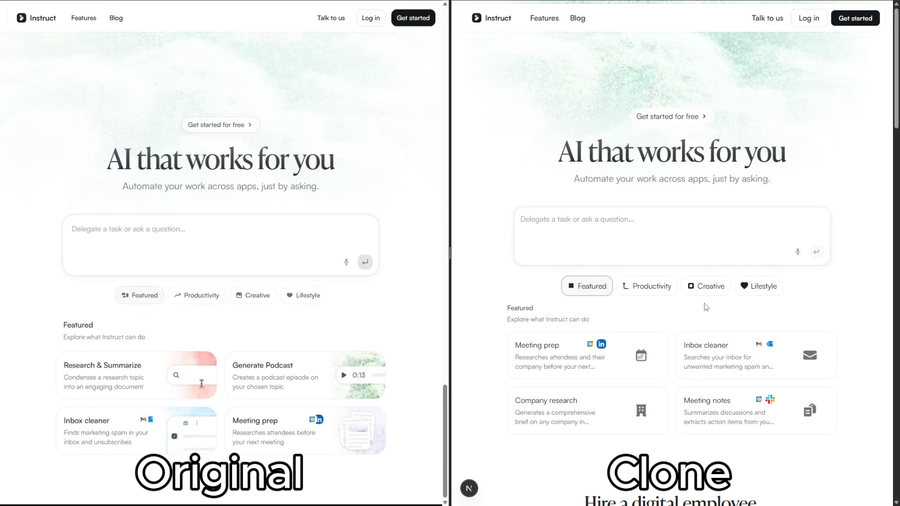

# AI Website Cloner Template

<a href="https://github.com/JCodesMore/ai-website-cloner-template/blob/master/LICENSE"></a> <a href="https://github.com/JCodesMore/ai-website-cloner-template/stargazers"></a> <a href="https://discord.gg/hrTSX5yTpB"></a>

A reusable template for reverse-engineering any website into a clean, modern Next.js codebase using AI coding agents. 

**Recommended: [Claude Code](https://docs.anthropic.com/en/docs/claude-code) with Opus 4.7 for best results** — but works with a variety of AI coding agents.

Point it at a URL, run `/clone-website`, and your AI agent will inspect the site, extract design tokens and assets, write component specs, and dispatch parallel builders to reconstruct every section.

## Demo

[](https://youtu.be/O669pVZ_qr0)

> Click the image above to watch the full demo on YouTube.

## Quick Start

1. **Clone this repository**
   ```bash
   git clone https://github.com/JCodesMore/ai-website-cloner-template.git my-clone
   cd my-clone
   ```
2. **Install dependencies**
   ```bash
   npm install
   ```
3. **Start your AI agent** — Claude Code recommended:
   ```bash
   claude --chrome
   ```
4. **Run the skill**:
   ```
   /clone-website <target-url1> [<target-url2> ...]
   ```
5. **Customize** (optional) — after the base clone is built, modify as needed

> Using a different agent? Open `AGENTS.md` for project instructions — most agents pick it up automatically.

## Supported Platforms

| Agent                                                         | Status                     |
| ------------------------------------------------------------- | -------------------------- |
| [Claude Code](https://docs.anthropic.com/en/docs/claude-code) | **Recommended** — Opus 4.7 |
| [Codex CLI](https://github.com/openai/codex)                  | Supported                  |
| [OpenCode](https://opencode.ai/)                              | Supported                  |
| [GitHub Copilot](https://github.com/features/copilot)         | Supported                  |
| [Cursor](https://cursor.com/)                                 | Supported                  |
| [Windsurf](https://codeium.com/windsurf)                      | Supported                  |
| [Gemini CLI](https://github.com/google-gemini/gemini-cli)     | Supported                  |
| [Cline](https://github.com/cline/cline)                       | Supported                  |
| [Roo Code](https://github.com/RooCodeInc/Roo-Code)            | Supported                  |
| [Continue](https://continue.dev/)                             | Supported                  |
| [Amazon Q](https://aws.amazon.com/q/developer/)               | Supported                  |
| [Augment Code](https://www.augmentcode.com/)                  | Supported                  |
| [Aider](https://aider.chat/)                                  | Supported                  |

## Prerequisites

- [Node.js](https://nodejs.org/) 24+
- An AI coding agent (see [Supported Platforms](#supported-platforms))

## Tech Stack

- **Next.js 16** — App Router, React 19, TypeScript strict
- **shadcn/ui** — Radix primitives + Tailwind CSS v4
- **Tailwind CSS v4** — oklch design tokens
- **Lucide React** — default icons (replaced by extracted SVGs during cloning)

## How It Works

The `/clone-website` skill runs a multi-phase pipeline:

1. **Reconnaissance** — screenshots, design token extraction, interaction sweep (scroll, click, hover, responsive)
2. **Foundation** — updates fonts, colors, globals, downloads all assets
3. **Component Specs** — writes detailed spec files (`docs/research/components/`) with exact computed CSS values, states, behaviors, and content
4. **Parallel Build** — dispatches builder agents in git worktrees, one per section/component
5. **Assembly & QA** — merges worktrees, wires up the page, runs visual diff against the original

Each builder agent receives the full component specification inline — exact `getComputedStyle()` values, interaction models, multi-state content, responsive breakpoints, and asset paths. No guessing.

## Use Cases

- **Platform migration** — rebuild a site you own from WordPress/Webflow/Squarespace into a modern Next.js codebase
- **Lost source code** — your site is live but the repo is gone, the developer left, or the stack is legacy. Get the code back in a modern format
- **Learning** — deconstruct how production sites achieve specific layouts, animations, and responsive behavior by working with real code

## Not Intended For

- **Phishing or impersonation** — this project must not be used for deceptive purposes, impersonation, or any activity that breaks the law.
- **Passing off someone's design as your own** — logos, brand assets, and original copy belong to their owners.
- **Violating terms of service** — some sites explicitly prohibit scraping or reproduction. Check first.

## Project Structure

```
src/
  app/              # Next.js routes
  components/       # React components
    ui/             # shadcn/ui primitives
    icons.tsx       # Extracted SVG icons
  lib/utils.ts      # cn() utility
  types/            # TypeScript interfaces
  hooks/            # Custom React hooks
public/
  images/           # Downloaded images from target
  videos/           # Downloaded videos from target
  seo/              # Favicons, OG images
docs/
  research/         # Extraction output & component specs
  design-references/ # Screenshots
scripts/
  sync-agent-rules.sh  # Regenerate agent instruction files
  sync-skills.mjs      # Regenerate /clone-website for all platforms
AGENTS.md           # Agent instructions (single source of truth)
CLAUDE.md           # Claude Code config (imports AGENTS.md)
GEMINI.md           # Gemini CLI config (imports AGENTS.md)
```

## Commands

```bash
npm run dev    # Start dev server
npm run build  # Production build
npm run lint   # ESLint check
npm run typecheck # TypeScript check
npm run check  # Run lint + typecheck + build
```

## Weather Data

The weather view uses GFS fields from NOAA NOMADS and renders them with an earth.nullschool-style Canvas globe. Runtime data is cached in `.weather-cache/` and refreshed through:

```bash
npm run weather:update
npm run weather:import
```

The updater uses `wgrib2` when it is installed. On Windows it can also use the
Python `eccodes` decoder from `requirements-data.txt`, so a separate `wgrib2`
installation is optional:

```powershell
python -m pip install -r requirements-data.txt
npm run weather:update
```

If neither decoder is available or NOMADS cannot be reached,
`/api/weather-earth?request=status` reports the problem and the UI falls back to
the built-in demonstration field instead of presenting it as live data.
`weather:import` persists the decoded run in
`website_data.weather_forecast_fields`. The live field set includes 10 m and
100 m wind, gust, temperature, relative and specific humidity, CAPE, mean-sea
and surface pressure, precipitable water, precipitation, snow depth, and
surface short-wave radiation.

## Zenodo Climate Projection Data

Install the data-processing dependencies once:

```powershell
python -m pip install -r requirements-data.txt
```

Import exactly one GFDL-ESM4/SSP1-2.6 NetCDF file from Zenodo into PostgreSQL:

```powershell
npm run climate:sync-metadata
npm run climate:import -- --record-id 20501729 --file gfdl-esm4_ssp126_rsds_2021_2030.nc
```

The importer resumes a partial download, verifies the Zenodo MD5, stores the
3,848-point coordinate list once, and writes one gzip-compressed
`hour × location` Float32 block per day. After a successful import it removes
that one NetCDF scratch file. Run the command separately for each additional
variable and decade so the full 27 GB record is never staged on local disk at
the same time.

## GRACED Carbon Data

The carbon-emission globe reads daily GRACED frames from PostgreSQL. Download and
prepare one month with the Python environment that provides `xarray`, `netCDF4`,
and `numpy`:

```powershell
& "C:\Users\53472\anaconda3\python.exe" scripts/sync-carbon-graced.py --sector Power --month 2026-04
```

Import the generated manifest and compressed daily frames:

```powershell
npm run carbon:import -- --manifest "../data/carbon-graced/processed/Power/2026-04/manifest.json"
```

The importer stores one gzip-compressed Float32 grid per date and sector in
`website_data.carbon_emission_frames`. It is idempotent and updates matching
`(observed_on, sector)` rows instead of creating duplicates. Use a different
official sector code (`total`, `Industry`, `Residential`,
`GroundTransportation`, `DomesticAviation`, `InternationalAviation`, or
`InternationalShipping`) to add another layer.

GRACED source and visualization frames remain at their native 0.1-degree
resolution. Prediction pipelines should aggregate a copy to 0.5 degrees or to
administrative regions when constructing model features; they must not replace
the 0.1-degree source frame.

## Data Catalog and Renewable Potential

The database catalog groups acquired and missing datasets by Power Earth,
Weather Earth, Carbon Earth, and Installation-potential/Dispatch Earth:

```powershell
npm run catalog:sync
```

Public GISPO renewable-resource CSVs can be streamed directly to PostgreSQL
without keeping local copies:

```powershell
npm run potential:import
```

This import preserves the source assumptions (ERA5 2019, 0.25-degree cells,
capacity potential in GW) and creates a separate 0.5-degree project view in
`website_data.renewable_resource_potential`.

### If using docker

```bash
docker compose up app --build # build and run the app
docker compose up dev --build # run the app in dev mode on port 3001
```

## Updating for Other Platforms

Two source-of-truth files power all platform support. Edit the source, then run the sync script:

| What                   | Source of truth                         | Sync command                       |
| ---------------------- | --------------------------------------- | ---------------------------------- |
| Project instructions   | `AGENTS.md`                             | `bash scripts/sync-agent-rules.sh` |
| `/clone-website` skill | `.claude/skills/clone-website/SKILL.md` | `node scripts/sync-skills.mjs`     |

Each script regenerates the platform-specific copies automatically. Agents that read the source files natively need no regeneration.


## Star History

[](https://star-history.com/#JCodesMore/ai-website-cloner-template&Date)

## License

MIT
