# 多源异构数据可视化与智能分析平台技术方案

**版本：V0.1 讨论稿｜日期：2026-09-27｜用途：课题组与教师评审**

本文依据当前讨论、2026-09-26实库盘点及现有项目代码编写。目标是明确系统组成、模块协作、技术候选和验证路径。文中的新架构尚未实施；“已确认”指需求已确认，“已核实”指存在检查证据，“推荐”指工程建议，“待验证”指尚未完成兼容性或效果测试。

## 阅读结构

| 章节 | 回答的问题 | 图示安排 |
|---|---|---|
| 1. 总体方案 | 建设什么、服务谁、做到什么程度 | 总体思路树 |
| 2. 总体架构与协作 | 模块如何独立又能协同 | 架构树、端到端流程图 |
| 3. 前端入口与项目工作台 | 用户怎样进入、选择和比较数据 | 页面树、GRACED/哈佛参考图 |
| 4. 模块一：数据库与数据管理 | 数据从哪里来，怎样存、处理和查询 | 数据组织树、导入发布流程 |
| 5. 模块二：可视化与模板 | 如何把同一份数据交给不同渲染能力 | 能力树、Atlas参考图、选型对比 |
| 6. 模块三：分析与预测 | MCP调用哪些算法，任务如何执行 | 算法能力树、任务流程 |
| 7. 模块四：智能交互与知识库 | 小云、总管、专业Agent如何配合 | Agent职责树、问答流程 |
| 8. 项目管理与共用接口 | 如何保存、隔离权限和复现结果 | 管理树、模块交接表 |
| 9. 部署与技术选型 | 使用哪些技术，如何适配现有服务器 | 部署树、方案对比表 |
| 10. 分阶段验证与待定事项 | 如何证明可运行，哪些事项还未决定 | 验证树、验收矩阵 |
| 附录 | 原始构想与证据来源 | 教师草图、数据盘点和源码基线链接 |

模块章节统一采用“定位与边界—内部组成—技术选择—输入输出—协作流程—独立验收”的表达方式。树状图用于展示包含关系，流程图用于展示执行先后；参考截图仅解释视觉和交互思路，不作为本站已实现界面。

## 1. 总体方案

### 1.1 建设目标

在现有网站基础上，建设面向课题组的通用多源异构数据可视化与智能分析平台。通过官方发布或管理员审核的数据来源，形成“数据接入与管理—按需查询—模板化可视化—算法分析—结果保存与导出”的闭环，并支持小云语音辅助操作。

系统首先验证框架能否真实运行、模块能否独立测试和协同工作。模型预测精度作为独立研究目标评价，不把完成算法调用等同于获得可靠预测。

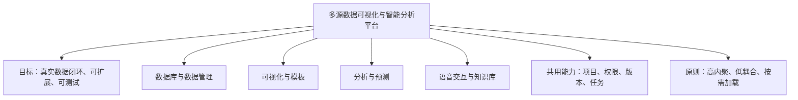

### 1.2 已确认的建设边界

- 面向课题组少量用户，个人项目第一阶段完全私有；管理员统一维护共用数据、模型和模板。
- 保留现有三个地球样式，新增独立轻量开屏；专题切换移至底部小型地球入口，提供独立BI专题及项目并排对比。
- 开屏采用固定展示数据；进入工作台并选择条件或恢复项目后，再按需读取业务数据。
- 用户可以筛选和下载平台发布的数据，不开放个人业务数据上传。
- 开发者先适配模型或MCP，管理员再启用和配置；Agent在已批准能力之间选择组合。
- 第一阶段分析以MCP通用统计、聚类、时序预测和历史回测为核心。中国风场超短期预测因配对实测数据不足暂缓。
- 自部署数据、文件和计算服务，允许使用外部语言模型、语音和指定联网检索API。个人项目私有指应用访问权限，不等同于全部链路离线。
- 气象定时检查更新，其他数据由管理员手动触发；保存项目保留原数据版本，用户可主动更新。
- 设备场景、持续滚动预测、跨区调度和原中国大屏固定业务链不纳入本阶段必做范围。

### 1.3 现有基础与重构对象

已核实的基础包括Next.js/React前端、多个不同渲染方式的地球、PostgreSQL数据、受控问数接口及小云相关接入代码。现有EnergyIR有来源和参数校验思路，但仍含中国范围及窄业务限制；Deep Agent示例仅登记时间工具，不能视为新的多Agent业务体系已完成。

推荐复用地球、语音入口、数据处理脚本和确定性校验方法，通过新接口逐步适配。约93GB现有数据库先保持可访问，后续按兼容方式增加目录、版本和结果结构。

## 2. 总体架构与协作

### 2.1 推荐形态：模块化后端＋独立计算进程

各业务块有独立职责和接口，第一阶段可部署在同一后端应用中；耗时计算在独立Worker中运行。“模块独立”通过接口、数据所有权和测试边界实现，不要求每个Agent都成为一个微服务。

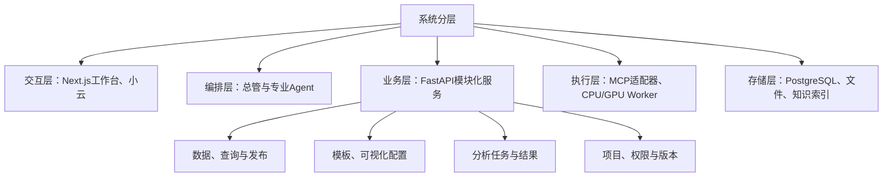

### 2.2 一条典型协作流程

用户说“把所选地区的月度发电量画成趋势图，并做一次历史回测”。总管使用当前项目上下文，数据Agent取得合格序列，分析Agent提交批准的算法任务，可视化Agent选择趋势与预测图模板，工作台显示真实任务状态和带来源的结果。

鼠标和Agent共享业务接口。鼠标操作无需调用语言模型才能执行；Agent也不能绕过接口权限直接修改数据库。数据库故障、模型故障和语音故障分别报告，不应使整个网站一起失效。

### 2.3 模块职责

| 模块 | 负责 | 交付给下一模块 |
|---|---|---|
| 数据管理 | 数据目录、来源审核、查询、聚合、版本、导出 | 数据引用、字段描述、单位、质量和版本 |
| 可视化 | 选择模板、绑定字段、配置编码与交互、渲染 | 可保存的视图配置和图表产物 |
| 分析预测 | 算法准入、任务执行、评估、结果登记 | 任务状态、结果数据、指标和运行信息 |
| 智能交互 | 理解意图、协调工具、解释结果、检索知识 | 可执行操作计划与有依据的回答 |
| 共用服务 | 用户、项目、权限、审计、缓存、任务状态 | 全链路一致的身份和上下文 |

## 3. 前端入口与项目工作台

### 3.1 页面结构

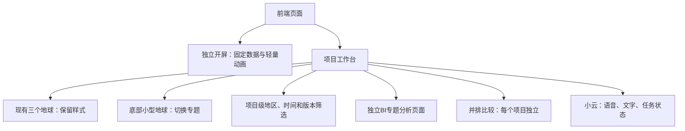

### 3.2 固定数据开屏

管理员选取已审核数据快照，在发布前抽样、简化并生成压缩展示资源。浏览器加载小型资源后绘制动画，不查询业务库，不等待天气接口、Agent、MCP或模型。入口按钮先可用，动画无需看完；离开页面后释放相关渲染资源。

固定数据仍有首次下载和渲染成本。建议对粒子数、资源体积、帧率和首屏时间建立实测预算，并准备静态降级画面。再次访问利用版本化静态资源缓存。真实数值快照保留来源和时期，不能标成实时数据。

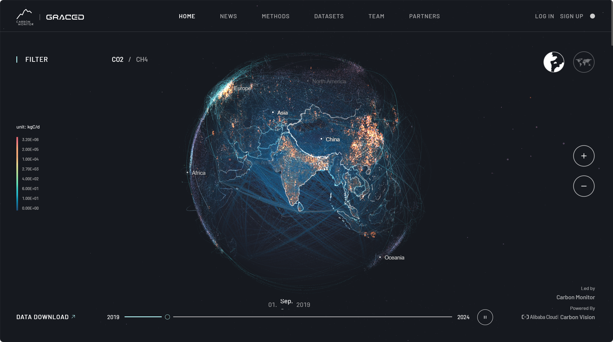

**图3-1：GRACED视觉参考。** 来源为用户提供的[GRACED网站](https://www.carbonmonitor-graced.com/)截图。借鉴深灰蓝背景、地球轮廓和粒画子层次；图中的筛选、数值图例与时间轴属于数据工作区，不作为轻量开屏必备控件。此图是原站参考，不是本站设计稿，也不能据静态图推断完整动。

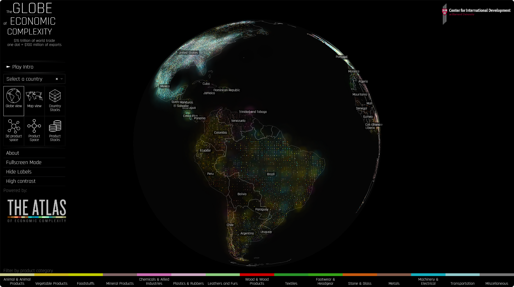

**图3-2：哈佛地球表达参考。** 来源为用户提供的[Globe of Economic Complexity](http://globe.cid.harvard.edu/)截图。借鉴粒子表达和数据探索的衔接。推荐开屏以GRACED的视觉语言结合哈佛式聚集/进入体验；具体美术稿另行确认。本站内部三个地球不因该参考图而更换样式。

### 3.3 项目与筛选行为

同一项目内，地球、BI和三维视图共享地区、时间范围及数据版本；图表各自保留指标和样式。不同项目并排时不强制同步时间，每个项目拥有自己的地球与分析区。

小云遇到会替换当前项目的含糊指令时，先问“关闭当前并重新开启，还是在旁边开启”；用户已明确意图则直接执行。长时间离开后页面保持原位，恢复保存项目时保留原版本。经济专题已明确拟接哈佛数据，其独立入口布局仍待页面规划，不据此擅自替换现有三个专题。

**独立验收：** 使用已审核的固定样本即可验证开屏、切换、恢复和并排布局；检查开屏不发业务数据请求，查看页面切换后动画资源是否释放。性能目标在指定设备与网络条件下制定，本文不虚报已达到的秒数或帧率。

## 4. 模块一：数据库与数据管理

### 4.1 定位与组成

数据库模块是其他模块的数据基础。它提供可解释、可复现的数据子集，不承担图形绘制或自然语言决策。管理员负责接入与审核，普通用户负责筛选、使用和下载。

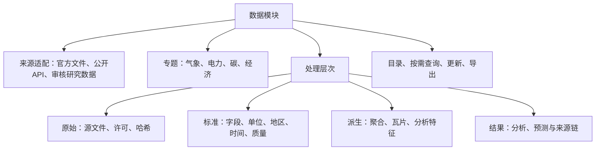

### 4.2 数据安排与现状

截至2026-09-26的只读核查，核心数据如下。下表记录数据实际存在性，不代表对应新页面已经完成。

| 专题 | 已有数据 | 首批用途与限制 |
|---|---|---|
| 气象 | GFS13指标，22次起报 | 全球地球图层；保留起报/有效时间，现存批次不构成完整历史档案 |
| 历史气象 | W5E5 v3.0，2019—2024六变量、3848点、13152日帧 | 日/月趋势与聚类；不能解释成小时数据或配对风场NWP |
| 气候情景 | GFDL四SSP，2021—2060五变量、292200日块，每块24小时 | 情景比较与小时表达；不是实测未来 |
| 电力统计 | 全国与31省，2015—2025能源月度统计54912行 | BI趋势和排名；9709条NULL须核对源口径 |
| 风光情景 | 四SSP、32地区、40年、两技术，共10240年度小时序列 | CF及按地图装机换算的功率/电量分别标识 |
| 空间资产 | 9143能源设施、约100万OSM几何、222943潜力记录 | 点线面和资源表达；科研/众包/官方统计身份分开 |
| 碳 | GRACED Power 2708日，2019-01—2026-05；total零散851日 | 优先Power闭环；total缺月不能插成完整历史 |
| 风场研究 | 英国21机组SCADA及2921条GFS点值，6605条小时配对 | 保留研究；中国实测配对缺少，中国预测暂缓 |
| 经济 | 拟接哈佛Atlas，尚未采集 | 国家、产品、贸易和复杂度指标；覆盖以实际发布表为准 |

详细证据见[数据盘点与分配报告](../project-management/DATA_REFACTOR_ALLOCATION_2026-09-26.md)。其中W5E5为日数据、WFDE5为小时数据的区分也见[CDS官方说明](https://cds.climate.copernicus.eu/datasets/derived-near-surface-meteorological-variables?tab=overview)。

### 4.3 技术与存储组织

- **结构化与空间数据：** PostgreSQL为主，按需要增加PostGIS；初期在一个实例内以schema/表划分模块，不要求每个专题独立数据库。
- **文件：** 原始NC/GRIB/MAT、模型权重和大导出通过统一文件接口管理，初期使用服务器D盘受控目录，后续可替换S3兼容存储。现有PG二进制帧先兼容保留。
- **数据处理：** Python配合Pandas/Xarray等适配表格与气象数组；SQL负责适合数据库执行的筛选、关联和聚合。具体库版本在环境验证时锁定。
- **Agent访问：** 通过业务查询接口；[Google MCP Toolbox](https://github.com/googleapis/mcp-toolbox)作为受限参数化查询的候选适配器。第一阶段只开放审核后的查询，不开放任意SQL执行和管理权限。
- **数据语义：** 维护单位、聚合规则、时间粒度、真实身份、空间覆盖和质量定义。AI可辅助生成受控查询参数，业务含义由管理员规则校验。

### 4.4 更新、版本与导出

气象任务按源发布时间定时检查，发现完整批次后发布；失败保留上次成功批次并明确其时间。其他来源第一阶段管理员手动更新。已保存项目引用不可变的版本清单，用户主动更新产生新项目修订，不静默替换旧结果。

哈佛数据优先走[官方下载](https://atlas.hks.harvard.edu/data-downloads/)，必要时用[GraphQL API](https://github.com/harvard-growth-lab/api-docs/blob/main/atlas.md)获取小范围补充。官方说明接口可能改变，本站日常业务应查询本地数据。保留商品分类、国家代码映射、币值口径和每个下载文件的引用要求。

导出首批建议CSV/Parquet数据、PNG/SVG图表以及HTML/PDF报告；大导出走后台任务。平台不承诺把所有原始大型文件都作为即时浏览器下载对象，按数据集发布范围和访问权限提供入口。

**输入：** 管理员发布的来源配置或合法查询条件。**输出：** 数据引用、数据子集、质量与来源说明、导出任务。**独立验收：** 固定查询结果可复核；单位与聚合正确；缺失不变成零；新批次不会改写旧项目；失败批次不进入已发布目录。

## 5. 模块二：可视化与模板

### 5.1 统一模块中的三层分工

可视化Agent、MCP/工具适配层和浏览器渲染器归属同一可视化模块。Agent理解表达目标，适配器生成或校验配置，渲染器绘图并响应交互。数据库处理数据不能替代ECharts等绘图库；MCP提供调用方式，返回图片也不自动成为交互式BI。

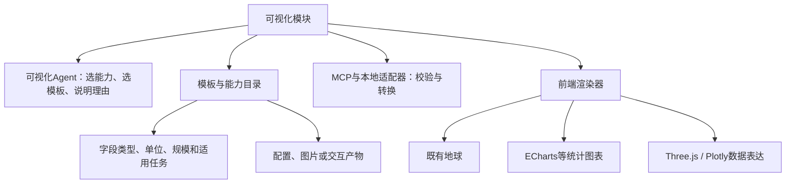

### 5.2 技术候选与接入顺序

| 位置 | 推荐或候选 | 优点 | 接入边界 |
|---|---|---|---|
| 现有地球 | 复用现有MapLibre、D3/Canvas、iframe等对应实现 | 保留既有样式 | 通过适配器统一筛选与状态，不假设所有地球使用同一引擎 |
| 常规交互BI | ECharts＋社区[hustcc/mcp-echarts](https://github.com/hustcc/mcp-echarts)候选 | MCP提供option等输出，便于前端接续渲染 | 需验证配置安全、图表事件、版本兼容和保存恢复 |
| 动态统计图 | [VChart MCP](https://github.com/VisActor/vchart-mcp-server)候选 | 提供spec/image/html等输出 | 优先验证配置输出；图像/HTML导出路径可能依赖远程服务，需按自部署要求配置 |
| 粒子、点云、立体分布 | [Three.js](https://threejs.org/docs/pages/Points.html)模板 | 可定义专门的数据空间表达 | 开发者制作模板并封装工具，不能当作接入即生成任何三维场景 |
| 科学曲面 | [Plotly.js](https://plotly.com/javascript/3d-surface-plots/)候选 | 有交互式曲面等科学图表能力 | 集成到现有前端，按需加载；并不要求另建Dash站点 |
| 多后端图表描述 | [Flint](https://github.com/microsoft/flint-chart)备选 | 可从高层描述编译到不同图表后端 | 作为后续简化适配的研究项，不与所有候选同时引入 |
| 关系/层级等补充 | [AntV MCP](https://github.com/antvis/mcp-server-chart)与GPT-Vis候选 | 适合补充关系和层级表达 | 默认图片能力与交互渲染分别验证，不能只凭返回URL判为完成BI |

首批建议验证“既有地球＋ECharts交互BI＋一种三维数据模板”，验证统一接口后再增加VChart等互补能力。Apache项目名下的[ECharts MCP](https://github.com/apache/echarts-mcp)主要示例为图片输出，可用于导出等场景，不能独自承担本站交互BI。

### 5.3 模板化需要登记的内容

模板至少登记：版本、适用数据形状、必需字段、支持单位、规模上限、图形编码、交互事件、输出格式与渲染器。比如曲面需要明确两个坐标轴和一个数值维度；粒子的颜色、大小、速度分别表示什么，应由模板定义。缺字段时说明原因或推荐其他图表，不编造坐标或虚构数据。

用户仅说“可视化这份数据”时，Agent自动选已接入能力并简要说明理由；有实质歧义再提问，用户始终可以手动切换。外部工具生成配置后仍经过字段、单位和允许配置项校验，不把模型生成的任意JavaScript或HTML直接作为受信代码执行。

### 5.4 BI页面组织参考

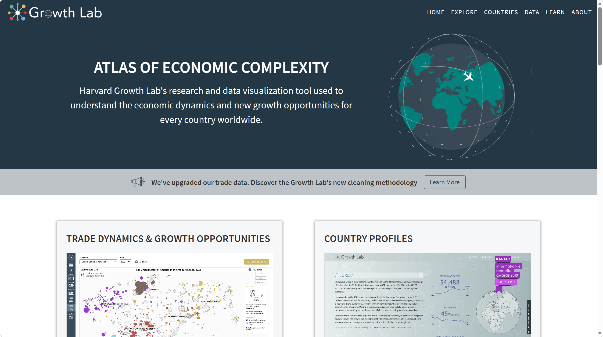

**图5-1：Atlas专题组织参考。** 来源为用户提供的[Atlas](https://atlas.hks.harvard.edu/)页面截图。借鉴“总入口—专题分析—国家/地区画像”的层次。图中不是本站BI效果稿，也不能据此认定原站由ECharts实现。

推荐本站BI采用“项目筛选摘要—主要图表—辅助比较—来源与结果说明”结构。地球与BI共享项目条件；比较另一个项目时，各自保存完整上下文。

**输入：** 数据引用、字段描述和表达意图。**输出：** 版本化模板配置、视图与导出产物。**独立验收：** 给定固定数据可独立绘图；切换模板不改写数据；单位与图例正确；筛选事件可传回工作台；保存后可复现相同配置。

## 6. 模块三：分析与预测

### 6.1 第一阶段定位

由分析Agent调度管理员批准的统计、聚类和通用预测工具，建立真实的任务与结果闭环。MCP封装操作接口，实际计算由算法库或模型完成；高星项目、厂商品牌和调用成功都不能替代适用性测试。

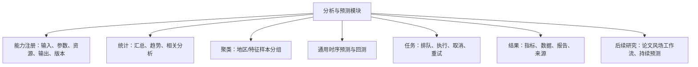

### 6.2 首批候选

| 能力 | 技术建议 | 可用验证数据 | 状态 |
|---|---|---|---|
| 统计/相关性 | SQL、Python统计工具，开发者封装MCP | NBS能源、W5E5、GRACED Power | 需定义统计口径，相关性不解释为因果 |
| 聚类 | [scikit-learn](https://scikit-learn.org/stable/modules/clustering.html)，先验证KMeans/DBSCAN等适用方法 | 地区气象或能源结构特征 | 算法库成熟不等于本站已有聚类MCP，适配与特征标准化待做 |
| 时序基础模型 | [TimesFM](https://github.com/google-research/timesfm)优先候选，[Chronos](https://github.com/amazon-science/chronos-forecasting)备选 | 合格的月度或日序列 | 模型版本、权重使用条件、输入长度和单卡消耗待验证 |
| 现成预测MCP | [chokukil/timesfm-mcp](https://github.com/chokukil/timesfm-mcp)社区候选 | 同上 | 社区本地GPU适配，不能称Google官方成熟服务；未安装验收 |
| 自有算法工具 | [MCP Python SDK](https://github.com/modelcontextprotocol/python-sdk)封装 | 上述各种算法 | 首批提供提交任务、读状态、取结果等受控工具 |

缺测、非等间隔、样本太少或指标含义不一致时，先返回可用性说明。NBS的1—2月空值需核对合并发布规则，不能直接插值后宣称真实月度预测。对GFDL做分析要保留“情景模拟”身份，不把对模拟序列的外推包装成真实风电预测。

### 6.3 任务执行与资源

在共享服务器上按1张RTX4090、约24GB显存规划。GPU首版建议一次执行一个计算任务，其余排队；CPU任务另设有界并发。具体卡号、CPU/内存份额与管理员协调，不能因整机资源较多而默认全部占用。

任务保存queued/running/succeeded/failed/cancelled等真实状态。用户关闭页面或打断语音不自动取消已提交任务；明确取消通过任务接口执行。重试使用同一逻辑任务标识避免重复发布结果。用户修改筛选条件后，旧任务结果仍对应原输入修订。

### 6.4 论文预测保留范围

中国风场缺少对应实测与NWP，暂不实施。英国数据保留供后续适配研究；“500相似样本—历史后续序列分歧—触发后结合NWP重选样本—冻结特征层微调”的论文方法作为专门插件规划，不等同于通用TimesFM调用。

样本输出窗口必须在当时已知，历史回测不得使用后来发布的天气或未来标签。论文未触发时使用初始模型；是否改成继承上次微调模型应作为不同实验。10分钟SCADA与论文15分钟设置的差异要明确记录，不声称已经严格复现。

**输入：** 数据引用、算法标识和经校验参数。**输出：** 任务标识、结果引用、评估与运行记录。**独立验收：** 不依赖语音即可运行；错误输入被识别；取消/重试不产生错误成功状态；至少与简单基线比较，计算耗时和精度分别报告。

## 7. 模块四：智能交互与知识库

### 7.1 小云、总管与专业Agent

小云是统一语音与文字入口。语音识别后的意图交给总管，总管协调专业Agent；不让每个Agent分别持有一套用户状态。推荐[LangGraph](https://docs.langchain.com/oss/python/langgraph/overview)管理任务状态和分工，语音及语言模型供应商经适配层调用，复用现有可用接入。

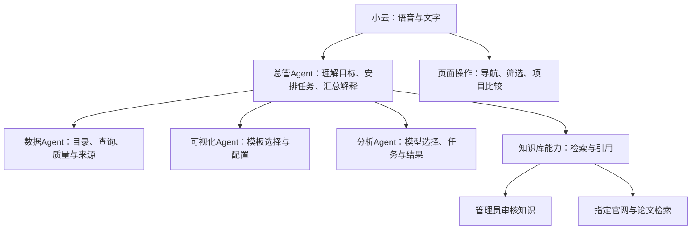

页面上用任务卡展示“正在取数/已选图表/模型排队/结果完成”等状态。展示可核对的操作摘要和选择理由，不以虚拟动画冒充算法正在执行。

### 7.2 语音交互边界

已接入的小云能力优先复用，语音识别、意图解析、业务操作、播报各自可替换。麦克风权限、识别失败或供应商断连不阻塞文字和鼠标操作。用户停留或离开时不擅自跳页；改变项目去向存在歧义时再询问。

小云可导航、筛选、创建比较项目、生成图表、提交分析、查询任务和解释结果。模型发布、数据源维护等管理操作仍受管理员角色限制，语音不会提升用户权限。

### 7.3 知识库问答

推荐先整理管理员审核文档，使用PostgreSQL元数据、[pgvector](https://github.com/pgvector/pgvector)向量检索与关键词检索组合。文本嵌入模型可将[BGE-M3](https://huggingface.co/BAAI/bge-m3)作为候选，部署时验证资源消耗。文档保留版本、发布日期、来源及段落定位。

回答先检索审核知识；不足时允许检索指定官网和论文来源。可评估[Tavily MCP](https://github.com/tavily-ai/tavily-mcp)等检索适配，但来源白名单由本站服务执行，不能只写在提示词里。联网结果明确引用与获取时间，不自动进入审核知识库。

结构化数值问题通过数据工具查询，不让语言模型凭知识库段落猜测当前数据库数值。网页和论文内容作为证据，不作为改变工具权限的指令。外部API只接收完成任务所需的文本、摘要或指定内容，完整原始数据、凭据不随Agent消息传递。

### 7.4 语义检查的先后顺序

先用管理员定义的确定性规则核对单位、粒度、聚合含义、来源与输入条件。此前讨论的“JEV”保留为不确定情况的后端语义检查方向；其准确技术指代、产品/论文来源和部署方式尚未明确，本文不把它列为首阶段必需依赖，也不宣称其可以自动证明业务正确。

**输入：** 用户意图、当前项目、可用工具和知识证据。**输出：** 经校验操作、真实状态和引用回答。**独立验收：** 同一任务鼠标与语音行为一致；越权不能执行；来源不足时说明限制；无语音服务时文字路径仍可用。

## 8. 项目管理与共用接口

### 8.1 私有项目与管理边界

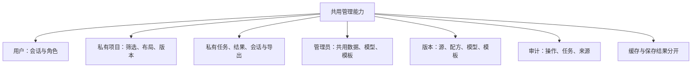

用户身份由服务端会话取得，不能采信模型参数中的owner。项目、任务、结果、知识会话和导出均校验所属用户；共享缓存只适用于确认可以共用的数据，私人结果缓存须包含权限范围。GPU排队和工具返回不会暴露其他用户项目。

管理员维护平台公共资产，不默认在应用中读取其他成员私人研究项目。物理服务器和数据库运维权限属于另一层管理边界，不能把应用私有承诺解释为对数据库管理员绝对不可见。

### 8.2 统一接口契约

推荐以OpenAPI/JSON Schema定义跨模块数据结构，Python端使用Pydantic校验，前端使用对应TypeScript类型及运行时校验。API负责业务，MCP负责向Agent暴露批准的操作；它们复用同一服务实现。

| 契约 | 核心内容 | 为什么需要 |
|---|---|---|
| ProjectContext | 项目标识、修订号、地区、时间、各源版本 | 防止同一项目多个视图条件不一致 |
| DataRef | 数据集与版本、字段、单位、粒度、范围、质量 | 通过引用传递数据，避免把全量数据放进提示词 |
| VisualizationSpec | 模板/引擎版本、字段映射、编码、交互配置 | 实现保存恢复与替换渲染器 |
| AnalysisJob | 逻辑任务标识、输入版本、算法、参数、资源需求 | 支持排队、重试、取消和追踪 |
| ResultRef | 结果位置、权限、指标、模型版本、来源链 | 保证结果可解释且不串项目 |
| CapabilityManifest | 能力标识、输入输出、限制、版本、健康状态 | 管理员启用，Agent据此选择 |

### 8.3 保存、升级与缓存

保存项目包含筛选、布局、数据版本清单、模板配置及结果引用；用户主动更新数据时生成新修订。已提交任务继续使用原修订，完成时不覆盖当前不同条件的图表。

临时缓存可采用约7天过期作为候选策略，具体时长可配置。用户已保存项目引用的数据、模型和结果不随临时缓存清理；需建立引用保留规则。插件新版本可用于新任务，已保存结果保留原配置与版本；重放旧插件无法运行时，应明确展示已有产物和不兼容原因。

**独立验收：** 两个测试用户无法跨用户读取项目/任务/导出；重复请求不创建重复计算；保存后恢复同一版本；缓存到期不破坏已保存项目；更新模板不静默改写历史结果。

## 9. 部署与技术选型

### 9.1 现有资源与推荐部署

2026-09-26已核实服务器为Windows 11专业版，双路Xeon共48核/96线程、约256GB内存、4张RTX4090，D盘空闲约24.3TiB。用户确认与其他课题共享，本项目先按1张约24GB显存显卡规划。Ubuntu/WSL2已运行；其内部GPU、PyTorch及网络配置尚未验证。Docker Desktop当时停止，不能写成容器环境已就绪。

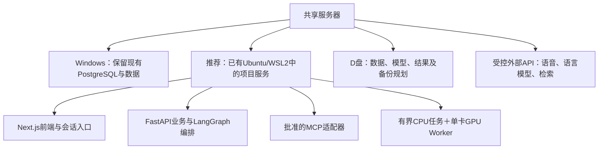

部署时先确认WSL到Windows PG的受控连接、文件访问方式与显卡分配。推荐为本项目创建独立Python环境，验证后锁定版本，避免修改服务器上其他课题的环境。容器化可在验证后采用Docker Compose；不以重装系统或搬迁现有PG作为第一步。

### 9.2 同一位置的选择比较

| 位置 | 推荐方案 | 备选方案 | 当前取舍 |
|---|---|---|---|
| 后端形态 | 模块化FastAPI＋独立Worker | 每个模块独立微服务 | 少量用户先降低部署负担，以接口保证解耦 |
| Agent编排 | LangGraph | 自建轻量状态机 | 多专业Agent和恢复需求适合评估LangGraph，保留确定性业务函数 |
| 任务队列 | [Procrastinate](https://procrastinate.readthedocs.io/en/stable/) | Celery＋Redis | 先利用PG减少新增组件；复杂路由/更大规模再评估备选 |
| 数据MCP | Toolbox受限工具＋业务API适配 | 自建全部MCP查询工具 | 数据查询可复用；私有项目读写坚持本站业务权限 |
| 文件存储 | D盘目录＋统一文件接口 | S3兼容对象存储 | 初期成本较低，接口保留替换能力 |
| 图表 | ECharts为主，互补插件按需接入 | 多引擎同时全面接入 | 先完成可保存、可交互的共同契约 |
| 分析模型 | 单卡逐个验证TimesFM等 | 多模型同时常驻 | 先实测显存和时延，再增加并发 |
| 账号会话 | 验证现有能力；不足时评估[Better Auth＋PG](https://www.better-auth.com/docs/adapters/postgresql) | 机构已有统一认证 | 登录库负责认证，业务服务仍自行落实项目所有权；机构SSO条件待确认 |

[FastAPI官方文档](https://fastapi.tiangolo.com/tutorial/background-tasks/)建议重计算评估独立任务工具，而不是全部依赖请求进程中的后台函数。[Procrastinate的Windows说明](https://procrastinate.readthedocs.io/en/stable/howto/basics/windows.html)存在运行和测试边界，因此Worker优先验证Linux环境。

### 9.3 运行与恢复要求

气象调度、分析Worker和网页进程分别监控，任务并发、SQL超时、导出规模与文件存储均设置边界。保存结构化错误和来源，不在日志中记录密钥。数据库不可用时报告不可用或明确标注的旧快照，不能生成假数据掩盖故障。

现有源码已做重构前GitHub私有分支基线保存，但源码备份不包含当前全部数据库和原始数据。正式重构涉及数据结构前，应单独验证PG与必要文件备份及恢复路径；本方案编写未执行备份或恢复。

## 10. 分阶段验证与待定事项

### 10.1 推进顺序

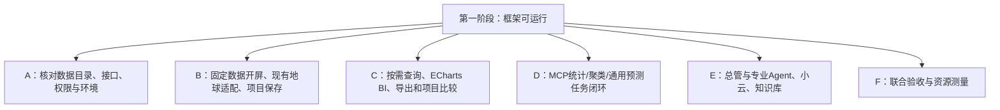

上述顺序用于降低联调难度。Agent工具契约从A阶段就定义，现有小云接口持续保留，避免到后期才发现页面能力无法被语音调用；完整语音和Agent联合验收在底层接口可运行后完成。

### 10.2 可检查的验收标准

| 编号 | 验收对象 | 通过条件 |
|---|---|---|
| A01 | 开屏 | 固定展示资源可加载；不请求业务数据、模型；用户可直接进入 |
| A02 | 数据 | 至少一套真实数据从目录选择到查询和下载一致；粒度、单位、版本明确 |
| A03 | 可视化 | 地球和BI使用同一项目上下文；不同模板可独立测试并保存恢复 |
| A04 | 多项目 | 每个项目独立筛选；添加比较不会覆盖当前项目 |
| A05 | MCP分析 | 真实算法完成提交、排队、计算、结果保存和展示；失败有可解释状态 |
| A06 | 预测评估 | 若接入预测，按时间划分并与基线比较；报告精度和耗时，不预设模型一定胜出 |
| A07 | Agent与语音 | 至少一条语音任务与鼠标操作共用接口，显示真实步骤；歧义时询问 |
| A08 | 知识库 | 审核知识与联网结果分清，答案可追溯来源，证据不足不编造 |
| A09 | 私有性 | 用户A无法访问用户B的项目、任务、结果、会话及导出 |
| A10 | 版本更新 | 新气象批次发布后，旧保存项目可恢复；主动更新产生新修订 |
| A11 | 故障恢复 | 页面刷新/语音中断不丢任务；重试不重复发布结果；临时缓存不删保存依赖 |
| A12 | 资源 | 使用获配GPU，CPU/内存占用有界；记录测试设备、网络、样本与实测表现 |

首批专题建议：GFS与W5E5气象展示、NBS月度能源BI、GRACED Power碳专题；经济专题待哈佛数据实际采集审核后接入同一链路。分析选其中满足输入要求的数据验证统计/聚类与通用回测。中国风场论文预测不进入第一阶段验收条件。

### 10.3 待确定事项及解决方式

| 事项 | 当前状态 | 怎样收敛 |
|---|---|---|
| 开屏最终美术稿 | 已确认固定数据轻量展示；GRACED/哈佛混合方向为建议 | 后续制作静态稿或小样确认，不更换现有地球样式 |
| 经济专题页面入口 | 来源方向明确，入口位置未定 | 在工作台页面结构评审时确认，不影响数据接口设计 |
| 首批数据具体版本与覆盖 | 现有实库已盘点，目录有旧状态 | 依据源、表和质量证据统一目录；不单凭旧文档判断 |
| MCP与模型版本 | 已选候选，未集成验证 | 用一份合格数据验证输入、输出、许可证/权重条件和资源后锁定 |
| GPU具体卡号与CPU/内存额度 | 已确认单卡预算 | 部署前与管理员协调，不默认使用整机资源 |
| WSL内部环境 | 尚未核实模型执行能力 | 只读环境检查后，在独立环境验证依赖和GPU |
| JEV具体指代 | 只有语义检查方向 | 补充准确来源再决定；确定性规则先行 |
| 性能目标与缓存时长 | 原则明确，数值待实测 | 指定代表设备和数据规模后制定，不虚报指标 |

## 附录：构想、参考图与证据

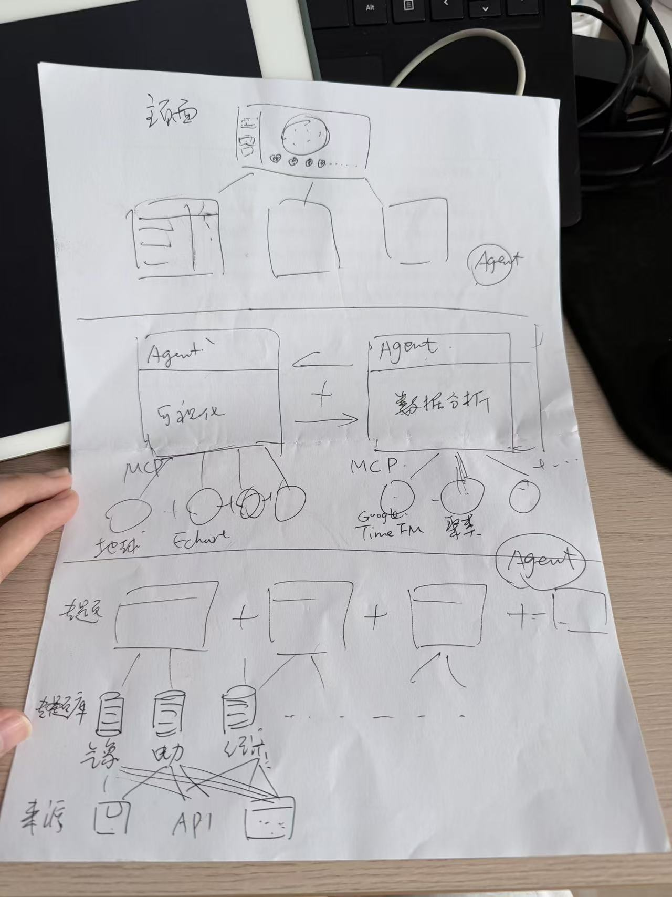

**图A-1：教师原始架构草图。** 用户提供。本文延续其“多源数据—专题存储与处理—Agent调度—插件能力—前端交互”的主线，并补充统一接口、版本与权限、单卡任务执行等工程边界。

- 项目决策与历史变化：[讨论记录](../project-management/DISCUSSION_LOG.md)。
- 当前思路总览：[项目驾驶舱](../../PROJECT_DASHBOARD.md)。
- 数据实库盘点及缺口：[数据分配报告](../project-management/DATA_REFACTOR_ALLOCATION_2026-09-26.md)。
- 源码重构前基线：[备份范围说明](../../vendor/source-backups/pre-refactor-20260926/README.md)。
- 参考截图均来自用户本次讨论提供的图片，已复制到本文相邻assets目录以避免临时路径失效；用于内部方案比较，正式对外材料需保留来源说明。
- 技术项目的功能说明来自正文链接的一手资料；文档可查不代表已在本站安装成功。具体依赖、数据源与接口均需在对应阶段验证。
