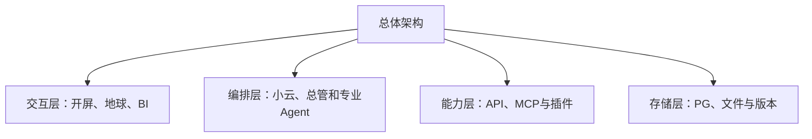
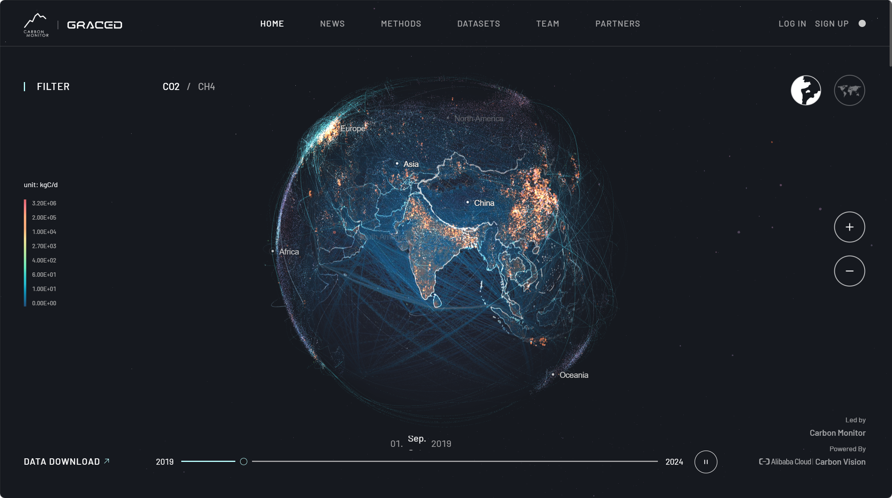
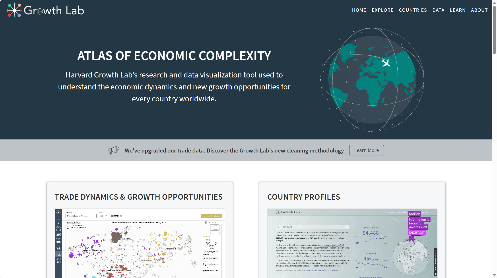
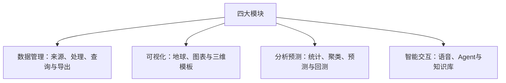
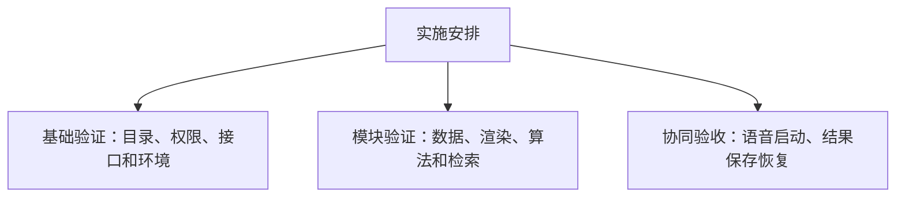

# 多源异构数据可视化与智能分析平台技术方案

**V0.2 精简讨论稿｜2026-09-27｜Word排版目标为3页**

## 一 总体架构与页面形态

**建设目标。**在现有网站基础上重构面向课题组的多源异构数据可视化与智能分析平台，形成“官方数据接入—按需查询—可视化—分析预测—保存导出”的完整流程。采用分块设计、高内聚低耦合，各模块可独立测试，通过统一接口协同。第一阶段以真实运行闭环为目标，个人项目完全私有，管理员统一维护数据、模型和模板。

**总体技术路线。**保留现有Next.js／React前端和三个地球样式，后端建议采用FastAPI模块化服务，LangGraph负责Agent编排；PostgreSQL承担数据与元信息管理，耗时算法由独立计算进程执行。MCP是Agent调用能力的接口规范，实际查询、绘图和计算由相应程序完成。

**页面形态。**新增独立开屏，用预处理的固定数据及轻量动画展示，避免打开页面时查询业务库或调用模型。进入后才选择数据范围，底部以小型地球切换专题，通过专题入口进入BI。单个项目共享筛选条件；并排项目各自保留地球和分析区，不强制同步时间。

**样式参考。**开屏参考GRACED的深色地球与哈佛的粒子表达，BI参考Atlas的专题组织；工作台内部地球保持原样。第一阶段三维表达聚焦粒子、曲面和立体分布，设备场景以后作为插件接入。

参考截图由用户提供，非本站效果稿。

## 二 四大模块及技术路线

**数据库模块。**以PostgreSQL为核心，按气象、电力、碳、经济划分专题，以原始、标准、派生、结果区分处理层次；共用数据通过引用关联，避免重复复制。空间查询按需使用PostGIS，大文件与模型放在服务器受控目录。Python／Pandas／Xarray负责清洗和转换，SQL负责筛选与聚合；数据Agent经受控接口查询，可评估Google MCP Toolbox适配审核后的参数化查询。

**可视化模块。**可视化Agent、工具适配器和浏览器渲染器共同组成一个模块。Agent根据数据自动选择已接入模板并说明理由：ECharts承担交互BI，候选hustcc/mcp-echarts生成配置；VChart MCP补充动态统计图，Three.js用于粒子与点云模板，Plotly.js用于科学曲面。第一阶段先完成ECharts和一种三维模板，其他能力逐步接入。仅返回图片的MCP用于静态产物，不能替代交互BI。

**分析预测模块。**管理员启用开发者适配好的算法，分析Agent选择并组合。首批统计使用SQL／Python，聚类使用scikit-learn封装MCP；时序预测优先评估TimesFM，Chronos作为备选，社区timesfm-mcp仅作适配参考，不称为Google官方服务。计算通过任务队列执行，返回状态、评估指标和结果引用，再交给可视化模块；模型版本及资源消耗测试后确定。

**智能交互模块。**小云作为语音与文字入口，总管协调数据、可视化和分析Agent，鼠标与语音共用业务接口及用户权限。知识库优先采用审核资料，建议以PostgreSQL＋pgvector配合关键词检索；不足时通过受控检索工具查询指定官网和论文，标注来源，不自动纳入审核知识。先执行管理员语义规则，JEV准确指代待明确后再评估。

## 三 模块协作与实施安排

**数据安排。**气象优先使用GFS和W5E5，电力使用全国及省级月度统计，碳使用GRACED Power；GFDL气象与风光序列明确标注情景模拟。经济专题从哈佛Atlas官方下载或API取得数据，审核后入库，当前尚未采集。中国风场缺少配对实测功率和NWP，超短期预测暂缓；英国数据保留后续研究，首阶段以通用MCP分析和历史回测为主。

**模块交接。**各模块通过项目上下文、数据引用、可视化配置、分析任务和结果引用交接，统一记录地区、时间、单位、质量及版本。用户发出指令后，总管安排取数、配置或计算，前端展示真实进度。接口采用OpenAPI／JSON Schema约束；Agent不能绕过服务直接管理数据库。

**部署与保存。**继续使用现有PostgreSQL服务器，计算服务优先验证已有Ubuntu／WSL2环境，建议Procrastinate作为基于PG的任务队列。按共享环境中的1张RTX4090规划，初期GPU任务串行排队，具体版本、配额和性能实测确定。气象定时更新，其余由管理员手动触发；保存项目固定版本，用户主动更新。已保存结果与临时缓存分开，关闭页面不丢任务。

**实施与验收。**先核对目录、权限和接口，再分别验证查询、图表、算法和知识检索，最后贯通小云指令至结果保存。验收关注：按需加载、图表可交互、计算可追溯、用户间数据隔离、项目可恢复，以及失败可解释。预测需与简单基线比较，不以调用成功代表精度合格。

**后续决策。**待确定的主要事项为经济专题入口、首批插件与模型版本、WSL内部GPU环境和性能预算。该方案为技术讨论稿，尚未实施重构；详细数据证据、候选对比及来源保留在V0.1备查稿。

详细证据与完整来源见[V0.1备查稿](TECHNICAL_PROPOSAL_2026-09-27.md)。
