# 多源异构数据可视化与智能分析平台技术方案

**V0.3 图示讨论稿｜2026-09-27｜流程图优先**

恢复原方案十个板块，每块给出内部步骤、主要分支及输入输出。技术候选尚未集成验证；参考图不代表本站已实现界面。

## 一 总体方案

以官方或管理员审核的数据为基础，建设可复用的可视化与智能分析平台。四大模块独立测试，通过统一接口组成真实业务闭环。

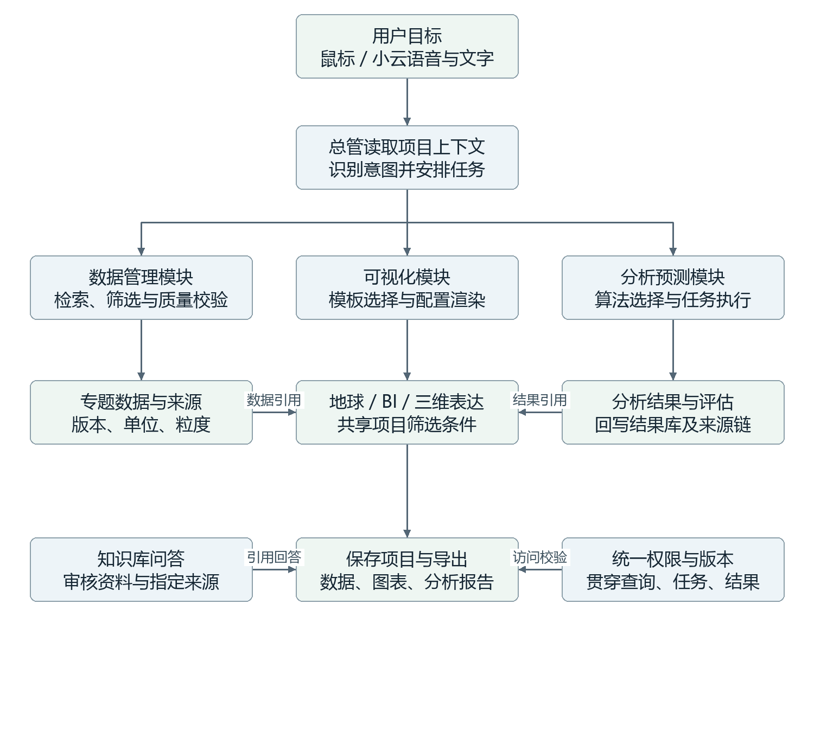

**技术选择：**前端 Next.js／React；后端 FastAPI；Agent编排 LangGraph；数据 PostgreSQL；算法由独立Worker执行。

**边界与验收：**第一阶段服务课题组少量用户，个人项目私有；不开放个人数据上传。推荐选型尚未集成验证。

## 二 总体架构与模块协作

示例任务：对选定地区生成趋势图，并运行一次分析。固定数据引用后，可视化与计算分别执行；计算失败不影响已完成的图表。

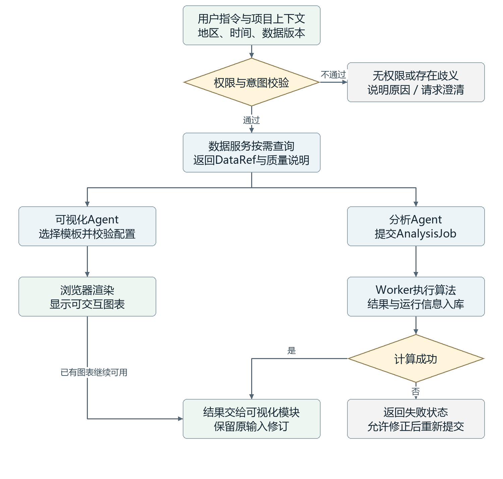

**技术选择：**通过OpenAPI／JSON Schema约束接口；MCP与鼠标操作复用业务服务。大数据通过引用传递，不塞入模型提示词。

**边界与验收：**交接对象为项目上下文、DataRef、VisualizationSpec、AnalysisJob和ResultRef；各模块可用固定输入单独测试。

## 三 前端入口与项目工作台

新增固定数据开屏，内部保留当前三个地球样式。项目内共享筛选，项目之间独立；BI通过专题入口进入。

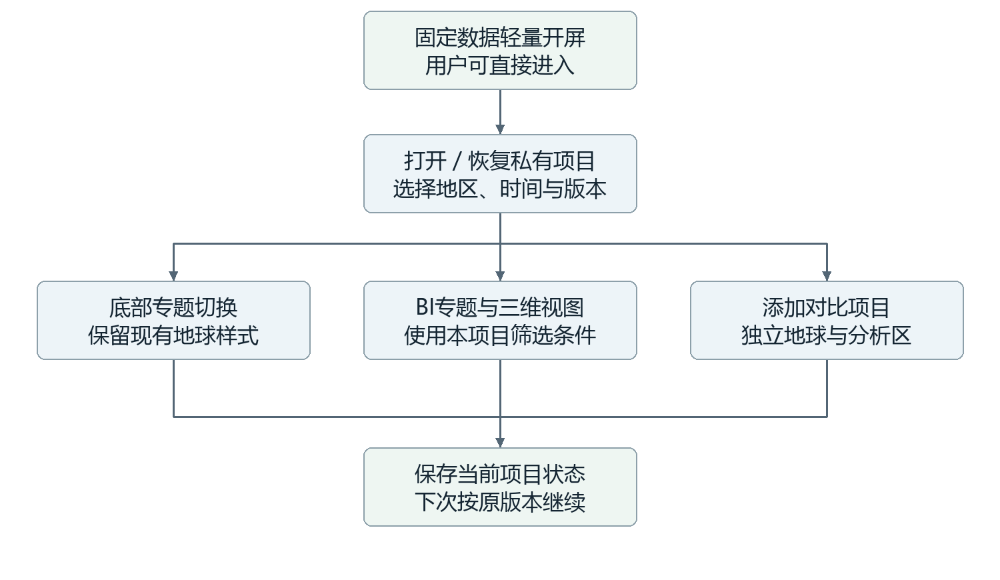

**技术选择：**开屏使用预处理、压缩、可缓存的固定资源，不等待业务库、实时API或Agent；参考图仅说明方向，不代表已实现。

**边界与验收：**验收重点：开屏无业务取数请求；并排项目互不覆盖；离开开屏释放动画资源。

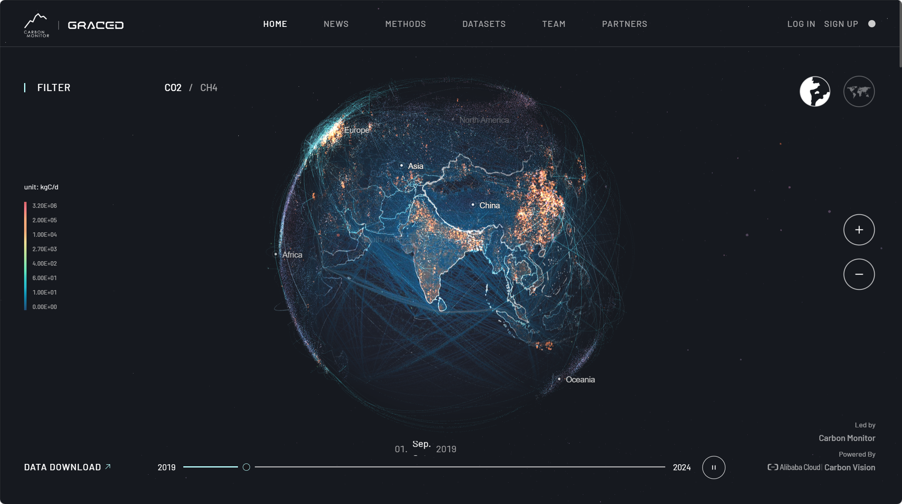
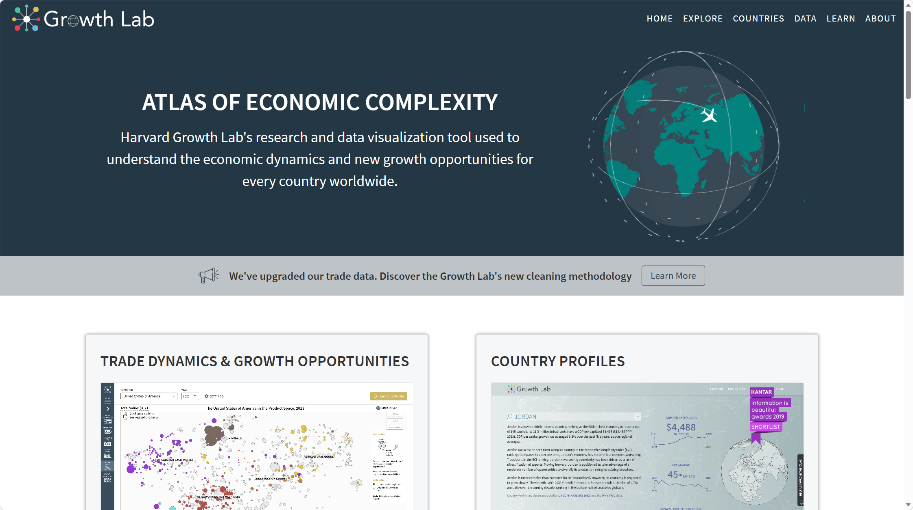
参考截图由用户提供，非本站效果稿。

## 四 数据库与数据管理

数据按气象、电力、碳、经济专题管理，并区分原始、标准、派生和结果层。发布成功后才供上层查询，原始版本可追溯。

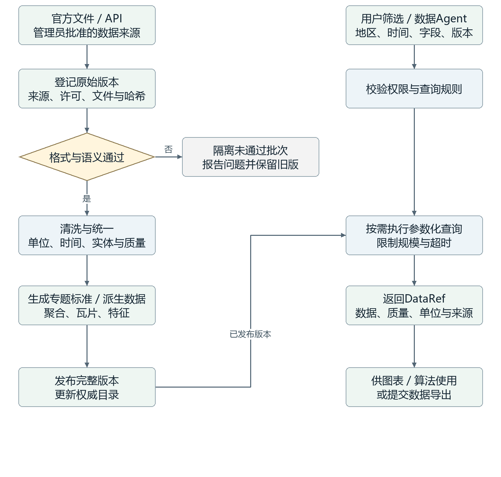

**技术选择：**PostgreSQL＋按需PostGIS；Python／Pandas／Xarray处理数据；Google MCP Toolbox为受限查询候选，禁止Agent任意管理库。

**边界与验收：**气象定时更新，其余管理员触发。用户只筛选与下载；缺失不补零，实测与模拟分开标识。

## 五 可视化与模板

可视化Agent选择能力，适配器生成并校验配置，前端渲染器绘图。三者归属同一模块；MCP并不取代浏览器的交互渲染。

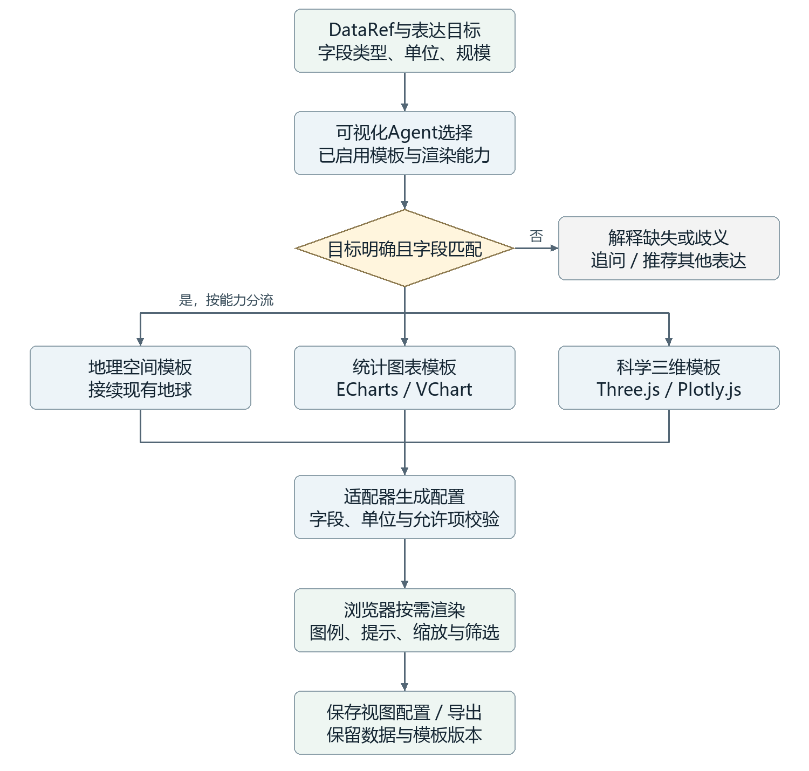

**技术选择：**首批：现有地球＋ECharts＋一种Three.js数据模板。候选：hustcc/mcp-echarts、VChart MCP、Plotly.js；逐个验证后接入。

**边界与验收：**保存模板版本与字段映射；不执行任意生成脚本。图片型MCP用于静态输出，不能单独承担交互BI。

## 六 分析与预测

第一阶段按需运行统计、聚类、通用时序预测及历史回测。Agent负责选择与调度，算法负责计算，预测效果独立评价。

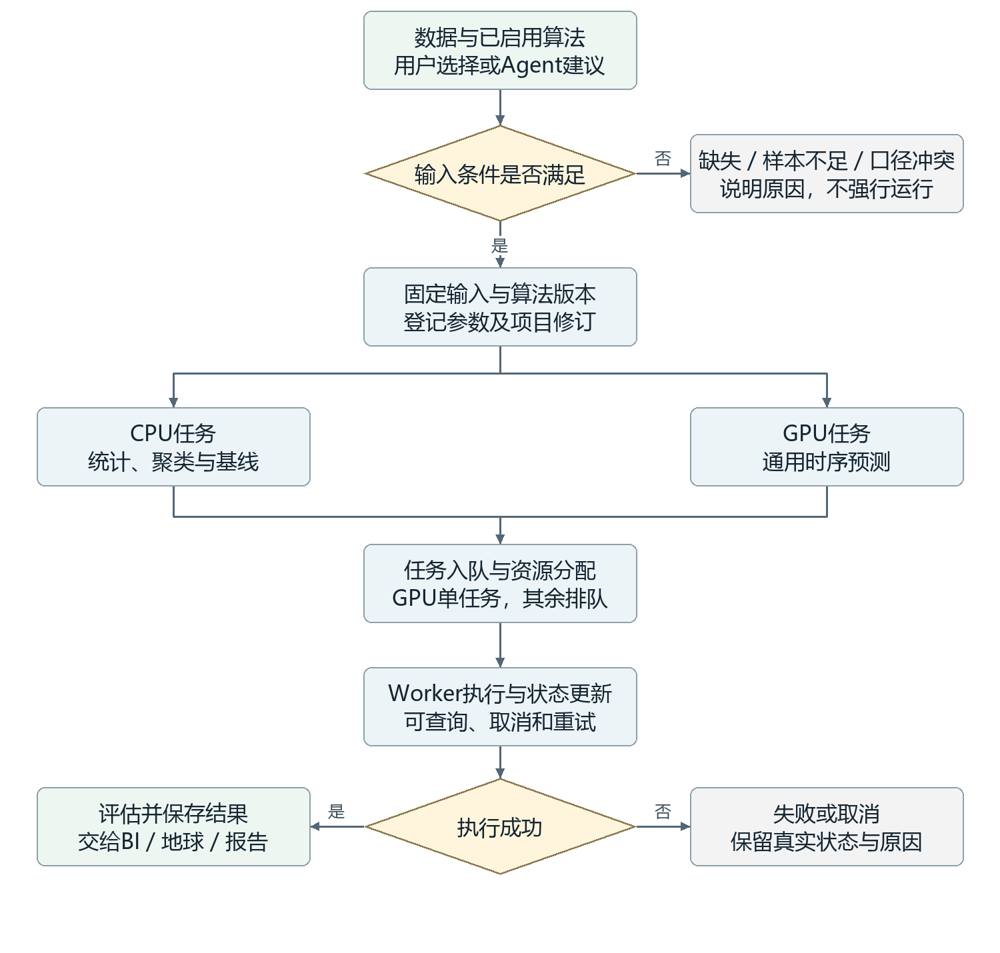

**技术选择：**SQL／Python统计；scikit-learn聚类；TimesFM优先评估、Chronos备选；MCP Python SDK封装受控操作。社区timesfm-mcp不是Google官方服务。

**边界与验收：**按1张RTX4090规划GPU队列；中国风场预测因配对实测不足暂缓。英国论文工作流保留后续研究。

## 七 小云与知识库问答

小云统一接收语音与文字；总管协调专业Agent。操作请求走业务工具，专业问题走知识检索，界面持续显示真实任务状态。

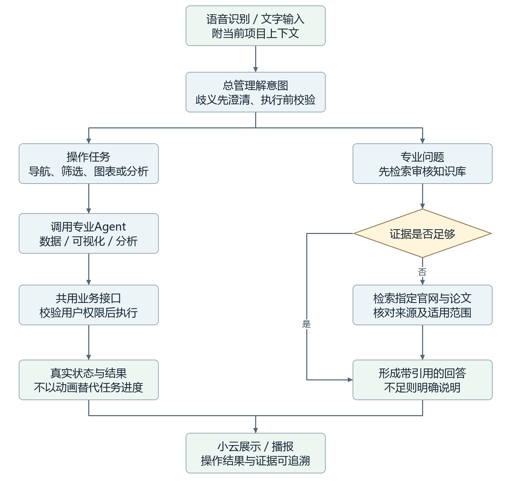

**技术选择：**LangGraph管理编排；复用小云接入；知识检索建议PG＋pgvector及关键词，指定联网检索可评估Tavily MCP。

**边界与验收：**知识库优先，联网内容标注来源且不自动入审核库。确定性语义规则先行，JEV具体指代待核实。

## 八 项目管理与统一接口

私人项目、任务、结果及导出均校验所属用户。共用数据、模型和模板由管理员维护，项目保存引用而非复制全量数据。

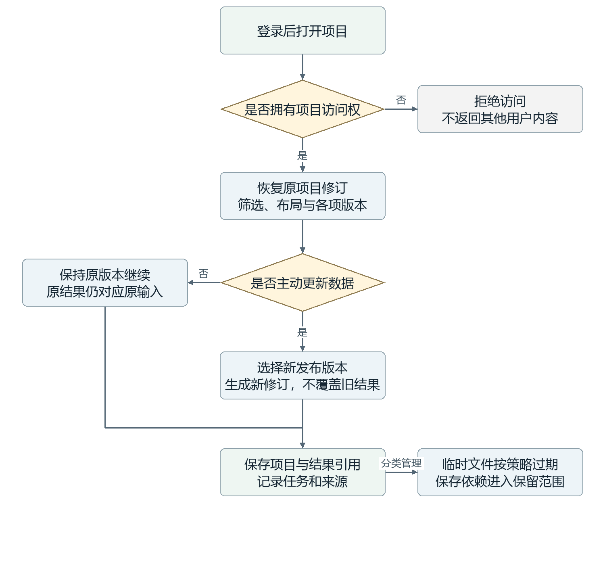

**技术选择：**ProjectContext描述范围与修订；DataRef固定数据；VisualizationSpec保存视图；AnalysisJob和ResultRef保存任务及结果。

**边界与验收：**缓存与保存依赖分开；管理员更新数据不会静默改写旧项目。切换、替换项目存在歧义时询问用户。

## 九 部署与技术选择

建议采用模块化后端＋独立计算Worker，复用现有PG服务器。逻辑模块独立不要求每块都部署成微服务；环境检查通过后再安装和联调。

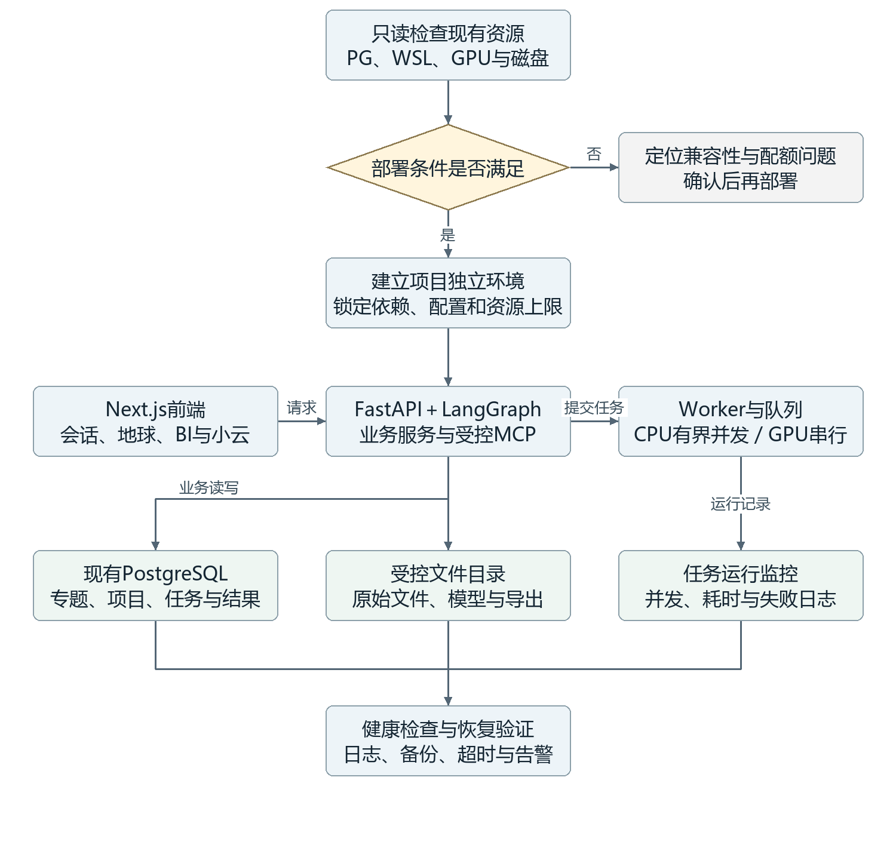

**技术选择：**现有Windows服务器已有PG和Ubuntu／WSL2；先验证WSL访问PG及GPU。任务队列推荐Procrastinate，复杂调度再评估Celery＋Redis。

**边界与验收：**仅按共享服务器1张GPU规划，不默认占满整机。外部API可用于语言模型、语音和检索，数据与算法优先自部署。

## 十 分阶段验证与待定事项

先让单个模块可运行，再验证完整链路。第一阶段重点是框架真实闭环；模型准确度、性能和数据质量分别记录。

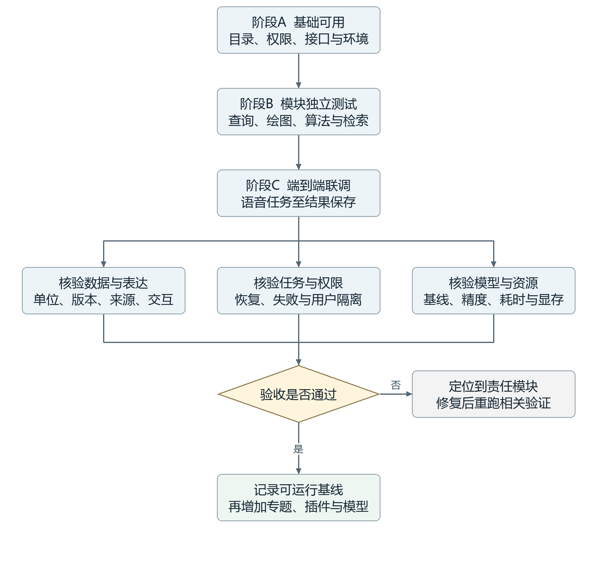

**技术选择：**首批数据：GFS／W5E5、NBS月度能源、GRACED Power。哈佛经济数据待采集审核；GFDL及风光序列保留情景模拟身份。

**边界与验收：**待确定：经济专题入口、模型与插件版本、WSL内部GPU兼容性、资源配额及性能预算。全部为方案讨论，未实施网站重构。

详细技术来源与证据见[V0.1备查稿](TECHNICAL_PROPOSAL_2026-09-27.md)。
