# 多源异构数据可视化与智能分析平台技术方案

**V0.4 讨论稿｜2026-09-27**

本方案合并总体设计与架构协作说明，先交代数据基础，再介绍各模块的技术依据与处理流程。技术候选尚未完成集成验证。

## 一 总体方案

本方案面向课题组内部的数据研究工作，在现有网站基础上构建多源异构数据可视化与智能分析平台。系统以管理员维护的官方或经审核研究数据为基础，将数据查询、图形表达、算法计算和知识问答组织为可追溯的工作流程。现有三个地球的样式予以保留，新增能力通过统一接口接入。

总体架构自下而上划分为数据基础层、业务能力层和交互调度层。PostgreSQL及文件存储构成数据模块，为可视化、分析预测和知识库问答提供统一的数据访问与版本管理；三项业务能力处于同一层级，由小云与总管Agent协调调用。Next.js／React承载交互界面，FastAPI提供模块接口，LangGraph组织任务编排，耗时计算由独立进程执行。

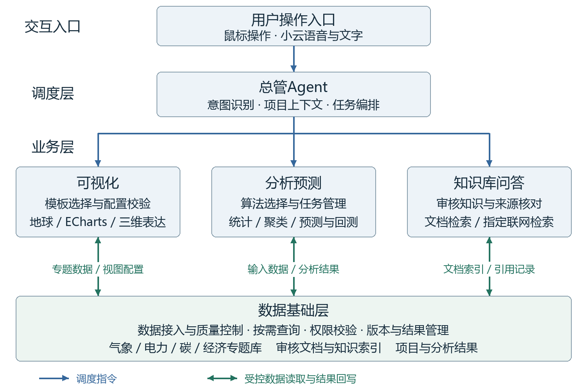

图中蓝色向下箭头表示总管对业务能力的调度，绿色双向箭头表示业务能力通过受控接口读取数据或回写结果，并非直接开放数据库操作。可视化读取专题数据和分析产物，分析预测将计算结果保存至结果库，知识库问答读取审核文档及检索索引。各能力共享底层数据与权限规则，但可分别测试；分析结果通过版本化引用交给可视化，避免模块之间相互依赖内部实现。

## 二 现有数据基础与专题划分

下表依据2026年9月26日实库只读盘点，核对范围为表结构、数量、时段及部分质量字段。“已入库”仅表示存在记录，未全量验证载荷、原始文件及科学适用性；记录数不等同于独立分析样本。目录状态仍需校正，缺口按表中限制处理。

|专题|当前数据与覆盖|定义及数据性质|用途与限制|
|---|---|---|---|
|气象|GFS全球预报 0.5°网格；13指标，22次起报、286字段记录。|数值天气预报（NWP）：利用大气模式计算未来状态，需记录起报与有效时刻。|用于天气图层和区域摘要。现有批次不构成完整历史档案，也不等同于气象站实测。|
|气象|W5E5 v3.0中国裁剪 2019—2024；6变量、3848点、13152日帧。|日尺度偏差校正再分析数据，描述历史气象条件。当前温度单位登记为K。|用于历史趋势、区域比较。hours=1表示每日一个时间片；不能解释为小时数据。|
|气象|GFDL-ESM4情景气象 四种SSP；2021—2060；5变量、3848点。|气候模式在给定情景下的模拟。292200个日块，每块保存24个小时值。|用于情景及日内变化比较；不是未来实测，也不是短期业务天气预报。|
|电力|国家统计局月度能源统计 2015—2025；全国和31省，共54912行。|官方统计，包含发电量、分电源发电量及煤油气产量等指标。|用于月度趋势与结构分析。9709条NULL须核对发布口径，不能补零；不是小时负荷。|
|电力|GFDL风光情景序列 四SSP、32区域、40年、两技术，共10240条年度序列。|容量因子为出力与额定容量之比；序列每年8760／8784小时，功率及电量按地图装机假设换算。|属于情景派生数据，不是实测发电；容量因子、装机假设及换算结果分别标识。|
|风电研究|英国Hill of Towie 21机组，2025年信号约105.9万条；场站52561条（含次年边界）。|10分钟SCADA功率实测；配对GFS NWP点值2921条，仅+3／+6小时；已有6605条小时配对。|用于英国风场研究。负功率及运行标签待核对；现成小时配对不能视为论文所需的完整超短期样本。|
|碳|GRACED Power与total Power：2708日，2019-01—2026-05；total：851日、28月。|碳排放研究估算。当前网格0.1°，单位kgC/h；日期记录不等同于逐小时观测。|Power日期记录连续；total散布2019—2022，不能当完整序列。碳质量与CO₂质量不得混用。|
|空间基础|能源设施9143条；OSM几何1004381条；GISPO潜力222943条。|分别为项目名录、众包地理要素和研究资源潜力。另有基础边界及光伏足迹汇总。|用于点线面与资源分布。各源覆盖和统计口径不同；光伏源归档已有，精细多边形查询仍待加工核实。|
|经济|拟接入哈佛Atlas 当前尚未采集入库。|拟包含国家及产品贸易、伙伴贸易和经济复杂度研究指标，具体以发布文件为准。|优先官方下载，API受控补充；核对商品分类、币值基准、版本与引用要求后发布。|

注：目录状态与质量口径仍需校正；中国风场配对实测和哈佛经济数据待补。表中数量为盘点时点的记录数，不能直接等同于独立分析样本数。

## 三 数据组织与处理机制

专题划分与处理阶段是两个独立维度。气象、电力、碳和经济用于组织研究内容；原始、标准、派生和结果层用于记录数据加工过程。初期可在一个PostgreSQL实例内通过schema及表结构实现逻辑划分，同一来源由多个专题引用，避免为不同地球重复保存数据。

PostgreSQL适合保存目录、关系数据、项目和分析结果，并通过事务维护发布的一致性；空间查询按需求使用PostGIS。Python配合Pandas、Xarray处理表格与气象数组，SQL执行筛选、关联和聚合。原始大文件与模型权重由统一文件接口管理，现有数据库中的二进制帧先兼容保留。

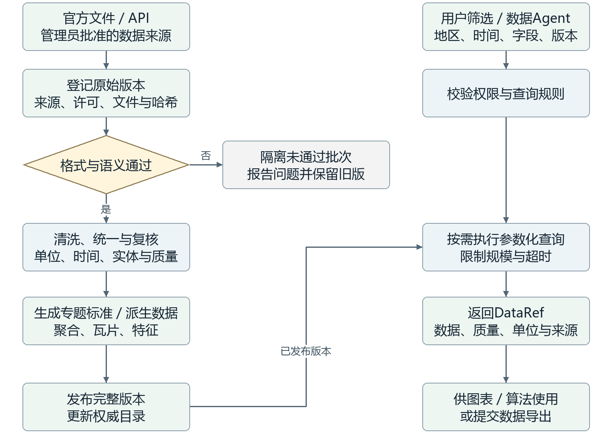

新批次先登记来源和原始版本，完成字段、时间、单位及质量检查后进入标准化处理；复核通过的完整版本才更新发布目录。用户查询只访问已发布版本，并返回数据质量和适用范围。气象按源发布节奏定时检查更新，其他来源由管理员触发。数据Agent通过受控服务查询，可评估Google MCP Toolbox适配审核后的参数化工具；业务含义仍由管理员规则校验。

## 四 前端组织与数据探索

前端将展示入口与数据工作区分开。开屏采用预先抽样、压缩和发布的固定数据资源，浏览器仅执行轻量动画，不等待业务数据库、实时天气接口或Agent响应。这能减少业务请求对入口的影响，但首次下载量和渲染开销仍需实测，低性能设备应具备静态降级方式。

进入工作区后，用户通过底部小型地球选择专题，保留现有地球样式，并从专题入口进入BI分析。一个项目内的地球和图表共享地区、时间及数据版本；并排对比时，每个项目保留自己的筛选条件，不强制同步时间尺度。

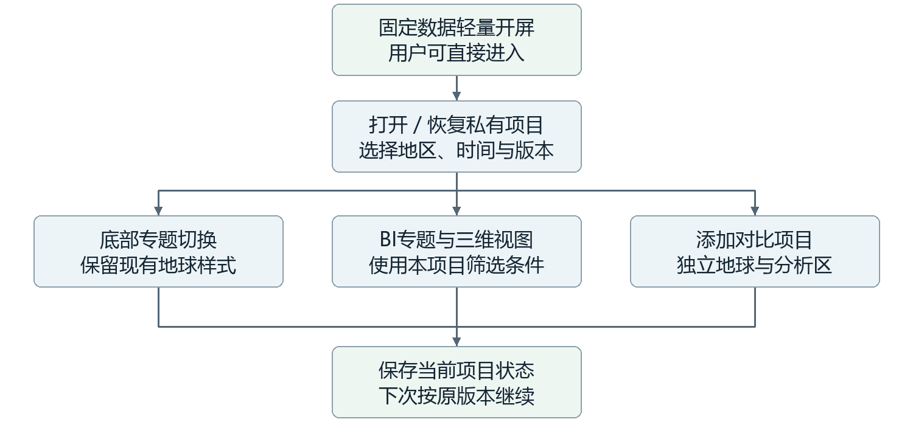

项目恢复使用已保存的版本和布局；主动更新后形成新修订。小云遇到替换当前项目的含糊指令时，先确认重新打开还是在旁边比较；用户离开页面后保持当前位置。下方参考图分别用于说明GRACED的视觉方向和Atlas的专题组织，不表示本站界面已完成。

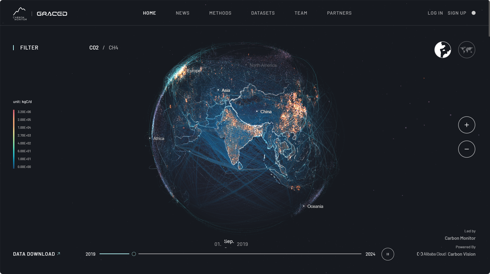
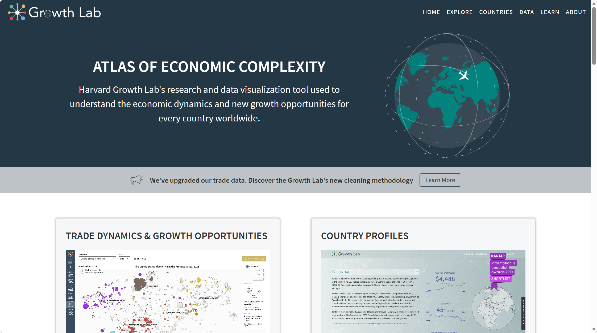
参考截图由用户提供，非本站效果稿。

## 五 可视化模板与渲染机制

可视化模块由能力目录、可视化Agent、适配器和浏览器渲染器组成。模板预先定义适用字段、单位、规模、视觉编码和交互方式，使同一份数据能够在不同表达之间切换，同时保留可恢复的配置。用户未指定图形时，Agent从已启用能力中选择并说明理由；字段不足或目标含糊时再澄清。

ECharts拟作为交互BI的主要组件，承担趋势、排名和结构分析；现有地球通过各自适配器继续工作。Three.js适合定制粒子、点云和立体分布，Plotly.js可补充科学曲面，VChart可作为动态统计图的候选。按数据特征选择渲染能力，比要求一种图表库覆盖全部场景更便于维护。

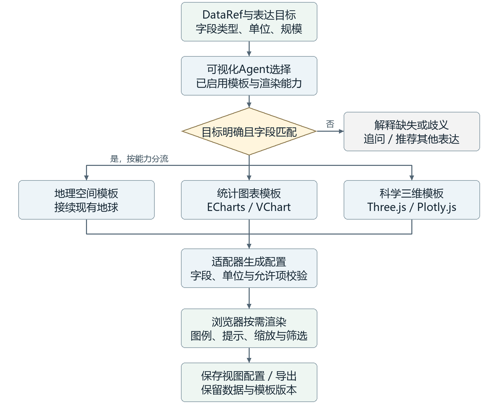

Agent确定模板后，工具适配器生成配置并校验字段映射、单位与允许选项，再由前端渲染并接收筛选事件。hustcc/mcp-echarts、VChart MCP等属于待验证的接入候选；MCP负责工具调用，并不替代浏览器渲染。仅输出图片的工具适合静态导出，不能单独满足交互BI。第一阶段先验证ECharts与一种三维数据模板，保存数据及模板版本后再扩展其他能力。

## 六 分析预测与任务执行

分析模块将算法适配、能力启用和任务执行分开。开发者先封装算法并登记输入要求、参数、资源限制和输出结构，管理员完成配置与启用后，分析Agent才能选择或组合这些能力。Agent负责组织步骤和解释结果，实际计算由确定性程序完成，避免将语言模型输出直接当作数值分析结果。

首批统计采用SQL及Python工具，聚类采用scikit-learn适配；通用时序预测优先评估TimesFM，Chronos作为备选。MCP Python SDK可封装提交任务、读取状态及获取结果的操作，便于统一调用不同算法。社区timesfm-mcp仅是适配参考，并非Google官方预测服务；模型版本、使用条件和显存消耗均需验证。

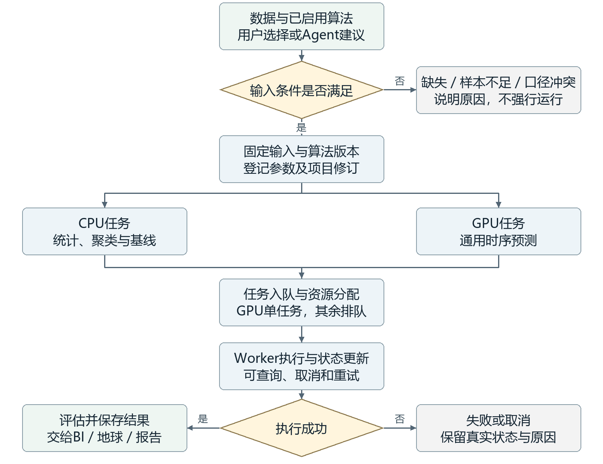

任务提交前检查缺失、粒度和样本长度，并固定数据、算法及项目修订。CPU任务设置有界并发，GPU任务按一张RTX4090的预算排队；计算完成后保存指标、产物及来源。历史回测仅使用预测时点已可获得的信息，并与简单基线比较。中国风场因缺少配对实测功率与NWP暂缓，英国论文流程保留后续研究，通用模型调用不等同于完成论文复现。

## 七 智能交互与知识检索

小云提供语音和文字入口，总管依据当前项目协调数据、可视化与分析Agent。LangGraph拟用于维护任务状态和组织工具调用，使不同角色围绕同一项目上下文工作，而非各自维护互相冲突的状态。语音识别、业务执行和播报通过适配层分开，语音服务异常时仍可使用文字及鼠标操作。

知识问答首先检索管理员审核的文档。建议在PostgreSQL中保存出处和版本，结合pgvector与关键词检索；向量检索补充语义相近内容，关键词检索保留术语匹配能力。审核资料不足时，允许检索指定官方网站和论文，可评估Tavily MCP等适配器，来源范围由服务端控制。

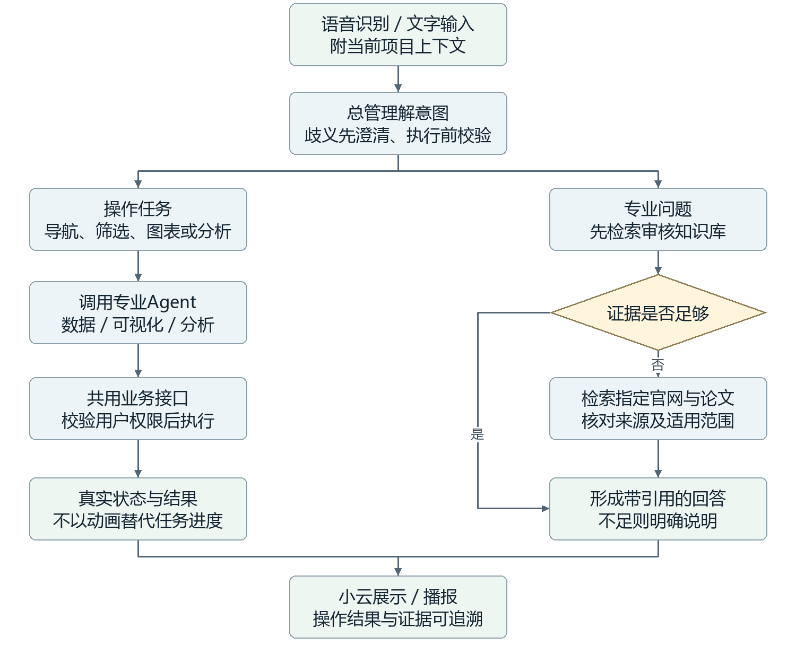

操作请求经权限校验后调用业务接口，界面展示真实任务状态。知识回答附带可追溯引用，并区分审核资料与联网证据；联网内容不自动成为已审核知识。结构化数值问题应查询数据库，不根据文档片段猜测当前数值。语义检查先采用管理员定义的单位、聚合和适用条件规则；JEV的准确技术指代尚未明确，因此不作为当前方案的必需依赖。

## 八 项目状态与模块接口

项目是用户组织数据范围、布局和分析结果的基本单位。第一阶段个人项目完全私有，项目、任务、结果、会话和导出均校验所属用户；平台共用的数据、模型和模板由管理员维护。所有权由服务端身份确定，不采信Agent自行传入的用户标识。

模块之间以结构化契约交接：ProjectContext保存筛选与修订，DataRef描述数据及质量，VisualizationSpec记录图形配置，AnalysisJob与ResultRef连接计算过程和结果。接口通过OpenAPI／JSON Schema定义，并在运行时校验。这使模块可以使用固定输入独立测试，也便于后续替换渲染器或算法而不改动其他业务。

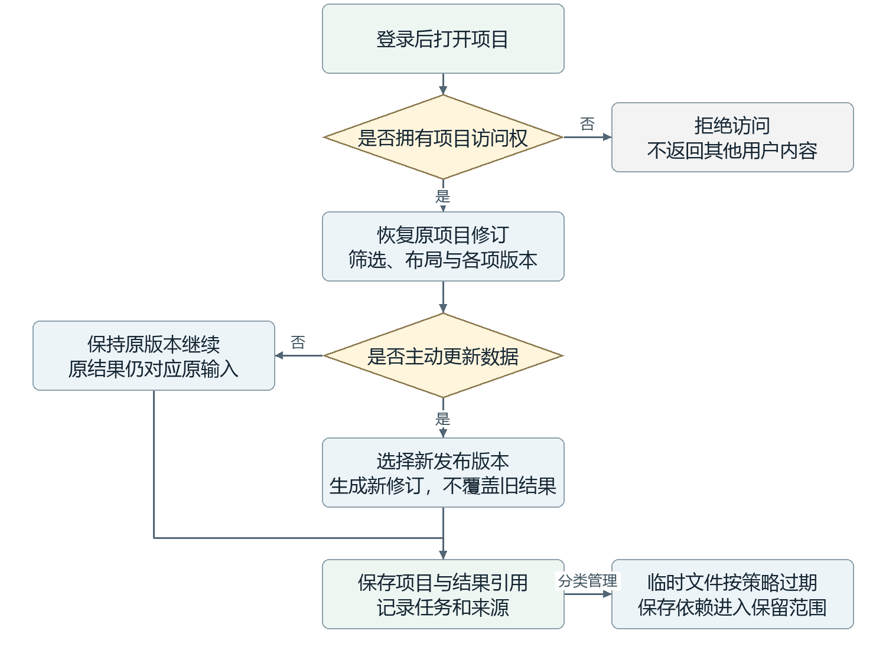

恢复项目时读取原有版本；用户明确选择更新才生成新修订，已运行任务仍绑定其原始输入。保存结果与临时文件采用不同保留规则，缓存过期不能破坏已保存项目。插件更新也不应静默改变历史配置；旧版本无法重放时，应保留现有产物并说明限制。应用内私有权限不等同于对物理数据库运维人员不可见。

## 九 部署方案与运行保障

部署继续使用当前连接PostgreSQL的服务器。2026年9月26日核查显示，该机运行Windows 11专业版、PostgreSQL及Ubuntu／WSL2，配备四张RTX4090；由于与其他课题共享，本项目仅按其中一张约24GB显存的GPU规划。WSL内部GPU、模型依赖和网络连接仍待验证，不能据硬件清单认定模型已具备运行条件。

建议在独立环境中运行FastAPI、Agent编排与计算Worker，现有PG先保持原部署。Procrastinate可利用PostgreSQL管理任务，减少第一阶段新增基础组件；更复杂的路由和规模需求出现后，再比较Celery＋Redis。前端、查询与重计算分进程运行，避免长任务占用网页请求；CPU、内存、磁盘及GPU均设置明确配额。

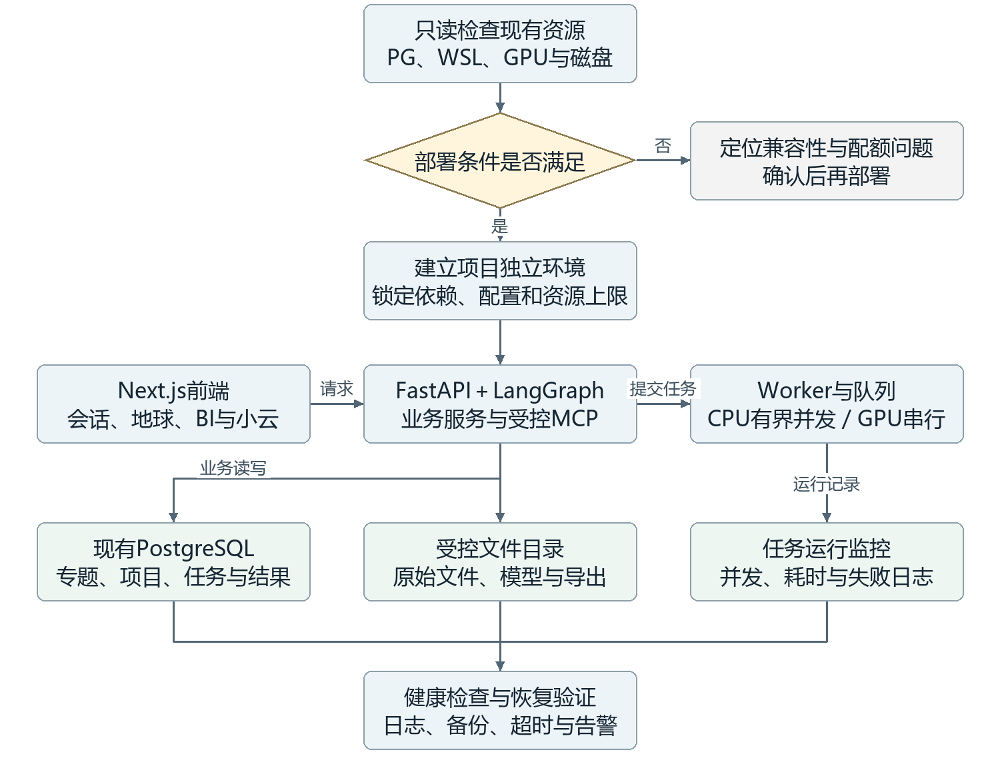

按图先检查环境和配额，再锁定依赖并部署服务。模型文件、原始数据与结果优先规划在容量较充足的D盘，访问经统一文件接口管理。运行期间记录状态、耗时和失败原因，并验证超时、恢复和备份流程。既有GitHub源码基线不包含完整数据库与原始数据，正式迁移前仍需单独验证数据备份；外部模型、语音和检索调用仅传递任务所需内容。

## 十 实施路径与验证方法

实施顺序以降低联调不确定性为原则。首先核对权威数据目录、指标定义、用户权限和接口契约，再使用固定数据分别验证查询、渲染、算法与知识检索，最后贯通小云发起的端到端任务。Agent工具契约从基础阶段同步设计，避免页面完成后才发现无法通过语音执行相同操作。

首批选择GFS与W5E5气象、国家统计局月度能源和GRACED Power数据验证流程。数据检查关注单位、版本、质量和来源；功能检查关注图表交互、任务恢复和用户隔离；模型检查记录时间划分、基线、误差、耗时及资源占用。框架运行成功与模型精度达标是两个独立结论，不预设基础模型一定优于简单方法。

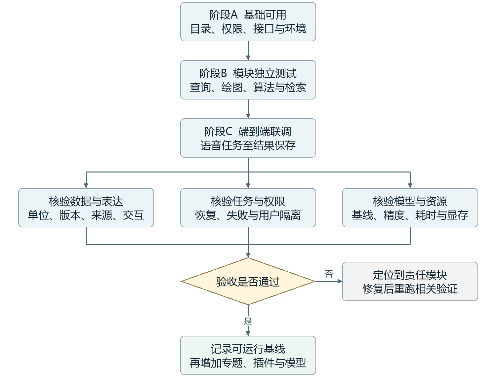

各项验证通过后形成可回退的运行基线，再逐步增加经济专题、可视化插件和分析模型。当前待收敛事项包括经济专题入口、首批插件及模型版本、WSL内GPU兼容性和资源配额。本文描述拟建架构及验证路径；数据库事实以2026年9月26日盘点为准，技术候选的可用性仍需后续集成测试。

数据依据：[2026年9月26日实库盘点](../project-management/DATA_REFACTOR_ALLOCATION_2026-09-26.md)。技术来源及候选比较：[详细备查稿](TECHNICAL_PROPOSAL_2026-09-27.md)。
