# 多源异构数据可视化与智能分析平台技术方案

V0.5 讨论稿 2026年9月27日

## 一 总体方案

本方案面向课题组内部的数据研究工作，在现有网站基础上构建多源异构数据可视化与智能分析平台。系统以管理员维护的官方或经审核研究数据为基础，将数据查询、图形表达、算法计算和知识问答组织为可追溯的工作流程。现有三个地球的样式予以保留，新增能力通过统一接口接入。

总体架构采用模块化后端与独立计算进程。数据基础层位于底部，可视化、分析预测和知识库问答处于同一业务层；小云提供入口，总管Agent协调任务。模块内部集中处理自身职责，跨模块只交换经过校验的数据引用、配置与结果。这种高内聚、低耦合的安排允许逐块验证，也便于替换模型与图形插件。

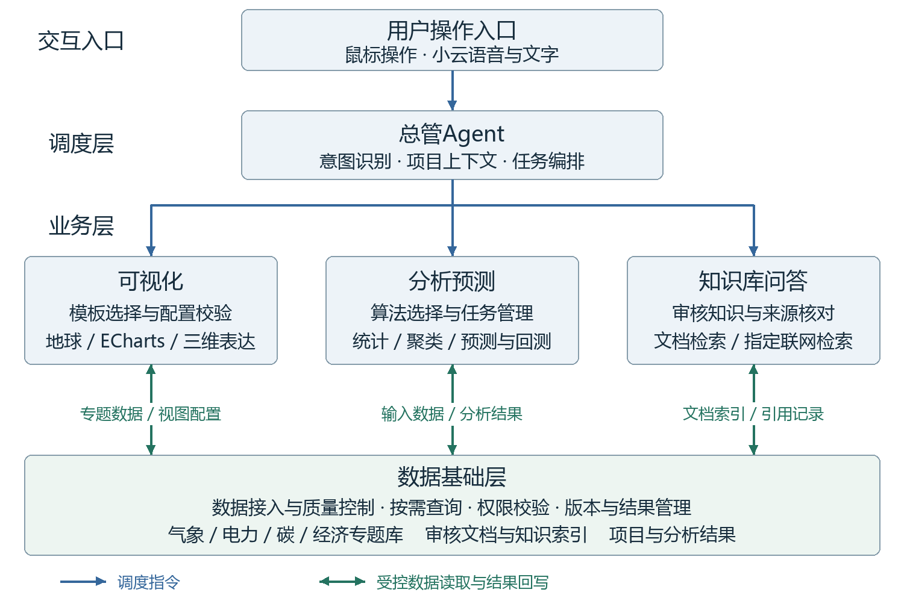

技术基线为现有Next.js／React前端、FastAPI业务接口、PostgreSQL数据库和LangGraph任务编排。MCP是Agent调用工具的协议，数据库、图表库和算法仍各自执行查询、渲染和计算。首阶段自部署为主，面向课题组少量用户，个人项目私有；开发者适配能力，管理员启用，用户通过鼠标或小云调用。

本版是在V0.4上的批注修订稿，补充内部流程、工具比较和实施验收。数据下载与概念图已完成；图中平台能力均为拟建方案，不表示网站、MCP或模型已部署。

## 二 现有数据基础与专题划分

既有数据依据2026年9月26日只读盘点；经济数据依据9月27日实际下载和文件检查。已有记录不代表已完成全部载荷与科学质量检查，记录数也不等同于独立样本数。专题是研究分类，不要求分别部署数据库。

|专题|当前数据与覆盖|定义及数据性质|用途与限制|
|---|---|---|---|
|气象|GFS全球预报<br>0.5°网格；13指标，22次起报、286字段记录。|数值天气预报（NWP）：利用大气模式计算未来状态，需记录起报与有效时刻。|用于天气图层和区域摘要。现有批次不构成完整历史档案，也不等同于气象站实测。|
|气象|W5E5 v3.0中国裁剪<br>2019—2024；6变量、3848点、13152日帧。|日尺度偏差校正再分析数据，描述历史气象条件。当前温度单位登记为K。|用于历史趋势、区域比较。hours=1表示每日一个时间片；不能解释为小时数据。|
|气象|GFDL-ESM4情景气象<br>四种SSP；2021—2060；5变量、3848点。|气候模式在给定情景下的模拟。292200个日块，每块保存24个小时值。|用于情景及日内变化比较；不是未来实测，也不是短期业务天气预报。|
|电力|国家统计局月度能源统计<br>2015—2025；全国和31省，共54912行。|官方统计，包含发电量、分电源发电量及煤油气产量等指标。|用于月度趋势与结构分析。9709条NULL须核对发布口径，不能补零；不是小时负荷。|
|电力|GFDL风光情景序列<br>四SSP、32区域、40年、两技术，共10240条年度序列。|容量因子为出力与额定容量之比；序列每年8760／8784小时，功率及电量按地图装机假设换算。|属于情景派生数据，不是实测发电；容量因子、装机假设及换算结果分别标识。|
|风电研究|英国Hill of Towie<br>21机组，2025年信号约105.9万条；场站52561条（含次年边界）。|10分钟SCADA功率实测；配对GFS NWP点值2921条，仅+3／+6小时；已有6605条小时配对。|用于英国风场研究。负功率及运行标签待核对；现成小时配对不能视为论文所需的完整超短期样本。|
|碳|GRACED Power与total<br>Power：2708日，2019-01—2026-05；total：851日、28月。|碳排放研究估算。当前网格0.1°，单位kgC/h；日期记录不等同于逐小时观测。|Power日期记录连续；total散布2019—2022，不能当完整序列。碳质量与CO₂质量不得混用。|
|空间基础|能源设施9143条；OSM几何1004381条；GISPO潜力222943条。|分别为项目名录、众包地理要素和研究资源潜力。另有基础边界及光伏足迹汇总。|用于点线面与资源分布。各源覆盖和统计口径不同；光伏源归档已有，精细多边形查询仍待加工核实。|
|经济|哈佛Atlas首批快照已下载本地<br>2015—2024；232个国家及地区年度指标2316行，中国商品12472行、伙伴贸易2109行。|公开研究数据产品；另有233行国家字典、1248行HS92四位商品字典。ECI为经济复杂度，RCA为显性比较优势。|尚未导入PG。部分GDP、人口、ECI、RCA为空；币值口径及再分发条款需核对。不是完整全球贸易档案。|

## 二 现有数据基础与专题划分 续

气象专题以GFS承担当前预报图层，以W5E5提供历史背景，以GFDL描述长期气候情景。三者进入不同数据集和时间口径，用户可在项目间比较。气象地球用于空间观察，BI用于区域趋势与分布统计；日均温、瞬时风场和情景序列必须保留各自定义，不能只因时间相同就拼接为一条序列。

电力专题以国家统计局数据展示月度规模和电源结构，以设施数据展示装机空间分布，以GFDL风光结果比较情景下的资源与模拟出力。新能源容量因子可制作曲面、区域排名和日内变化图。英国Hill of Towie用于实测风电的研究验证；中国风场超短期预测因缺少配套实测与NWP暂缓。

碳专题优先使用日期覆盖连续的GRACED Power开展时空分布、区域汇总和变化分析；total仅展示确有记录的时段。积分与汇总须核对网格值究竟是单元总量还是面积通量、时间值是平均率还是累计量，再决定面积和时长权重。kgC与kgCO₂必须显式换算，不能只改图例。

经济专题首批建立全球国家年度概览、中国商品结构和中国伙伴贸易三类分析页，使用国家着色、排名、矩形树图和贸易关系表达。经济能力先以专题数据与BI插件接入，不强制新增第四种地球外观；空间展示复用现有地球适配接口。年度样本较短，首阶段以描述分析为主，不预设通用预测模型适合所有指标。

|本次核验|结果|对使用的影响|
|---|---|---|
|记录与字典|业务记录16897行；字典1481行；组合键重复0；引用缺失0|保留原始JSON、CSV、查询、SHA-256与manifest；下载不等于发布|
|源接口缺失|GDP、人均GDP、人口各401条；ECI 16条；RCA 50条|缺失保持NULL；统计时显示有效覆盖|
|分类与版本|HS92四位商品；clusterId全为空；ECI为当前发布口径历史值|商品ID关联字典，保留代码前导零；不能据此复现历史可获得版本|

本次使用哈佛官方公开GraphQL接口保存2015—2024年快照，未抓取网页图形或私人接口。批量下载端点返回403，故首批未包含完整世界双边商品历史。金额保留原值，货币、名义／不变价及基期应在发布目录中补齐。项目文件README与manifest记录下载边界和来源。[1]

## 三 数据组织与处理机制

数据库内部按“专题”和“处理阶段”同时组织。建议在一个PG实例中设置catalog、staging、standard、derived、results、projects、knowledge等逻辑schema；气象、电力、碳、经济由数据集标识区分。大型网格与原始文件通过文件接口管理，PG保存目录、索引、统计和引用，现有二进制帧先兼容读取，再根据实测瓶颈调整存储。

|对象|拟保存的内容|作用|
|---|---|---|
|catalog<br>数据版本目录|来源、版本、单位、时间粒度、质量、状态、文件哈希|决定哪些数据已发布且适合某种分析|
|standard 专题事实表|实体、时间、指标、数值、质量标记、版本外键|为SQL筛选和关联提供一致结构|
|derived 与 results|区域聚合、可视化载荷、模型结果及来源版本|复用昂贵计算，避免重复加工|
|文件存储|源文件、数组切片、权重和报告；PG记录URI及校验值|大载荷不进入Agent提示词或普通接口响应|

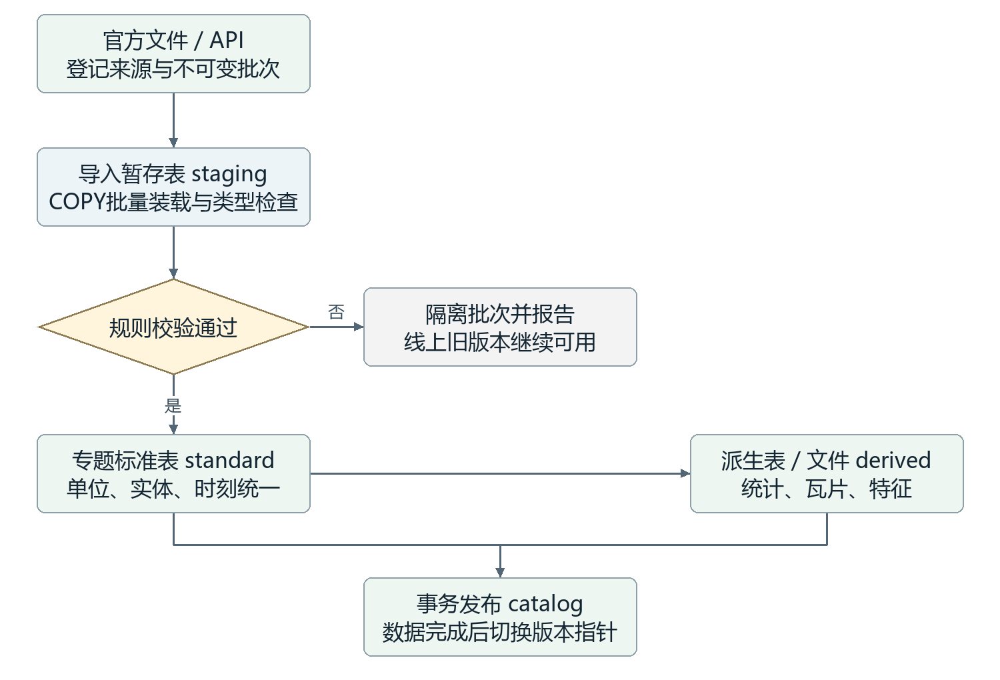

SQL中的CREATE TABLE定义字段类型与约束，外键连接目录和事实表，唯一键防止重复批次。导入服务先批量装入暂存区，再由INSERT SELECT生成标准数据；完成质量检查后，在一次事务中登记完整版本并更新发布指针。文件须先写完并核验，事务失败时回滚目录变更，避免用户读到半个版本。气象定时检查新批次，其他来源由管理员触发。

## 三 数据组织与处理机制 SQL示例

SQL是描述“从哪些表、按什么条件、取哪些结果”的语言。SELECT确定输出列，WHERE限定版本与时间，JOIN按键关联字典，GROUP BY组织统计，ORDER BY确定结果顺序。下面展示拟建标准表的参数化查询，并非已在现库执行的迁移脚本；图中是理解查询的逻辑过程，数据库优化器可能改变实际执行顺序。[2]

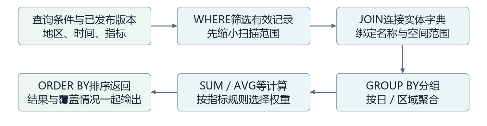

```sql
SELECT date_trunc('day', observed_at) AS day,
       AVG(power_mw) AS mean_power_mw,
       COUNT(power_mw) AS valid_count,
       COUNT(*) AS record_count
FROM standard.wind_observation
WHERE dataset_version_id = $1
  AND station_id = $2
  AND observed_at >= $3 AND observed_at < $4
  AND quality_status = 'accepted'
GROUP BY 1
ORDER BY 1;
```

此例返回某风场每日平均有功功率，单位仍为MW；它没有计算发电量。只有确认采样等间隔且有效覆盖满足规则时，算术平均才适合该日；发电量需要对功率乘对应持续时间再求和，单位为MWh。COUNT反映已有记录中的有效数量，完整性还须与独立生成的期望时间网格比对，不能用COUNT(*)掩盖整段缺测。

占位符$1—$4由工具服务绑定真实参数，不拼接用户文字。服务端固定表名、字段和允许的聚合操作，设置只读角色、执行超时及返回规模；按版本、实体和时间建立匹配索引，空间过滤按需采用PostGIS。大范围导出转为异步任务，不能靠LIMIT截断后仍宣称结果完整。SQL负责计算，管理员维护的指标规则负责判断这项计算的业务含义。

## 三 数据组织与处理机制 数据Agent

数据Agent设置为“数据目录解释与受控查询协调者”。系统指令要求它只使用已发布数据和启用工具，不自行修改表结构、补造缺失数据或改变单位。可读信息包括数据集字典、时间与空间覆盖、质量摘要和管理员语义规则；数据库口令由工具服务持有，不进入模型上下文。

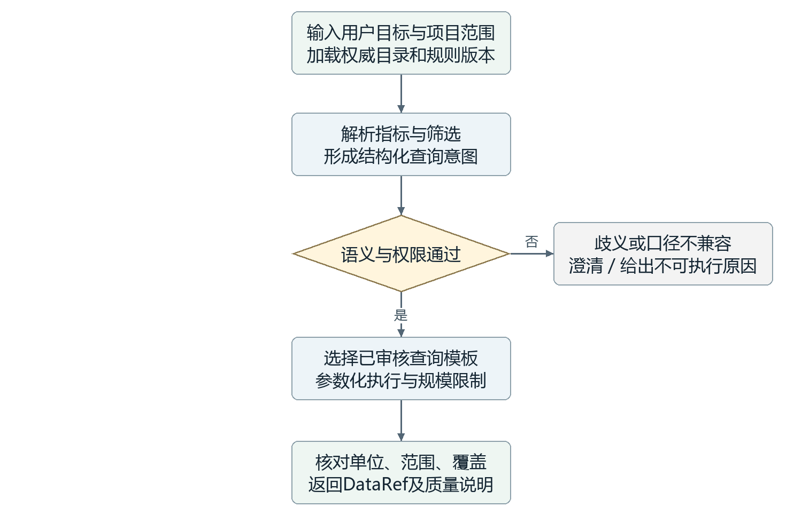

子图状态拟包含project_id、revision、intent、dataset_version、filters、metric_rule、query_template、data_ref、warnings和error。parse节点可调用语言模型；权限、规则、参数绑定和结果校验节点采用确定性代码。工具拟提供catalog.describe、data.query、data.export等操作，这些名称是本项目接口设计，不是现成MCP的官方工具名。

首批推荐自建FastAPI查询服务，可通过Google MCP Toolbox的预定义SQL工具适配PG，或以MCP Python SDK薄封装同一业务服务。数据库Agent只拿到模板和参数；导入发布服务使用独立写入角色。可视化Agent要求数据时调用数据服务，复杂字段解释才进入数据Agent，避免每次拖动时间轴都调用语言模型。

管理员规则示例：气候情景不可标为实测，kgC与kgCO₂不可直接混合，NBS空值不可补零，NWP必须保留起报时刻和有效时刻。规则不通过即停止查询计划或请求澄清。JEV的具体实现仍未明确，暂不列为必要依赖。[3]

## 四 前端组织与数据探索

开屏与工作区分开：开屏仅使用固定、预先抽样压缩的展示资源，可缓存并提供直接进入按钮；不等待PG查询、天气更新或Agent推理。进入后打开当前专题项目，保留三个地球现有渲染样式，项目切换入口移至底部的小型地球。开发时只调整页面组织与适配接口，不以概念图替换当前地球引擎。

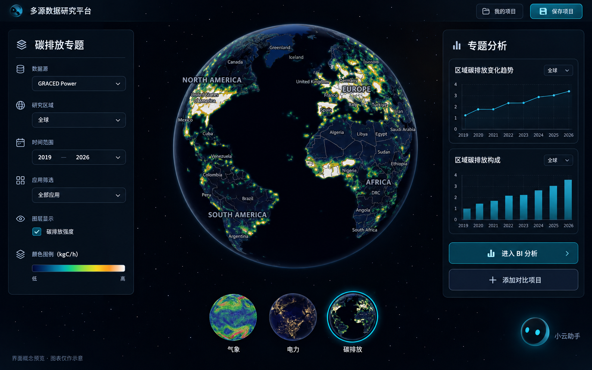

此图展示的是开屏之后的工作区，不是固定数据开屏。左侧筛选、中央地球、右侧专题摘要共同读取同一项目筛选；“进入BI分析”打开详细分析视图，“添加对比项目”增加另一套地球与BI区域。并排项目各自保持时间、范围与数据版本。图中的小图仅表达布局，不能据此认定GRACED已包含所有排放部门。

项目恢复使用保存时的数据和插件版本，用户主动更新才形成新修订。闲置时保持当前位置。语音要求打开其他项目且可能替换当前内容时，小云先说明影响，并让用户选择当前页重开或旁边对比。地球与图表通过共享筛选事件协同；并排时采用按需加载、隐藏视图暂停渲染和离开页面释放资源，控制多个WebGL视图开销。

## 五 可视化模板与渲染机制

可视化Agent与ECharts MCP可以归属于同一模块，但职责仍应清楚：Agent判断数据适合怎样表达，MCP或本地适配器返回图形配置，浏览器图表库负责真实交互。这样既能统一调度，也能单独验证选择、配置和渲染三步。Agent不重新计算业务指标，缺少派生字段时向数据或分析模块提出请求。

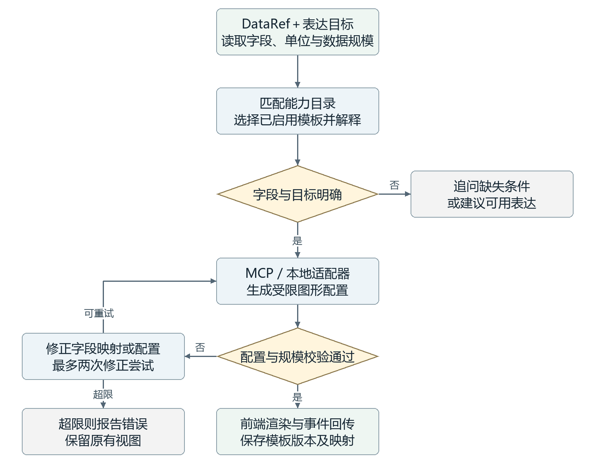

拟用LangGraph维护goal、data_ref、field_profile、candidate_ids、template_id、spec、validation_errors、attempts和render_status。能力目录登记必需字段、可接受单位、最大规模、交互事件、导出方式和版本。语言模型只在候选之间做选择与映射；JSON Schema校验、单位一致性、规模门槛和渲染结果回执由程序执行。图中“最多两次”是初始可配置策略，不是模型自动保证。

日期加数值优先趋势图，类别加数值优先排名或结构图，经纬度加标量使用地球分布，规则二维网格加数值可用曲面，经纬度加U/V矢量才适合风场粒子。没有方向信息的碳排放点不能画成代表物理输运的流线。仅为开屏装饰的运动须与真实数据表达区分。

## 五 可视化模板与渲染机制 工具选择

下表列出拟接入或验证的能力，均未完成本站集成。首批选择现有地球适配、ECharts交互BI和一种Three.js数据模板；其他插件逐个验证后启用。库的开源许可不等于部署零成本，模型推理、服务器、前端GPU与适配维护另行计入。

|能力及状态|适合的数据|输出与交互效果|成本及接入判断|
|---|---|---|---|
|hustcc/mcp-echarts<br>社区MCP候选 [4]|时间序列、排名、分布、组成|PNG／SVG／option；option经校验交给本站ECharts后才能实现BI联动|MIT；可本地生成；主要是CPU、存储和Agent调用费；优先验证|
|apache/echarts-mcp<br>Apache仓库候选 [5]|常见统计图及报告图|以图片结果为主要接口；不能单独承担本站筛选交互|适合补充静态导出；核验锁定版本许可、图片服务和上传路径|
|VisActor/vchart-mcp-server<br>现成MCP候选 [6]|动态排名、多维分类、时间变化|VChart规格及图片／HTML能力，动态统计表达丰富；本站仍需事件适配|MIT；默认导出调用远端服务；自部署export服务后再用于私有项目|
|AntV mcp-server-chart<br>现成MCP候选 [7]|关系、层级、流程、统计数据|多种图表的图片输出适合报告；交互需另接G2／GPT-Vis等前端|本地部署消耗CPU与存储；默认远端图像服务须替换或审核|
|现有地球＋Three.js<br>自建工具适配 [8]|经纬度、网格、矢量、点云|保持地球样式，新增粒子、立体柱和点分布；支持拾取和图层切换|无统一官方“万能地球MCP”；主要为开发与浏览器GPU成本|
|Plotly.js<br>自建工具适配 [9]|规则网格曲面、三维散点、科研结果|可旋转曲面与坐标悬停；补充科学三维视图，不替换所有地球|本地JS渲染；按需打包减少体积；无需购买Plotly托管产品|

对交互式BI，返回VisualizationSpec比返回图片URL更重要。即使候选MCP声称“支持所有图表”，也要验证时间筛选、区域联动、中文字体、导出与历史配置恢复。含HTML或脚本的结果不能直接注入主页面；优先提取配置交给本地渲染器，确需HTML时使用隔离容器。

## 六 分析预测与任务执行 数据路由

分析模块以数据条件决定可用算法，而不是按数据专题机械绑定模型。Agent先读取DataRef和质量摘要，判断用户需要描述、分群还是预测。统计、特征构造与模型调用由确定性程序执行；模型返回成功只说明计算完成，预测有效性仍由回测评价。

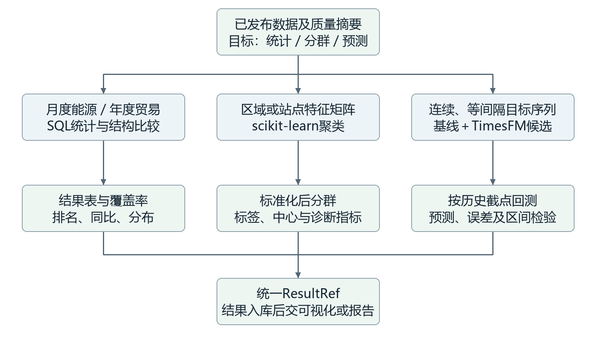

气象网格先用Xarray按区域和时段提取标量或特征；大数组不能原样传入语言模型。W5E5日序列可用于趋势和方法验证，GFDL用于情景比较，不把对模拟序列的外推宣称为真实气候预报。GRACED Power先核对单位与时间聚合，再生成区域序列；total不连续时不能按连续训练样本处理。

NBS月度统计先处理已确认的发布口径，1—2月的缺失不能自行填成零或伪造月值。哈佛首批每个实体约十个年度样本，优先排名、结构与相关性展示；当前发布版ECI的历史值不具备“历史时点可见”的完整证明，不用于宣称严格实时历史回测。中国风场预测继续搁置。

## 六 分析预测与任务执行 算法与MCP

Google TimesFM、Amazon Chronos与scikit-learn本质上是模型或算法库，并不自动成为本项目可调用的MCP服务。建议用官方库在自己的服务器运行，由MCP Python SDK封装统一任务接口。社区包装可参考，但“公司研发模型”与“公司提供并保障的MCP服务”必须分别标识。

|能力与接入方式|输入条件|输出及适用效果|资源与选择|
|---|---|---|---|
|SQL／Python统计<br>自建分析工具|经过单位、时间规则审核的表格或区域摘要|汇总、分布、变化率、相关性；不宣称因果|CPU；优先实现，复用数据库查询|
|scikit-learn<br>自建MCP [10]|实体×特征矩阵；处理缺失并标准化|KMeans给出分群中心；DBSCAN识别密度簇及噪声；标签不是业务真值|CPU为主；保存特征、缩放器、随机种子与算法参数|
|StatsForecast<br>自建MCP [11]|等间隔时间序列；季节长度有业务依据|SeasonalNaive／AutoARIMA等基线，提供可解释比较依据|CPU；首批与主模型同时评估|
|Google TimesFM 2.5<br>官方模型＋自建MCP [12]|连续目标序列；上下文、粒度与预测长度满足模型要求|通用预测及可选分位数输出；实际精度以本站回测为准|代码及≤2.5权重Apache-2.0；一张GPU排队，显存须实测|
|Amazon Chronos-2<br>官方库＋自建MCP [13]|时间序列，可含符合可获得性条件的协变量|点预测／分位数，多变量与协变量场景备选|代码Apache-2.0；部署前固定具体权重及许可；CPU／GPU实测|
|动态匹配与在线建模<br>后续专用研究插件|实测功率＋对应NWP＋已成熟历史窗口；500相似样本流程|实现论文特征匹配、漂移判定及在线更新；不由通用预测MCP自动替代|实现与训练成本高；英国数据先补足验证，中国任务暂缓|

TimesFM 3.0权重当前采用单独的非商业、非生产许可，不能仅因研究平台自部署就默认可作生产服务；首批因此优先验证2.5。没有可靠数据支持为本项目承诺某模型的MAE或固定显存占用。成本比较按CPU时、GPU时、峰值内存和外部LLM tokens实测；本地模型无需向厂商逐次购买推理，但有硬件与维护成本。[12]

## 六 分析预测与任务执行 Agent链

分析Agent采用LangGraph的StateGraph组织显式节点与条件分支。下面节点名和流程是本项目设计；LangGraph提供状态、分支与持久化机制，不会自动决定正确模型。节点内部可以调用语言模型，也可以只执行规则或接口程序。[14]

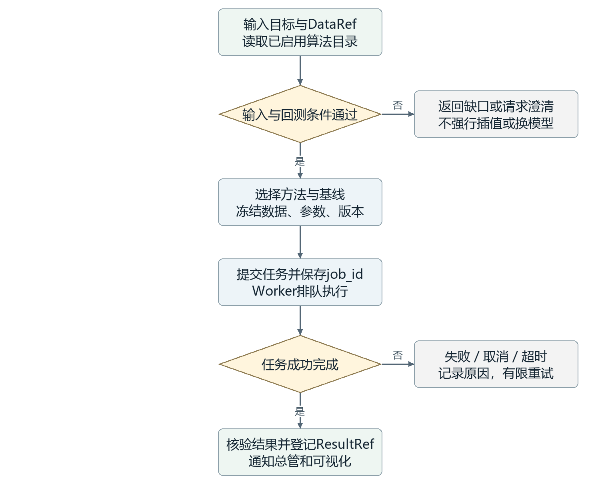

状态至少保存project_id、revision、data_ref、goal、quality_report、algorithm_id、model_version、parameters、backtest_plan、job_id、result_ref、errors和attempts。validate检查样本长度、连续性和时间泄漏；select_plan在管理员批准的能力内选择；freeze_input固定引用；submit_job提交一次；collect_result在任务完成事件后恢复；evaluate对照基线并输出报告。

拟建MCP工具为analysis.list_capabilities、analysis.submit、analysis.status、analysis.cancel与analysis.result。submit仅返回任务标识，真正训练与推理由Worker执行。服务用项目修订、输入哈希、算法版本和幂等键防止同一次请求重复排队；取消先登记请求，由Worker确认停止后才标记取消。LangGraph检查点保存编排进度，任务表保存计算状态，二者用job_id关联，不能相互替代。

## 六 分析预测与任务执行 协作与回测

模块间传递结果引用，不传递某个模型对象或数据库连接。相同ResultRef可以在BI中展示预测曲线，也可以在具有空间对应关系时回传地球。知识Agent可解释模型与指标定义，但不能替代结果表提供数值；小云显示执行步骤和结论摘要，不将“已提交”说成“已完成”。

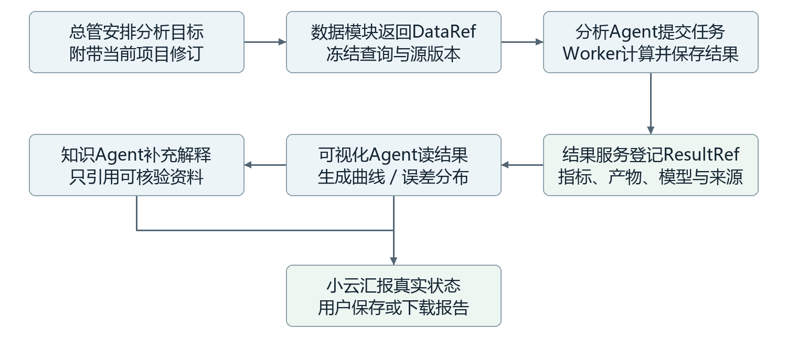

回测以历史预测时点逐步推进。每个时点只使用当时已经可获得的实测和NWP批次；训练、标准化、相似样本检索及参数选择不得看到测试未来。输出至少记录时间划分、预测跨度、MAE／RMSE、基线误差、耗时和峰值资源；涉及近零功率时不单独依赖MAPE。预测区间须评估覆盖率，不能将模型分位数直接当作已校准置信度。

论文路线作为后续专用插件保留：维护增量特征库，检索500组相似且输出窗口已完整出现的历史样本；升级方法的漂移判断应按原论文定义实施，不能用尚未发生的真实未来功率比较当前预测误差。是否使用功率与未来NWP再次匹配、更新哪些网络层，以及未触发时使用初始模型还是最近更新模型，必须写入实验协议；改变这些步骤应明确标为变体。

现有英国数据可以支持研究流程准备，但NWP只有部分提前量，已有6605条小时配对不等于15分钟超短期建模样本完整。首批通用模型调用与论文复现分别验收；运行成功不等于已具备中国风场预测能力。

## 七 智能交互与总管调度

小云沿用当前助手接入，作为语音、文字及动作反馈入口；实际业务能力统一暴露给鼠标和Agent。语音识别将音频转为文字，总管确定意图并调用子Agent，播报模块将已确认状态转为语音。语音组件故障时，文字与页面操作仍然可用；语音识别供应商接口、鉴权和回调方式在接入前核验，不预设现有SDK已经支持全部动作。

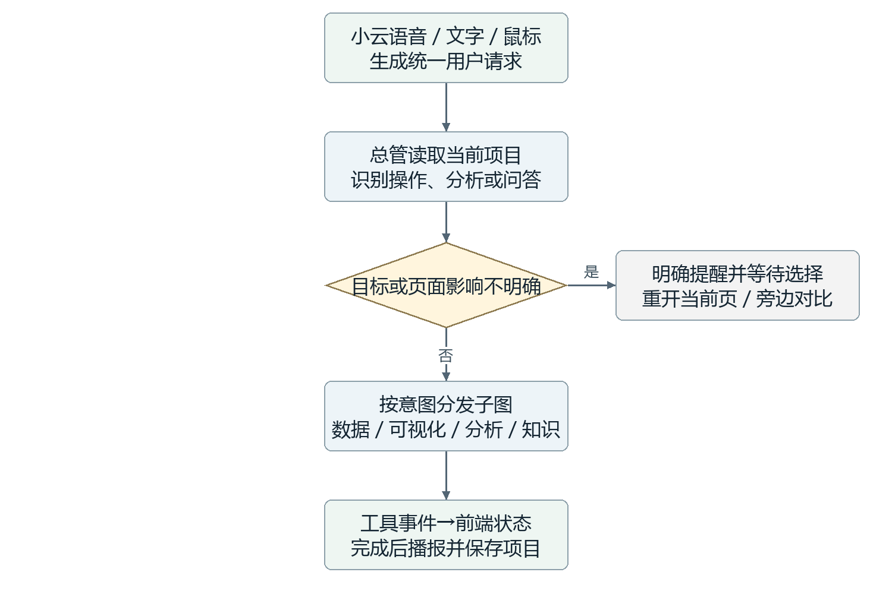

总管状态保存用户请求、服务端用户身份、当前项目修订、计划步骤、待澄清项、子任务标识和公开状态。parse_intent提取目标，resolve_context补充页面范围，clarify使用LangGraph暂停并等待回复，dispatch启动业务子图，summarize依据工具结果组织反馈。权限检查必须在业务服务再次执行，不能只依赖总管提示词。

示例“比较英国风电并解释误差”：总管先固定比较项目，数据模块准备输入，分析模块回测，可视化模块生成结果图，知识模块解释误差指标并附来源。界面显示“数据准备中、排队中、计算中、完成或失败”，只暴露操作摘要与依据，不展示模型内部思维过程。对用户离开页面的情况保存状态并保持当前位置，不主动跳转或替换项目。

## 八 知识库连接与检索 资料入库

知识库不是把文档交给语言模型永久记住，而是建立可追溯的文档目录与检索索引。原始PDF或网页快照由文件服务保存，PG维护document、document_version和chunk；每个片段记录文本、页码／章节、来源URL、审核状态、适用时间和哈希。模型回答前先检索片段，回答中的引用再指回原文位置。

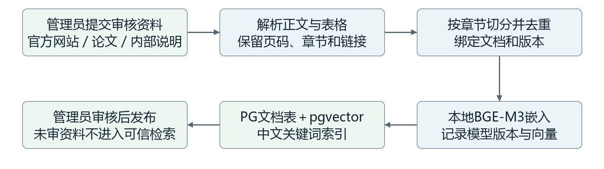

|组件|拟用技术|作用与边界|
|---|---|---|
|解析与切分|文本PDF提取；扫描页按需OCR；按章节及表格结构分段|保留定义及上下文，识别错误交管理员核对；不将整本书塞入提示词|
|语义检索|BGE-M3本地嵌入＋pgvector [15][16]|中文及英文语义相似召回；模型、维度、索引版本必须一致|
|关键词检索|中文分词后建立PG tsvector，术语词典维护同义词|补足指标名、标准编号和缩写；PG默认分词不等于中文检索已完善|
|对外服务|FastAPI检索服务＋自建知识MCP|提供kb.search与kb.get_passage；校验用户范围、审核状态和引用位置|

导入时先清除页眉页脚等噪声，保存原文与解析版本，再生成嵌入和关键词索引。建议以约500—800中文字符为切片起点，按标题、定义和表格边界调整，并用实际问答集调优；这不是固定最佳长度。更新资料产生新版本，旧项目引用仍指向旧文档。向量扩展与本地模型要先检查现有PG及运行环境兼容性，索引构建任务排队以免影响在线查询。

管理员维护共用审核资料；用户项目及会话保持私有。检索服务先执行权限和审核过滤，再返回允许的片段。网页内的指令一律作为文档内容，不允许它改变工具权限或调度规则。

## 八 知识库连接与检索 Agent与联网

知识Agent的LangGraph状态拟包含question、project_ref、query_terms、approved_hits、external_hits、evidence、citations和answer_status。classify节点把“某地区今年是多少”转给数据服务；概念问题进入retrieve，combine融合召回，assess检查定义、时效与冲突，必要时进入external_search，最后通过ground_answer与verify_citations生成带引用的回答。

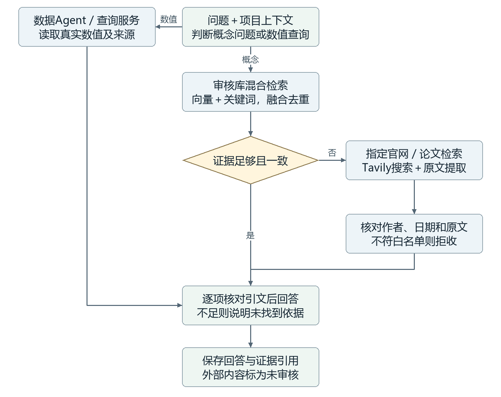

初始检索策略可设向量与关键词各召回20段，经融合去重选取约8段上下文，阈值用人工核验问题集调优。证据不足不仅指相似度低，也包括缺少适用地区、标准版本过期或资料相互冲突。答案按句绑定文档片段、页码或URL；找不到依据时明确缺口，不依靠模型记忆补出标准条文。

联网候选采用Tavily MCP的search与extract能力。服务端维护来源白名单，例如WMO、IPCC、NOAA、国家统计局、哈佛Growth Lab及管理员指定论文出版站；搜索域名过滤后，还要校验每个结果与重定向终点。论文可先核对DOI、作者和出版年份；仅有摘要就只依据摘要，不能声称读过全文。

外部证据另存未审核缓存，用户界面标明联网来源和检索日期，管理员审核后才发布为知识库新版本。Tavily现行按credit计费：基本搜索1 credit、高级搜索2 credits，按量价格0.008美元／credit；基本搜索约0.008美元／次，另计提取和语言模型费用。需密钥与预算上限，价格以采购时核验为准。[17]

## 九 项目状态与模块接口

这一板块解决“各模块如何认出同一份数据、同一次任务和同一个项目”的问题。接口对象可以理解为交接单：写明输入是谁、版本是什么、做了什么、结果在哪里。它们是本项目约定的数据结构，不是需要购买的新产品，也不是额外的Agent。

|交接对象|主要字段及含义|目的与实际效果|
|---|---|---|
|ProjectContext<br>项目上下文|project_id、revision、owner、topic、filters、layout、data_versions|恢复当前专题、筛选和布局；不同项目互不覆盖，owner由服务端身份生成|
|DataRef<br>数据引用|dataset_id、version、query_hash、schema、units、time_range、quality、artifact_uri|让图表和算法使用同一数据子集；传引用而非把大文件塞入模型|
|VisualizationSpec<br>图形配置|template_id、template_version、data_ref、field_mapping、options、events|保存选用模板和字段映射；用户下次打开仍可重建图表|
|AnalysisJob<br>计算任务|job_id、project_revision、input_ref、model_version、params、status、resource|将网页请求与耗时计算分开；支持排队、查询、失败恢复|
|ResultRef<br>分析产物|result_id、input_refs、artifact_uri、metrics、model_version、run_metadata|追溯每张结果图的输入与算法，允许不同可视化复用|
|EvidenceRef<br>知识证据|document_version、chunk_id、page／url、retrieved_at、review_status|回答能回到原文，区分审核资料和联网内容|
|CapabilitySpec<br>能力目录|tool_id、adapter_version、input_schema、limits、cost_class、enabled|明确哪些模型或模板可用，阻止Agent选择未部署能力|

这些接口使用Pydantic／JSON Schema定义，由FastAPI生成OpenAPI文档；MCP适配器和网页复用同一业务服务，避免两套规则。DataRef中的URI应为受权访问的内部标识或短时下载链接，不让Agent任意指定服务器文件路径。参数、错误码和返回状态需版本化，使模块可以用固定样例独立测试。

具体连接时，后端MCP客户端按管理员配置连接服务，读取工具名称和输入Schema，仅将启用且通过审核的工具交给对应Agent。同机工具可通过stdio启动子进程，独立服务采用Streamable HTTP；连接地址、版本、超时和凭据由服务端管理。LangGraph节点调用客户端，校验返回值后更新状态，浏览器不直接持有MCP服务凭据。[19]

## 九 项目状态与模块接口 版本协作

例如同一个气象项目包含地球、折线图和一次聚类任务：ProjectContext保存地区与日期，DataRef固定筛选后的输入，VisualizationSpec保存图形，AnalysisJob登记运行过程，ResultRef引用聚类结果。改变当前筛选不会偷偷改变已完成分析的输入；用户明确重新分析后才创建新任务。

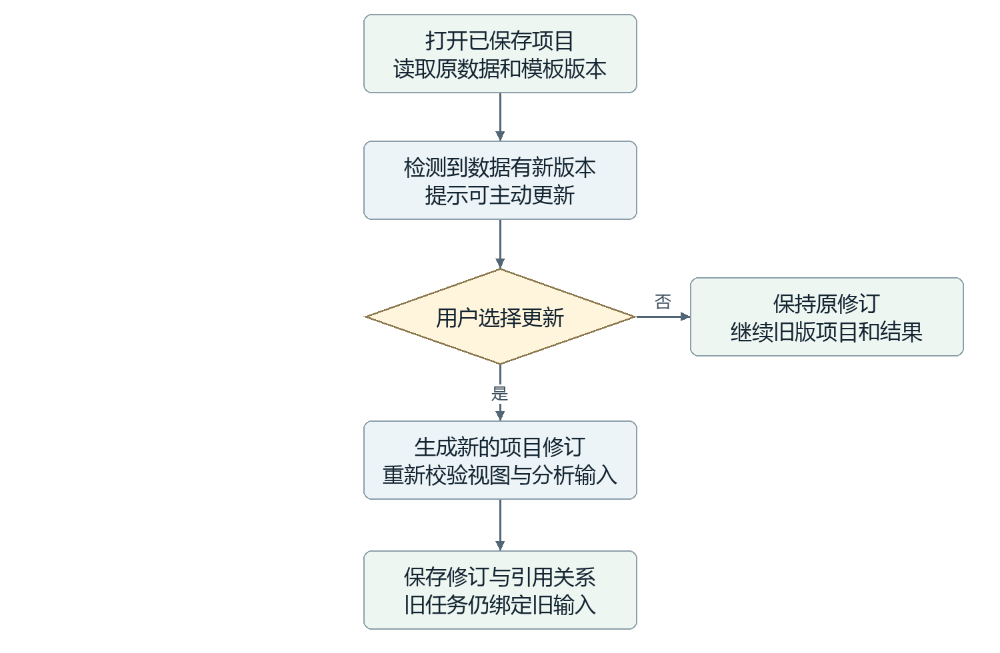

以revision进行乐观并发控制：两个页面同时修改项目时，提交接口比较预期修订，发生冲突则返回提示，不能静默覆盖。每个子任务保存发起时的项目修订；结果返回时，若用户已切换项目，只更新原任务记录并给出完成通知，不替换当前可视化。

保存项目、分析结果和证据引用持久保留；临时导出、未保存中间文件可采用一周等可配置过期策略。清理先检查引用关系，不能删除已保存项目依赖的文件。旧插件无法运行时保留既有导出产物并说明限制，不能宣称完全可重放。用户隔离在项目、结果、任务、会话和导出接口分别检查，应用内私有不等同于对服务器运维人员不可见。

## 十 部署方案与运行保障

部署继续使用当前连接PostgreSQL的服务器。2026年9月26日核查显示，该机运行Windows 11专业版、PostgreSQL及Ubuntu／WSL2，配备四张RTX4090；由于与其他课题共享，本项目仅按其中一张约24GB显存的GPU规划。WSL内部GPU、模型依赖和网络连接仍待验证，不能据硬件清单认定模型已具备运行条件。

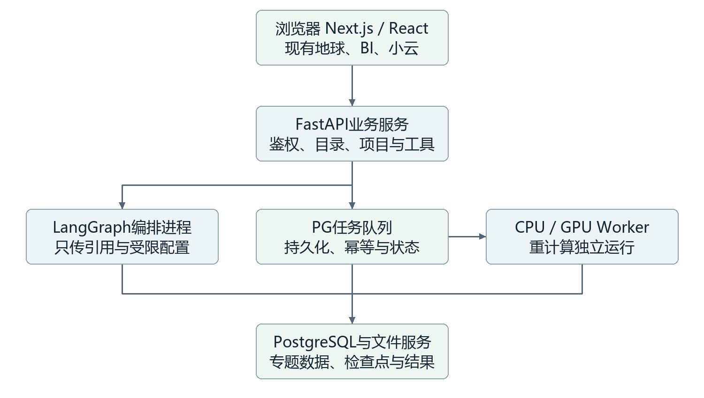

建议PG保持现有部署，新业务服务与Worker在隔离的Linux／WSL2环境部署。第一阶段可采用Procrastinate利用PG管理任务，降低新增组件数量；需要更复杂任务路由后再比较Celery＋Redis。任务状态与LangGraph检查点使用独立逻辑表，不能用数据库长事务等待GPU运行。

先验证WSL GPU驱动、PyTorch、磁盘路径和网络，再固定TimesFM等具体版本及依赖。GPU按单任务执行、其他请求排队规划；CPU并发、内存、磁盘与最长运行时间由实测和课题共享配额确定。模型权重、原始数据与产物优先使用容量较充足的D盘；队列服务本身不代表拥有GPU配额。

运行记录包括trace_id、项目修订、工具版本、耗时、错误和资源峰值；前端通过状态接口或SSE订阅任务变化。失败保留原因，重试受次数及幂等约束；源代码基线与数据库备份分别维护，并进行恢复演练。外部语音、语言模型和联网检索只接收完成任务必要的内容，不默认发送整库或原始大数组。

## 十一 实施路径与验证方法 基础模块

实施按可检查的产物推进，不以界面数量或Agent数量判断完成度。每阶段先用固定输入验证责任模块，再连到真实数据；前一阶段未通过的输入条件，不能由后一阶段靠提示词补救。以下是实施计划，本轮尚未执行部署。

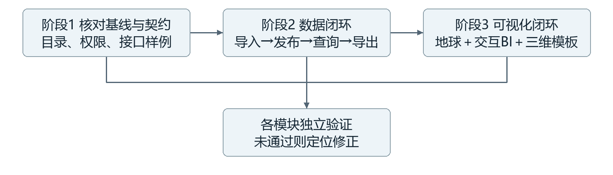

阶段1 建立可回退基线。核查现有源码基线、数据库备份及恢复路径；整理权威数据目录，修正目录与实表不一致的状态；确定数据版本、指标口径、用户权限和接口契约。同步盘点一张GPU的可用条件，提供各模块的固定输入与期望输出。目标是开发者能明确“数据是什么、接口收什么、失败怎么报”，而不是立即拆出大量微服务。

阶段2 打通数据闭环。为GFS、NBS、GRACED Power和本次Atlas文件编写管理员接入适配；创建暂存、审核、发布和受控查询过程；实现气象定时检查及其他数据手动更新。先验证一个批次从原始文件到查询结果，再覆盖失败批次、重复导入和导出。验收要求单位、时间、版本可追溯，失败不影响旧版，查询不全量加载，NULL不被悄悄改成零。经济金额口径未核定前只进入暂存及检查状态。

阶段3 打通可视化闭环。保留现有地球外观，增加固定数据开屏、底部专题入口和项目共享筛选；接入一个ECharts交互模板与一种Three.js数据表达；在静态配置可用后连接可视化Agent及MCP。验证地球与BI筛选一致、对比项目互不影响、点击事件正常回传、旧项目可恢复；测量资源下载量、首屏耗时和多视图显存开销后确定性能阈值。

## 十一 实施路径与验证方法 智能协作


阶段4 打通算法闭环。先使用固定小样本运行SQL统计、scikit-learn聚类与季节基线，再加载一版TimesFM进行历史回测；封装MCP提交、状态、取消与结果工具，验证任务队列和ResultRef回写。目标是同一数据可由管理员批准的方法处理，并在BI显示结果。验收分别记录“流程运行成功”和“模型效果达到实验要求”，保留不如基线的真实结果；测试重复请求、失败恢复、取消及GPU排队。

阶段5 接入知识与小云。建立小规模已审核资料集，完成解析、片段索引、混合检索与引用回看；再开放限定来源的联网补充。小云复用现有语音接口，把用户目标交给总管并展示子Agent状态。验收问题集包含可回答、证据不足、来源冲突、数值查库和越权场景；每条引用可回到原文，联网内容不自动升级为审核知识，含糊页面替换请求能够暂停等待用户选择。

阶段6 课题组试运行。使用多个用户的私有项目，贯通“打开旧项目→筛选→绘图→运行分析→知识解释→保存→下次恢复”。检查项目所有权、并排状态隔离、更新提示、旧版保留、临时缓存清理、长任务完成后的界面行为和故障恢复。记录端到端耗时、工具调用费用与资源峰值，形成部署说明、已启用能力目录和未通过事项清单。

|验收维度|首阶段应达到的结果|
|---|---|
|数据与可视化|一个真实专题完成查询、筛选、交互绘图和数据下载；来源与单位清楚|
|分析与问答|至少一种聚类、一个基线和一个通用预测模型可调用；知识回答可核验|
|协同与恢复|小云发起完整任务；各模块可独立运行；项目重开保持原版本|
|后续边界|中国风场预测、设备场景、持续滚动预测和新增模型按插件扩展，不阻塞首阶段|

## 资料来源与修订依据

网络技术资料核验日期为2026年9月27日。下列来源用于确认库、协议、模型及接口的公开能力；具体节点、接口对象、配额与验收流程是本项目拟定设计，不代表已经实施。

[1] [Harvard Growth Lab Atlas 官方API文档](https://github.com/harvard-growth-lab/api-docs/blob/main/atlas.md)

[2] [PostgreSQL 查询文档](https://www.postgresql.org/docs/current/queries.html)

[3] [Google MCP Toolbox for Databases](https://github.com/googleapis/mcp-toolbox)

[4] [hustcc MCP ECharts](https://github.com/hustcc/mcp-echarts)

[5] [Apache ECharts MCP](https://github.com/apache/echarts-mcp)

[6] [VisActor VChart MCP Server](https://github.com/VisActor/vchart-mcp-server)

[7] [AntV MCP Server Chart](https://github.com/antvis/mcp-server-chart)

[8] [Three.js Points 文档](https://threejs.org/docs/pages/Points.html)

[9] [Plotly.js 三维曲面文档](https://plotly.com/javascript/3d-surface-plots/)

[10] [scikit-learn 聚类文档](https://scikit-learn.org/stable/modules/clustering.html)

[11] [Nixtla StatsForecast](https://github.com/Nixtla/statsforecast)

[12] [Google Research TimesFM及权重许可说明](https://github.com/google-research/timesfm)

[13] [Amazon Science Chronos](https://github.com/amazon-science/chronos-forecasting)

[14] [LangGraph Graph API与状态图](https://docs.langchain.com/oss/python/langgraph/graph-api)

[15] [pgvector](https://github.com/pgvector/pgvector)

[16] [BGE-M3 模型卡](https://huggingface.co/BAAI/bge-m3)

[17] [Tavily 费用说明](https://docs.tavily.com/documentation/api-credits)

[18] [Tavily 官方MCP仓库](https://github.com/tavily-ai/tavily-mcp)

[19] [MCP 官方Python SDK](https://github.com/modelcontextprotocol/python-sdk)

[20] [Procrastinate 任务队列文档](https://procrastinate.readthedocs.io/en/stable/)

本地依据：docs/project-management/DATA_REFACTOR_ALLOCATION_2026-09-26.md；本次下载outputs/20260927-atlas-economic-data/manifest.json及validation.json。首页概念图由内置图像生成工具基于本站carbon-earth-latest.png与earth/preview.png生成，仅作为界面讨论材料。旧版V0.4保留，本版拆分交互与知识章节并展开原有模块内部流程。
