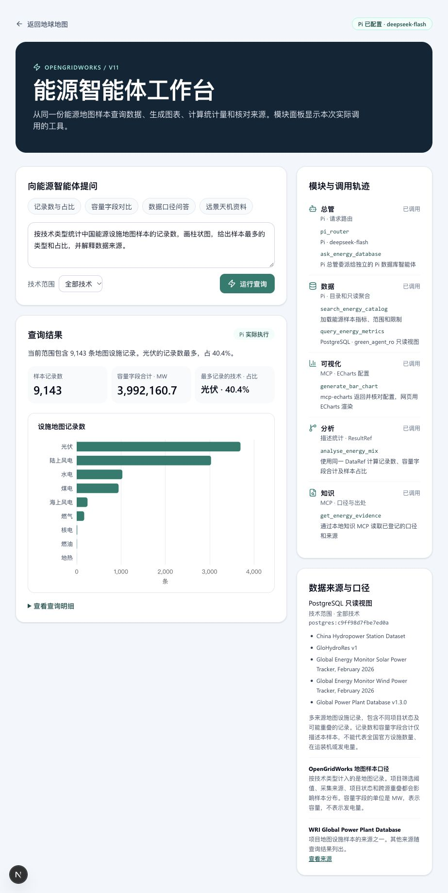

# V11 能源智能体工作台进度

演示入口为 `/energy`。现有地球地图左侧主导航也有入口。

## 已经跑通的链路

```text
能源工作台 → Pi 总管 → Pi 数据库智能体 → PostgreSQL 只读聚合视图 → DataRef
                     ├→ mcp-echarts → VisualizationSpec → 浏览器 ECharts
                     ├→ 描述统计 → ResultRef
                     └→ 知识 MCP → EvidenceRef
```

| V11 模块 | 当前实现 |
| --- | --- |
| 总管与交互 | Pi 处理能源问题，调用独立数据智能体及其他工具。页面显示实际调用轨迹。 |
| 数据 | 复用 Greensystem 的 Pi 工具预算、目录先行和只读事务做法。查询 `derived.energy_asset_summary`，按技术统计中国地图样本。 |
| 可视化 | 本地 `mcp-echarts` 经 stdio 返回柱状图配置，程序核对数据，浏览器用 Apache ECharts 绘图。 |
| 分析 | 计算样本记录数、容量字段合计和最大记录类别占比，结果关联同一数据指纹。 |
| 知识 | 本地 MCP 提供样本口径与出处，也可查询远景天机和 ECMWF Arcana 的公开入口。 |

实测示例“按技术类型统计中国能源设施地图样本的记录数，画柱状图，给出样本最多的类型和占比，并解释数据来源。”Pi 实际完成了委派、查询、图表、分析和知识调用。只读视图返回 9 类、9,143 条记录，其中光伏记录占 40.4%。这是地图样本统计，覆盖和去重口径见页面数据说明。



## 本地复现

1. 安装依赖后运行 `npm run dev -- --hostname 127.0.0.1`，打开 `/energy`。固定工具模式会使用仓库中的实际地图快照。
2. 在本地环境配置 `ENERGY_PI_ENABLED=true` 和 `DEEPSEEK_API_KEY` 后重启服务，模型默认 `deepseek-flash`。正式生产构建保持固定工具模式，Pi 模型仅在本地开发模式启用。
3. 使用 `zyz` 应用数据库账号执行 `scripts/v11-energy-agent-view.sql`，然后配置 `ENERGY_DATABASE_URL`。查询会在 `green_agent_ro` 角色和只读事务下执行。页面会标明 PostgreSQL 或仓库快照来源。

## 远景天机接入位置

天机是远景的气象基座模型。现阶段知识工具提供 [远景产品说明](https://www.envisioncn.com/future-energy-system) 和 [ECMWF Arcana 竞赛数据目录](https://data.ecmwf.int/ai-weatherquest/by_fc_date/20260702/Arcana/)。分析模块可以从竞赛公开数据选一份 NetCDF，对指定区域展示第 19–25 天温度或降水异常概率，并记录模型、起报时间、预报窗口和分辨率。供应商业务接口和实际数据处理属于后续接入。

当前范围为能源数据查询与描述统计。开放式 Text-to-SQL、完整语义目录、治理工单、预测运行及项目持久化属于后续阶段。
