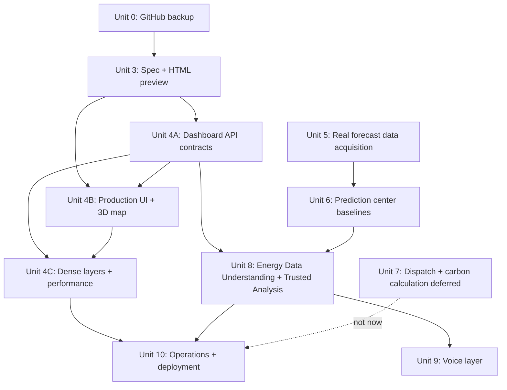
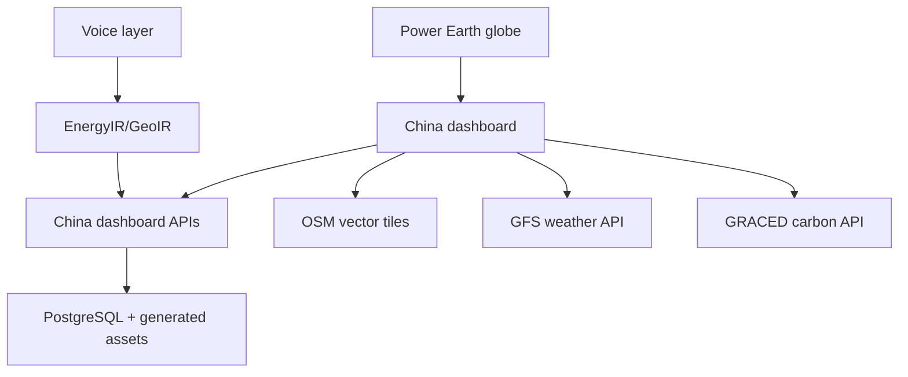

# feat: China Dashboard Delivery Roadmap

## Overview

This plan turns the user's Step 3 through Step 10 request into a sequenced delivery roadmap for the power-earth project, with Step 7 explicitly deferred. The first executable work after this plan is not production UI code. It is the GitHub safety baseline, followed by the China dashboard formal specification and a standalone HTML preview for visual approval.

The roadmap keeps two boundaries intact:

- The China dashboard must use the data that the current power-earth project actually has: national official statistics, mapped energy assets, OSM power infrastructure, PV footprint source material, current GFS forecast layers, GRACED Power, climate/VRE scenario outputs, and dataset quality metadata.
- Missing data must remain visible as missing. Real 15-minute wind/solar output, historical NWP archives, provincial hourly load, dispatch parameters, storage operation, and true real-time carbon intensity cannot be fabricated from model scenarios or annual statistics.

## Problem Frame

The user wants a rich expanded China power dashboard, not a larger version of the globe. The expanded screen should feel like a dedicated national power command screen: a central Three.js China map, left-side analytical context, right-side ultra-short-term prediction workflow visualization, synchronized playback, softened panel boundaries, and visual style compatible with the existing power-earth homepage.

The project already has a strong data-governance position in `docs/project-management/CHINA_DASHBOARD_MVP.md`: first display what is real, label each source and limitation, and disable predictive claims until the necessary observed power labels and historical NWP inputs exist. The plan below preserves that standard while making the dashboard visually richer.

## Requirements Trace

- R1. Back up the current GitHub version before formal code changes.
- R2. Split the large effort into separate major steps, and after each major step, continue the next one in a new Codex task to avoid excessive context.
- R3. Upgrade the China dashboard prototype into formal page specifications before production implementation.
- R4. Build a standalone HTML preview of the expanded China dashboard before integrating it into the app.
- R5. Make the expanded China dashboard richer than a globe zoom: central 3D China map, left analytics, right prediction workflow, charts, data quality, and synchronized playback.
- R6. Reuse the visual direction of the external `coastal-grid-dashboard` China 3D map, but remove coastal-only data, coastal city hubs, and coastal narrative.
- R7. Match the current power-earth homepage style: dark operational surface, cyan/amber electrical accents, restrained borders, compact labels, and no heavy nested card layout.
- R8. First production MVP includes only real national overview, China facility map, OSM grid/substations, PV footprint, province asset filtering, GFS and GRACED real layers, source/quality panel, and unavailable-data notices.
- R9. Million-scale OSM power infrastructure must be rendered through vector tiles or similarly bounded layer loading.
- R10. Prediction remains disabled until real observed wind/solar power labels, historical NWP with issue and valid times, installed/available capacity, outage, curtailment, and quality flags exist.
- R11. Prediction center starts with persistence, previous-day same-time, and LightGBM-style baselines before advanced GADF/CNN/dynamic matching/online Seq2Seq.
- R12. Every enabled model must show training window, model version, P10/P50/P90, generation time, horizon, and historical error.
- R13. Step 7 cross-region dispatch and carbon calculation remains deferred.
- R14. The energy analysis agent must understand the approved data catalog, restrict AI to structured EnergyIR/GeoIR plans, validate schema and grounding, route to deterministic read-only tools, return source-aware results, reuse reviewed analysis recipes, and refuse or clarify unsupported questions.
- R15. Voice is a later input/output layer only, after text AI query behavior is stable.
- R16. Operations must cover data updates, backups, restore drills, alerts, permissions, logs, browser tests, performance tests, Git hygiene, and deployment.
- R17. Do not spawn subagents unless the user explicitly approves it in the active task.

## Scope Boundaries

- This plan does not implement code. It defines the delivery sequence and acceptance criteria.
- The first China dashboard production integration waits for approval of the standalone HTML preview.
- The preview may contain animated UI choreography, but it must not present fake business values as real forecasts.
- Climate/VRE scenario data may be shown as long-term model scenario context, not as actual generated power or forecast labels.
- OSM grid geometry may show mapped infrastructure, voltage, and geometry. It cannot be used as real dispatch topology, transmission capacity, losses, or real-time flow.
- National official statistics and map asset sample totals must stay visually and semantically separate.
- Subagent configuration work for Sol/Terra/Luna is administrative and remains paused outside this roadmap.

### Deferred to Separate Tasks

- Step 7 cross-region dispatch and carbon calculation: deferred until provincial load, NTC channel capacity, losses, costs, storage parameters, emissions factors, and data quality contracts exist.
- Full advanced wind prediction paper route: deferred until real 15-minute power labels and historical NWP archives are available.
- Full-duplex voice: deferred until EnergyIR/GeoIR text workflows are stable.
- Production deployment: deferred until the China dashboard MVP has passed data, browser, and performance checks.

## Current Data-Informed Dashboard Content

The expanded China dashboard should be designed around the power-earth data that exists now.

| Dashboard area | What it should show now | Data source and identity | No-data behavior |
|---|---|---|---|
| National overview | National official capacity/generation/investment KPIs, separated from mapped sample totals | Official statistics and validation JSON described by `docs/project-management/WEBSITE_DATA_SOURCE_INVENTORY.md`; `official_stat` | Show "official statistic unavailable" with source gap, never derive from facility sample |
| Asset structure | Facility count and mapped capacity by technology and source | `website_data.energy_assets`, `src/lib/map-data.ts`; public facility datasets | Missing capacity fields show "unknown"; totals labeled "mapped sample" |
| OSM grid | Transmission, substations, plants, generators, voltage classes, map coverage | `website_data.geo_features`, `website_data.vector_tiles`, `public/data/osm-power/`; `crowdsourced map` | Layer disabled or degraded with explanation if tile catalog missing |
| PV footprint | CPVPD-2024 and ChinaPV 2015/2020 footprint coverage and year comparison | PV footprint summary/source archives; `research_estimate`/remote sensing | If polygons are not structured, show summary and "fine polygons pending" |
| Province focus | Selected province asset sample, source mix, layer filters, selected facility details | Province codes from assets and Natural Earth boundaries | Empty province shows "no mapped sample under current filters" |
| GFS inputs | Current forecast issue time, valid time, 100m wind and solar radiation status | `/api/weather-earth`; `forecast` | Show real unavailable state and stale/cache status |
| GRACED Power | Latest available Power-sector emissions frame status and daily research estimate context | `/api/carbon-earth`; `research_estimate` | Show missing frame/status; do not call it monitoring |
| VRE scenario context | 2021-2060 wind/solar capacity-factor scenario trends | `/api/data/climate-vre`; `model_scenario` | Label as scenario only; not actual output or short-term prediction |
| Prediction chain | Data-readiness workflow and locked model state | Gap list in `docs/project-management/DATA_GAP_DOWNLOAD_PLAN_2026-09-08.md` | Prediction button remains disabled with missing input list |
| Source quality | Source, time range, unit, update time, data identity, known limitation | `website_data.dataset_catalog` and project docs | Unknown values shown as "unverified" |

## Context & Research

### Relevant Code and Patterns

- `src/app/page.tsx` currently renders the main power-earth application shell.
- `src/components/opengridworks/MapAppShell.tsx` owns the current MapLibre globe/workbench, project modes, layer toggles, GFS and GRACED integration, selected-feature behavior, and source panel behavior.
- `src/app/globals.css` defines the existing power-earth visual system: dark surfaces, cyan electrical highlights, compact operational panels, map controls, source panel, and responsive floating panels.
- `src/lib/map-data.ts` defines region targets, technology metadata, voltage classes, source layers, map themes, facility data entry points, and region statistics helpers.
- `src/app/api/data/map-assets/route.ts` reads real energy assets and data centers from PostgreSQL.
- `src/app/api/data/climate-vre/route.ts` serves climate/VRE manifest, summary, and hourly scenario data.
- `src/app/api/weather-earth/route.ts` serves real GFS cache/status and returns unavailable state when real data is missing.
- `src/app/api/carbon-earth/route.ts` serves GRACED manifests and frames from PostgreSQL.
- `scripts/validate-china-data.mjs` is the existing data validation entry point for China data.
- External reference repository `coastal-grid-dashboard`: `src/components/ChinaMap3D.tsx`, `src/components/Dashboard.tsx`, `src/app/globals.css`, `public/data/china-full.json`, `public/data/china-terrain.jpg`, `public/data/china-terrain-normal.jpg`, and `public/data/china-relief.jpg` provide the 3D China map style and terrain assets to adapt.

### Institutional Learnings

- `docs/project-management/WORK_PROTOCOL.md` requires reading the project dashboard, discussion log, and relevant files before tasks; final decisions belong in project docs, and real progress requires evidence.
- `PROJECT_DASHBOARD.md` states that formal product code changes must start from a Git safety baseline because the worktree is heavily dirty.
- `docs/project-management/EARTH_PROJECT_DATA_INVENTORY_2026-09-08.md` classifies data identities: observed, official statistic, forecast, research estimate, and model scenario. The dashboard must expose these identities.
- `docs/project-management/DATA_GAP_DOWNLOAD_PLAN_2026-09-08.md` confirms that real 15-minute power labels, historical NWP, provincial hourly load, dispatch, storage, and emissions-factor data are missing or incomplete.
- `docs/project-management/PAPER_REPRODUCTION_ASSESSMENT.md` records that the ultra-short-term wind paper has no confirmed public code/data; only project-level reproduction is appropriate.

### External References

- The plan uses local project records of public sources already documented in `docs/project-management/WEBSITE_DATA_SOURCE_INVENTORY.md`.
- No new web research is required for this roadmap because the immediate work is governed by existing project documents and local code.

## Key Technical Decisions

- Treat Git backup as Unit 0, before any UI or data implementation. The current dirty worktree includes product files, scripts, docs, logs, PID files, and generated outputs, so the backup must classify files instead of blindly committing everything.
- Use one new Codex task per major unit after the previous unit is complete. The task prompt must include objective, scope, non-goals, source docs, evidence from the previous unit, blockers, and acceptance criteria.
- Do not use subagents inside these tasks unless the user explicitly approves it at that time.
- Step 3 produces both a formal specification and a standalone HTML preview. Production Next.js integration waits for the user's visual approval.
- The preview layout uses a full-bleed central 3D China map and unframed/banded side analysis regions. Cards are limited to repeated data items or true controls.
- Migrate the 3D China map style and assets from the external coastal reference, but strip coastal filters, coastal hub labels, weather-only vocabulary, and coastal-only metrics.
- Use existing power-earth colors and behavior as the dominant style. The coastal project contributes 3D map technique, not a new brand theme.
- In the prediction column, show a synchronized data-to-model pipeline and readiness state. Do not show a fake forecast curve unless it is explicitly labeled as UI placeholder in preview notes.
- In production, OSM grid/substation rendering must use the existing vector-tile path for dense geometry. GeoJSON may remain only for coarse previews, selected features, or bounded samples.
- Step 8 AI must generate IR only. Query execution stays deterministic and read-only.

## Open Questions

### Resolved During Planning

- Which big step runs next: Unit 3 China dashboard formal specification and standalone HTML preview, because Unit 0 GitHub safety backup is complete.
- Whether Step 7 is included now: no, it is explicitly deferred.
- Whether China dashboard implementation starts immediately: no, first create a standalone HTML preview for approval.
- Whether prediction can be enabled now: no, required observed power labels and historical NWP are missing.
- Whether old subagents should be used: no, they are not used by this roadmap.

### Deferred to Implementation

- Final production route name: default to `src/app/china/page.tsx` unless current navigation patterns suggest a better route during implementation.
- Exact official-stat fields in the first dashboard top strip: finalize in `docs/project-management/CHINA_DASHBOARD_SPEC.md` based on the validated local JSON/DB source available during Unit 2.
- Whether to add Three.js dependencies to the main app: decide only after the standalone preview is approved.
- Exact chart library for production: prefer lightweight SVG/CSS if sufficient; evaluate Recharts or existing local patterns only when implementation starts.
- Browser/performance budgets: Unit 2 proposes final PC targets, then Unit 4 verifies them against the real implementation.
- External data acquisition: user-provided credentials, licenses, or files may be needed for ERA5/CDS, real power labels, provincial load, and non-public power-system data.

## Output Structure

The likely new or updated files across this roadmap are:

```text
docs/plans/
  2026-09-09-001-feat-china-dashboard-delivery-roadmap-plan.md
docs/project-management/
  GIT_BASELINE_AUDIT_2026-09-09.md
  CHINA_DASHBOARD_SPEC.md
  CHINA_DASHBOARD_PREVIEW_REVIEW.md
  FORECAST_DATA_ACQUISITION_PLAN.md
  ENERGY_IR_GEO_IR_SPEC.md
docs/design-references/china-dashboard/
  china-dashboard-preview.html
  preview-data-sources.md
  preview-visual-checklist.md
docs/pr-evidence/
  china-dashboard-preview-desktop.png
  china-dashboard-preview-wide.png
src/app/china/
  page.tsx
src/app/api/china-dashboard/
  overview/route.ts
  layers/route.ts
  quality/route.ts
src/components/china-dashboard/
  ChinaDashboardShell.tsx
  ChinaMapScene.tsx
  LeftAnalysisRail.tsx
  PredictionWorkflowRail.tsx
  DataQualityPanel.tsx
src/lib/china-dashboard.ts
src/lib/china-dashboard.test.ts
src/lib/energy-ir/
  schema.ts
  grounding.ts
  compiler.ts
  fixtures.zh.json
  schema.test.ts
  compiler.test.ts
scripts/
  validate-china-dashboard.mjs
```

This structure is directional. Implementation may adjust names if the existing app patterns make a different layout simpler.

## High-Level Technical Design

> This illustrates the intended approach and is directional guidance for review, not implementation specification. The implementing agent should treat it as context, not code to reproduce.



The China dashboard interaction model is:

```text
Power Earth globe
  -> click China / choose China
  -> preserve globe state
  -> open China dashboard
  -> central 3D China map controls province and layer focus
  -> left rail updates analytical charts for selected scope
  -> right rail updates prediction-readiness workflow for selected scope
  -> source panel lists data identity, source, time range, unit, and limitation
  -> return restores the previous power-earth globe state
```

## Implementation Units

- [x] **Unit 0: GitHub Safety Baseline**

**Goal:** Back up the current repository state to GitHub before formal product changes.

**Requirements:** R1, R2, R17

**Dependencies:** None

**Files:**
- Create: `docs/project-management/GIT_BASELINE_AUDIT_2026-09-09.md`
- Modify: `.gitignore`
- Modify: `PROJECT_DASHBOARD.md`
- Modify: `docs/project-management/DISCUSSION_LOG.md`
- Test expectation: none -- this is operational repository hygiene, not product behavior

**Approach:**
- Audit the dirty worktree into code, docs, data scripts, generated outputs, logs/PID files, environment-sensitive files, and large artifacts.
- Keep user work intact. Do not delete files and do not run forbidden recursive delete operations.
- Scan environment-like files and connection files before staging.
- Exclude ephemeral PID/log/progress artifacts from Git unless they are intentionally documented evidence.
- Produce a backup commit and push it to the appropriate remote branch without overwriting remote history.
- Record the exact backed-up scope and exclusions in project docs.

**Patterns to follow:**
- `docs/project-management/WORK_PROTOCOL.md`
- `PROJECT_DASHBOARD.md`
- Existing Git branch prefix convention `codex/`

**Test scenarios:**
- Test expectation: none -- verify by Git status, commit identity, remote branch state, and audit document evidence.

**Verification:**
- A GitHub branch contains the backup commit.
- The audit document explains what was included and excluded.
- Sensitive files and transient process files are not accidentally committed.
- The working state after backup is understandable to the next task.

- [x] **Unit 3: China Dashboard Formal Spec and HTML Preview**

**Goal:** Convert the China dashboard MVP into a formal page specification and a standalone HTML preview that the user can inspect before production implementation.

**Requirements:** R2, R3, R4, R5, R6, R7, R8, R10, R17

**Dependencies:** Unit 0

**Files:**
- Create: `docs/project-management/CHINA_DASHBOARD_SPEC.md`
- Create: `docs/project-management/CHINA_DASHBOARD_PREVIEW_REVIEW.md`
- Create: `docs/design-references/china-dashboard/china-dashboard-preview.html`
- Create: `docs/design-references/china-dashboard/preview-data-sources.md`
- Create: `docs/design-references/china-dashboard/preview-visual-checklist.md`
- Create: `docs/pr-evidence/china-dashboard-preview-desktop.png`
- Create: `docs/pr-evidence/china-dashboard-preview-wide.png`
- Test expectation: none -- standalone visual prototype; verify by screenshot and source mapping

**Approach:**
- Define all enabled cards, disabled modules, map layers, data provenance, empty states, click behavior, province behavior, facility behavior, timeline/playback behavior, PC resolution targets, and performance targets.
- Produce a static preview bundle that opens through a lightweight local HTTP server and shows the final intended composition without requiring the Next.js app server.
- Center area: 3D China map style inspired by the external coastal reference, reworded and recolored for national power assets.
- Left rail: real-data analytics, including national official-stat strip, mapped asset mix, source coverage, VRE scenario trend context, and province focus summaries.
- Right rail: six synchronized animated workstations for GFS input, historical NWP, real-power labels, operating constraints, baseline/LightGBM, and P10/P50/P90 plus backtesting. Each workstation shows workers, machine activity, and a truthful visual artifact; unavailable stages produce waiting/lock artifacts rather than model values.
- Bottom/source area: data identity, source, time range, unit, current limitations, and explicit unavailable states.
- Mark every preview value as one of real source, derived from current inventory, or visual placeholder. Business placeholders must not be visually indistinguishable from real data.

**Visual thesis:** A national power command surface: dark power-earth base, precise cyan grid energy, amber reliability/data-quality accents, central terrain-lit China map, softened boundaries, dense but readable analysis.

**Interaction plan:** Synchronized playback should move a timeline cursor, pulse the active province/layer, update the left trend marker, and advance the right prediction workstation. Province selection updates map focus, left analytics, and workstation state together.

**Patterns to follow:**
- `src/app/globals.css` for power-earth colors, panel density, controls, and focus states.
- External reference repository `coastal-grid-dashboard`: `src/components/ChinaMap3D.tsx` for 3D map feel and controls.
- `docs/project-management/CHINA_DASHBOARD_MVP.md` for allowed and deferred module scope.

**Test scenarios:**
- Happy path: open the HTML preview at desktop size, press play, and see map, trend marker, and prediction stages advance together.
- Happy path: choose a province and see the map highlight, left analysis, and right source/readiness context update.
- Edge case: select a layer with unavailable data and see a clear unavailable message instead of blank space or fake output.
- Edge case: narrow PC viewport still preserves the central map and readable side rails without overlapping text.
- Error path: mark GFS or GRACED unavailable in preview state and verify the UI displays source-aware unavailable messaging.

**Verification:**
- The user can open the HTML file locally and review the expanded visual direction.
- Screenshots show the dashboard at standard desktop and wide desktop sizes.
- The spec lists every card, map layer, data source, no-data state, and click behavior.
- No production code is changed in this unit.

**Actual status (2026-09-09):** Complete and user-approved. Formal spec, static HTML bundle, source mapping, visual checklist, review record, and 1440×900 / 1920×1080 screenshots are present. The central map loads the user-specified `coastal-grid-dashboard` province/terrain assets; the right rail uses six animated worker stations and no longer contains separate national-gap or source-quality blocks. Browser checks passed for 34 province paths, 12 worker figures, workstation playback, unavailable-layer messaging, narrow-width warning, and zero console errors. The user approved continuing into production implementation.

**Evidence:** `docs/project-management/CHINA_DASHBOARD_SPEC.md`; `docs/project-management/CHINA_DASHBOARD_PREVIEW_REVIEW.md`; `docs/design-references/china-dashboard/china-dashboard-preview.html`; `docs/design-references/china-dashboard/preview-data-sources.md`; `docs/design-references/china-dashboard/preview-visual-checklist.md`; `docs/pr-evidence/china-dashboard-preview-desktop.png`; `docs/pr-evidence/china-dashboard-preview-wide.png`.

- [x] **Unit 4A: China Dashboard Data Contracts and APIs**

**Goal:** Add production data contracts and read-only endpoints for the China dashboard MVP.

**Requirements:** R8, R9, R10, R17

**Dependencies:** Unit 3 user approval

**Files:**
- Create: `src/lib/china-dashboard.ts`
- Create: `src/lib/china-dashboard.test.ts`
- Create: `src/app/api/china-dashboard/overview/route.ts`
- Create: `src/app/api/china-dashboard/layers/route.ts`
- Create: `src/app/api/china-dashboard/quality/route.ts`
- Modify: `scripts/validate-china-data.mjs`
- Create: `scripts/validate-china-dashboard.mjs`

**Approach:**
- Define a typed dashboard contract before wiring UI: overview KPIs, official-stat source fields, mapped asset summaries, layer health, province summaries, selected feature payloads, and unavailable-data reasons.
- Read from current PostgreSQL-backed APIs or local generated assets using existing patterns. Do not introduce write operations.
- Keep national official statistics separate from map sample totals in the response model.
- Add a source-quality block for each metric and layer: source, data identity, time range, unit, update time, and known limitation.
- Ensure missing downstream data returns explicit unavailable states.

**Execution note:** Start with contract tests for source identity, unavailable states, and official-vs-sample separation before filling endpoint details.

**Patterns to follow:**
- `src/app/api/data/map-assets/route.ts`
- `src/app/api/data/climate-vre/route.ts`
- `src/app/api/weather-earth/route.ts`
- `src/app/api/carbon-earth/route.ts`
- `src/lib/weather-earth.ts`
- `src/lib/carbon-earth.ts`
- `src/lib/climate-vre.ts`

**Test scenarios:**
- Happy path: overview endpoint returns official-stat KPIs and mapped-asset sample totals as separate objects.
- Happy path: layer endpoint reports OSM, PV footprint, GFS, GRACED Power, and VRE scenario layer availability with source metadata.
- Edge case: a province with no mapped facilities under current filters returns zero sample count and a warning, not an official zero.
- Error path: database unavailable returns a typed unavailable response or 503 consistent with existing API conventions.
- Integration: dashboard validation script checks each enabled MVP module has a source, unit, data identity, and no-data message.

**Verification:**
- API responses are deterministic, read-only, and traceable to documented sources.
- TypeScript types cover all enabled and unavailable dashboard states.
- Validation confirms no mock/demo/synthetic business data enters the dashboard contract.

**Actual status (2026-09-09):** Complete. Added typed official-statistic, mapped-sample, geometry, live-field, and interface-only identities; three read-only dashboard endpoints; contract-first Node tests; and dashboard/data validators. The overview endpoint prefers PostgreSQL and falls back to the same traceable generated snapshot when the configured database is unreachable. Five contract tests, TypeScript, validation, lint, and production build pass.

- [x] **Unit 4B: Production China Dashboard Shell and 3D Map**

**Goal:** Implement the approved dashboard as a production page with central 3D China map, left analysis rail, right prediction workflow rail, source panel, and return-to-globe behavior.

**Requirements:** R4, R5, R6, R7, R8, R10, R17

**Dependencies:** Unit 3 user approval, Unit 4A

**Files:**
- Create: `src/app/china/page.tsx`
- Create: `src/components/china-dashboard/ChinaDashboardShell.tsx`
- Create: `src/components/china-dashboard/ChinaMapScene.tsx`
- Create: `src/components/china-dashboard/LeftAnalysisRail.tsx`
- Create: `src/components/china-dashboard/PredictionWorkflowRail.tsx`
- Create: `src/components/china-dashboard/DataQualityPanel.tsx`
- Modify: `src/components/opengridworks/MapAppShell.tsx`
- Modify: `src/app/globals.css`
- Test: `src/lib/china-dashboard.test.ts`
- Test: `scripts/validate-china-dashboard.mjs`

**Approach:**
- Add a China dashboard route and a controlled entry from the power-earth China selection path.
- Preserve and restore the previous power-earth globe state when returning.
- Add Three.js dependencies only after preview approval and keep the 3D scene isolated from the existing MapLibre globe.
- Copy or adapt only allowed map assets from the external coastal reference: China boundary JSON and terrain/relief textures, subject to license and attribution review.
- Build the 3D map as the unframed visual center; side rails should look like transparent analysis instruments rather than nested card stacks.
- Show prediction as a workflow/readiness component first. It can visualize how data would flow, but the actual forecast output remains locked until Unit 6 and real data gates pass.

**Patterns to follow:**
- `src/components/opengridworks/MapAppShell.tsx` for region selection, source panel, toolbar behavior, and toast/status conventions.
- `src/app/globals.css` for power-earth styling.
- External reference repository `coastal-grid-dashboard`: `src/components/ChinaMap3D.tsx` for orthographic camera, province extrusion, South Sea inset, texture usage, and map controls.

**Test scenarios:**
- Happy path: entering China dashboard from power-earth opens the dashboard and returning restores prior globe state.
- Happy path: selecting a province updates map highlight, left analytics, right readiness state, and quality panel.
- Happy path: toggling MVP layers changes only allowed real layers and preserves source labels.
- Edge case: GFS unavailable renders a specific unavailable state while the rest of the dashboard remains usable.
- Edge case: GRACED unavailable renders a specific unavailable state and never hides the source-quality panel.
- Error path: map boundary JSON fails to load and the user sees a recoverable map error state.
- Integration: page uses the Unit 4A contracts without bypassing source metadata.

**Verification:**
- Browser screenshots show a nonblank, correctly framed 3D China map at standard desktop and wide desktop sizes.
- Interactive controls do not overlap and text remains readable.
- No fake prediction, dispatch, storage, or real-time provincial carbon claims appear in production UI.

**Actual status (2026-09-09):** Complete for the approved production shell. Added `/china`, a controlled power-earth toolbar entry, router-back behavior, full-height analysis rails, a CSS-perspective province map using the approved colored terrain/relief assets, province/layer controls, the six-stage pixel-worker factory with colorful per-stage SVG artifacts, synchronized playback, and the source ledger. Three.js was not added because the approved visual can be reproduced with a smaller isolated SVG/CSS scene; dense OSM rendering remains Unit 4C. Browser evidence at 1440×900 and 1920×1080 shows zero overflow, the 9,143-item traceable snapshot, and successful entry, Guangdong scope, and ledger interactions.

- [x] **Unit 4C: Dense Layers, Vector Tiles, and Performance**

**Goal:** Wire the production dashboard to dense OSM/PV/GFS/GRACED layers with bounded loading and measurable PC performance.

**Requirements:** R8, R9, R10, R17

**Dependencies:** Unit 4A, Unit 4B

**Files:**
- Modify: `src/app/api/data/vector-tiles/[...slug]/route.ts`
- Modify: `src/components/china-dashboard/ChinaMapScene.tsx`
- Create: `src/components/china-dashboard/LayerControlStrip.tsx`
- Create: `src/lib/china-layer-styles.ts`
- Modify: `scripts/validate-china-dashboard.mjs`
- Test: `src/lib/china-dashboard.test.ts`

**Approach:**
- Treat OSM transmission/substations/plants/generators as vector-tile layers for dense rendering.
- Keep PV footprint polygons bounded by zoom, year, and availability. If complete polygons are not structured, show only validated summaries and source status.
- GFS and GRACED overlays must use current API state and clearly label forecast/research-estimate identity.
- Use simplified geometry only when it preserves key infrastructure paths and the UI labels the simplification/coverage limits.
- Define PC performance targets in the spec and verify them against the production page.

**Patterns to follow:**
- Existing vector tile route and `public/data/osm-power/china-power-tilejson.json`.
- Existing MapLibre layer toggles and voltage class styling in `src/components/opengridworks/MapAppShell.tsx`.

**Test scenarios:**
- Happy path: enabling OSM grid uses vector tiles and does not load million-scale GeoJSON into the page at once.
- Happy path: voltage class filter changes visible OSM line classes without changing source metadata.
- Edge case: tile catalog missing returns unavailable layer state instead of a broken map.
- Edge case: low zoom shows generalized infrastructure and high zoom reveals detail without changing counted totals.
- Error path: a tile request failure is localized to that layer and does not break province analytics.

**Verification:**
- Dense layer rendering remains responsive on target PC desktop sizes.
- Network payloads and feature counts are bounded by zoom/layer selection.
- The data-quality panel reports vector-tile source, snapshot date, and simplification limits.

**Actual status (2026-09-09):** Complete for the available source-backed layers. The China page now renders the existing OSM transmission, substation, plant, and generator source layers through the bounded z3–5 vector-tile API, with feature toggles, voltage-class filters, overview/detail thresholds, and a visible high-load warning before z4–5. The local route serves real PBF files and returns cacheable 204 responses for intentionally absent sparse tiles so one missing tile cannot trigger the unavailable database fallback or break the terrain map. PV is reported as partial from its validated summary; GFS and GRACED remain visibly unavailable when their current manifests are absent; VRE is identified as a long-term model scenario rather than a live field. The quality ledger records the OSM snapshot date and topology limitations. The 53-tile inventory totals 224,201,077 bytes; z3 contains six tiles/1,604,193 bytes, while large z4–5 payloads are user-triggered only. A production build at 1920×1080 measured approximately 178 ms navigation and 120 ms first-contentful paint locally, and browser checks confirmed tile-ready state, reversible OSM visibility, and voltage filtering.

- [ ] **Unit 5: Real Forecast Training Data Acquisition**

**Goal:** Prepare and execute the real data acquisition path needed before any actual wind/solar prediction model can be enabled.

**Requirements:** R10, R11, R12, R17

**Dependencies:** Unit 0; can proceed in parallel with Unit 4 after the user has a preview direction

**Files:**
- Create: `docs/project-management/FORECAST_DATA_ACQUISITION_PLAN.md`
- Modify: `docs/project-management/DATA_GAP_DOWNLOAD_PLAN_2026-09-08.md`
- Modify: `docs/project-management/DISCUSSION_LOG.md`
- Create: `scripts/validate-forecast-training-data.mjs`
- Test expectation: none -- acquisition may depend on user-provided data and credentials; validation script defines the quality gate

**Approach:**
- Define the minimum viable training dataset: entity ID, observed power at 15-minute or hourly resolution, NWP issue time, NWP valid time, installed capacity, available capacity, outage flag, curtailment flag, timezone, and quality code.
- Prioritize real wind/solar output labels and historical NWP archives before advanced modeling.
- Separate data the assistant can fetch from data that requires user login, license acceptance, file upload, or legal authorization.
- Produce a validation gate that rejects climate scenario data as observed power labels.
- Keep the China dashboard prediction component disabled until validation passes.

**Patterns to follow:**
- `docs/project-management/EARTH_PROJECT_DATA_INVENTORY_2026-09-08.md`
- `docs/project-management/DATA_GAP_DOWNLOAD_PLAN_2026-09-08.md`
- `docs/project-management/PAPER_REPRODUCTION_ASSESSMENT.md`

**Test scenarios:**
- Happy path: a real training file with issue time, valid time, observed power, and capacity fields passes validation.
- Edge case: hourly data passes only for hourly baseline experiments and is not mislabeled as 15-minute ultra-short-term data.
- Error path: climate scenario capacity factor files are rejected as observed power labels.
- Error path: NWP rows without issue time are rejected because they risk future-data leakage.
- Error path: records with unknown timezone are rejected or quarantined.

**Verification:**
- The acquisition plan states exactly what the user may need to provide.
- The validation gate defines the minimum fields for unlocking prediction work.
- Dashboard and project docs still mark prediction as disabled until real data passes.

**Actual status (2026-09-11):** In progress with the formal observed-power source and historical NWP now imported. Hill of Towie v2 2025 was downloaded from Zenodo and verified at 1,596,220,683 bytes with official MD5 `d3cd7edb535a45ffca1c7028b397f035`; all 156 CSV entries passed ZIP CRC. The forecast subset was imported idempotently into four isolated `website_data.forecast_scada_*` tables on the connected PostgreSQL server, and the PowerRed/PowerRef source-evidence columns were backfilled with 500-row batches and monthly commits. Independent queries returned 21 turbines/48.3 MW, 52,561 unique farm observations, and 1,059,488 unique turbine signal rows from 2025-01-01 through 2026-01-01 UTC, with zero duplicate keys, zero fabricated curtailment labels, 37,299 source-reduced-power flags, and 66,219 non-null reduction-duration rows. Historical issue-time-preserving NWP returned 2,921 point rows and 6,605 hourly pairs, with no future leakage or valid-time mismatch. September coverage is materially lower and T02/T05/T08 fall below the 95% per-entity threshold; 2,155 hourly windows contain negative or invalid labels, leaving 75.4% pair coverage. PowerRed/PowerRef remain source reduction evidence rather than explicit grid-curtailment labels, so production forecasting remains locked.

- [ ] **Unit 6: Prediction Center Baselines**

**Goal:** Build the first prediction center around transparent baselines and evaluation, then leave advanced GADF/CNN/dynamic matching/online Seq2Seq behind data and quality gates.

**Requirements:** R10, R11, R12, R17

**Dependencies:** Unit 5 validated data; Unit 4A data contracts for dashboard display

**Files:**
- Create: `src/lib/prediction/contracts.ts`
- Create: `src/lib/prediction/baselines.ts`
- Create: `src/lib/prediction/evaluation.ts`
- Create: `src/lib/prediction/baselines.test.ts`
- Create: `src/lib/prediction/evaluation.test.ts`
- Create: `src/lib/prediction/real-data-backtest.ts`
- Create: `src/lib/prediction/real-data-backtest.test.ts`
- Create: `src/lib/prediction/real-data-backtest-loader.ts`
- Create: `src/app/api/prediction/status/route.ts`
- Create: `src/app/api/prediction/forecast/route.ts`
- Create: `src/app/api/prediction/backtest/route.ts`
- Create: `src/components/china-dashboard/PredictionResultPanel.tsx`
- Modify: `src/components/china-dashboard/PredictionWorkflowRail.tsx`
- Modify: `src/components/china-dashboard/ChinaDashboardShell.tsx`
- Modify: `docs/project-management/PAPER_REPRODUCTION_ASSESSMENT.md`

**Approach:**
- Implement persistence and previous-day same-time baselines first.
- Add LightGBM-style modeling only after a stable training/validation split and feature contract exist. If the production stack cannot host LightGBM directly, expose the same contract through a later model service rather than burying model logic in the UI.
- Use rolling time splits only. Do not randomize future time periods into training.
- Every result must include training range, model version, issue time, valid time, horizon, P10/P50/P90 when available, and historical error.
- Advanced dynamic matching and GADF/CNN/Seq2Seq remain research-phase modules until baselines prove stable improvement and data volume justifies them.

**Patterns to follow:**
- `docs/project-management/PAPER_REPRODUCTION_ASSESSMENT.md`
- Existing API unavailable-state behavior in `/api/weather-earth` and `/api/carbon-earth`

**Test scenarios:**
- Happy path: persistence baseline uses only past observed values and returns expected horizon values.
- Happy path: previous-day same-time baseline aligns timestamps by timezone and returns matching historical points.
- Edge case: missing observed history returns disabled/unavailable status, not a forecast.
- Error path: validation data that overlaps future test windows is rejected.
- Error path: model result without training range or version is rejected by the API contract.
- Integration: China dashboard prediction rail switches from locked workflow to real forecast only when status and forecast endpoints both pass required metadata checks.

**Verification:**
- Baselines produce auditable results on validated real data.
- Backtest metrics and prediction interval metadata are visible in the dashboard.
- Advanced models are documented but not enabled prematurely.

**Actual status (2026-09-11):** The first research prediction-center slice is implemented, but production remains locked. `src/lib/prediction/baselines.ts` now provides auditable persistence and previous-day-same-time baselines that reject missing history and horizon/interval mismatches; `src/lib/prediction/evaluation.ts` provides point MAE/RMSE/bias, strict baseline comparison, interval coverage/width, and research-row normalization. `PredictionResultPanel.tsx` renders the existing SDWPF evidence under the six-stage China workflow as colored model-vs-persistence error bars, rolling-fold status, and an explicit no-P10/P50/P90 notice. The local SDWPF pilot compares persistence, autoregressive ridge, and LightGBM with three expanding rolling-origin splits: D1–121/122–152/153–183, D1–152/153–183/184–214, and D1–183/184–214/215–245. LightGBM 4.7.0 wins the 10-minute comparison in only two of three folds (mean improvement +0.66%, worst fold -1.05%); 30 and 60 minutes win zero folds with mean improvements of -7.16% and -13.87%. The conservative gate requires every fold to beat persistence, so every LightGBM horizon is rejected and persistence remains the research baseline. `/api/prediction/status` now uses schema v2 and reads the same read-only PostgreSQL evidence as `/api/prediction/forecast`: SCADA, historical issue-time-preserving NWP, absolute site/time metadata, and capacity checks pass; temporal coverage, source quality, and authoritative curtailment-label gates fail. The response identifies Hill of Towie + NOAA GFS as `historical-backtest-only` / `verified-research-only`, exposes 6,605 pairs, 75.4% overall coverage, 85.83% best 90-day coverage, 2,155 invalid hourly windows, and the unresolved curtailment-label gap. China renders these facts in the workflow rail and country popup; other countries do not inherit China evidence. `/api/prediction/forecast` still returns HTTP 503 with null output and timestamps. No calibrated P10/P50/P90 or live forecast is exposed. The 18 prediction tests, 17 data validation tests, Python pair tests, lint, typecheck, and production build pass.

**Follow-up status (2026-09-11):** Unit 6 now also has a read-only real-data backtest path. `real-data-backtest-loader.ts` queries only `website_data.forecast_training_pairs`; `real-data-backtest.ts` accepts valid nonnegative historical pairs, rejects duplicate timestamps, refuses to impute missing history, and records coverage/quarantine/blocker evidence. The CHN route was verified against the connected PostgreSQL server: 6,605 raw and valid pair rows, zero rows with an authoritative curtailment label, persistence coverage 94.70% with MAE 3.5525 MW/RMSE 5.4123 MW, and previous-day-same-time coverage 81.36% with MAE 11.9476 MW/RMSE 15.9878 MW and -236.32% relative improvement. The latter does not beat persistence; both results remain `historical-backtest-only`. Non-CHN requests return unavailable rather than inheriting China evidence. The route is surfaced below the prediction-chain workstations, while `/api/prediction/forecast` remains HTTP 503 with null output and no P10/P50/P90. Prediction tests now pass 21/21, with typecheck and lint passing (one pre-existing warning remains); the production build is the remaining verification before commit.

- [x] **Unit 8: Energy Data Understanding and Trusted Analysis Agent**

**Goal:** Add a controlled energy analysis agent that understands the approved data catalog before answering questions, converts user intent into structured EnergyIR/GeoIR plans, routes requests to the correct read-only tool, validates results, and saves approved analyses as reusable versioned recipes. Text-to-SQL is only one constrained tool, not the product center.

**First slice:** Serve energy data analysts and project analysts with three question groups: mapped energy assets and sources; dataset time range, update time, and missingness; GFS/GRACED/VRE/OSM layer availability and coverage. Prediction, dispatch, and free SQL remain outside the first slice.

**Requirements:** R14, R17

**Dependencies:** Unit 4A stable read-only dashboard APIs and source/quality contracts; Unit 6 status is optional for prediction questions and must not block non-prediction queries

**Files:**
- Create: `docs/project-management/ENERGY_IR_GEO_IR_SPEC.md`
- Create: `docs/brainstorms/2026-09-10-energy-data-agent-requirements.md`
- Create: `src/lib/energy-ir/schema.ts`
- Create: `src/lib/energy-ir/grounding.ts`
- Create: `src/lib/energy-ir/semantic-catalog.ts`
- Create: `src/lib/energy-ir/router.ts`
- Create: `src/lib/energy-ir/compiler.ts`
- Create: `src/lib/energy-ir/recipes.ts`
- Create: `src/lib/energy-ir/validation.ts`
- Create: `src/lib/energy-ir/fixtures.zh.json`
- Create: `src/lib/energy-ir/schema.test.ts`
- Create: `src/lib/energy-ir/compiler.test.ts`
- Create: `src/app/api/energy-ir/query/route.ts`
- Create: `src/components/china-dashboard/AskEnergyPanel.tsx`

**Approach:**
- Build a semantic onboarding step from the database structure, current data catalog, field statistics, source metadata, and existing read-only APIs. AI may propose meanings and relations, but only reviewed or rule-confirmed definitions enter the versioned semantic catalog.
- Define 30-50 Chinese gold questions covering province, facility, technology, layer, source, time, forecast readiness, data quality, unavailable data, ambiguity, and refusal cases.
- LLM output is limited to JSON IR and an analysis plan. The app validates schema, grounds entities, checks availability/permission, routes to a metric API, spatial query, weather/carbon/VRE service, prediction service, or a constrained SQL candidate, then verifies result units and ranges.
- First release does not execute free AI-generated SQL. High-frequency questions use deterministic templates and read-only APIs; any later analyst-mode SQL must remain separately gated and audited.
- Return source, identity, time range, unit, freshness and limitation metadata with every result; let the LLM explain only validated facts.
- Save approved questions as versioned analysis recipes whose province, technology, time and chart parameters can be replaced without changing the business definition.
- Use current dashboard state as context: selected province, selected layer, time mode, and selected facility.

**Patterns to follow:**
- `docs/project-management/PAPER_REPRODUCTION_ASSESSMENT.md` GeoIR section.
- Existing typed API contracts from Unit 4A.

**Test scenarios:**
- Happy path: "广东有多少已映射光伏设施" grounds Guangdong and solar, compiles to an allowed read-only query, and returns source-labeled sample results.
- Happy path: "当前GFS数据是什么时间的" compiles to a weather status query and returns issue/valid time.
- Happy path: an analyst asks for an energy facility's source and mapped-asset identity and receives source-labeled fields.
- Happy path: an analyst asks for a dataset's time range, update time, and missingness and receives a quality response without treating an empty result as zero.
- Happy path: an analyst asks whether GFS, GRACED, VRE, or OSM is available for a selected province/layer and receives coverage and limitation metadata.
- Edge case: "全国风电真实15分钟预测是多少" returns unavailable or clarification until Unit 6 gates pass.
- Happy path: a reviewed analysis recipe runs for another province without changing metric definition, source identity, or chart semantics.
- Error path: an AI-proposed field meaning or table relation that has not been reviewed cannot enter the production semantic catalog.
- Error path: a generated IR with unknown metric is rejected by schema validation.
- Error path: a generated IR attempting write/delete/update is rejected before compilation.
- Error path: a vague time phrase that cannot be grounded asks for clarification.
- Integration: query result includes source identity and unit before the explanation layer runs.

**Verification:**
- Semantic catalog entries have source, unit, identity, version and review status.
- Gold question suite covers allowed, unavailable, ambiguous, refused and recipe-reuse cases.
- No free AI-generated SQL reaches the production database in the first release.
- Every displayed value and explanation can be traced back to a deterministic tool result and its source metadata.

**Actual status (2026-09-16):** The first EnergyDataAgent slice is implemented and live-provider acceptance is complete. `ResponsesEnergyPlanner` supports explicit OpenAI or DeepSeek selection and uses the Responses API with strict structured output to produce only a decision envelope and EnergyIR; `runEnergyDataAgent` re-validates and compiles that model output before invoking one deterministic read-only tool, then blocks display unless units and provenance pass result validation. DeepSeek is configured locally with `deepseek-flash`, the official `https://api.deepseek.com` base URL, non-thinking mode for bounded schema planning, and a Git-ignored key. Two real production-route calls returned HTTP 200: the model selected `mapped-assets`, the validated result resolved Guangdong solar to 188 mapped facilities, and the answer retained the mapped-sample/not-official-statistics limitation. Province suffixes such as “广东省” are normalized before deterministic boundary lookup. The production API does not use the deterministic Chinese parser as its agent: that parser remains only as a 40-question offline regression baseline. The `/china` overlay carries province/layer/time context and shows provider/model configuration, facts, provenance, limitations, IR, plan, and trace. Missing the selected provider key or explicit `ENERGY_AGENT_MODEL` still produces an honest disabled/503 state instead of a rules-based fallback. The 19 EnergyIR/agent tests, six voice tests, typecheck, lint, diff check, and production build pass. Earlier 1440×900 browser evidence remains at `output/playwright/china-dashboard-unit8-energy-ir-1440x900.png`.

- [x] **Unit 9: Full-Duplex Voice Layer**

**Goal:** Add voice as an optional input/output layer on top of the stable EnergyIR/GeoIR text workflow.

**Requirements:** R15, R17

**Dependencies:** Unit 8 stable text AI queries

**Files:**
- Create: `docs/project-management/VOICE_INTERACTION_SPEC.md`
- Create: `src/lib/voice/voice-state.ts`
- Create: `src/lib/voice/voice-state.test.ts`
- Create: `src/components/china-dashboard/VoiceControl.tsx`
- Modify: `src/components/china-dashboard/AskEnergyPanel.tsx`

**Approach:**
- Keep voice off by default.
- Voice only sends recognized text into the same EnergyIR/GeoIR path. It does not create separate business logic.
- Add explicit microphone state, mute state, interruption behavior, and privacy notes.
- Simple navigation commands may route directly to UI actions; data questions use the same controlled query path.

**Patterns to follow:**
- Voice and text decisions in `PROJECT_DASHBOARD.md`
- Controlled AI workflow from Unit 8

**Test scenarios:**
- Happy path: recognized command changes dashboard state through the same action path as text.
- Happy path: recognized question uses EnergyIR/GeoIR and returns the same answer as typed input.
- Edge case: microphone off means no capture and no recognition state.
- Error path: recognition failure shows recoverable unavailable state.
- Error path: interruption cancels the previous spoken response before starting the new one.

**Verification:**
- Voice feature cannot bypass EnergyIR/GeoIR.
- User can see and control whether audio capture and speech output are active.
- Existing text workflow remains usable with voice off.

**Actual status (2026-09-14):** The browser voice layer is implemented inside the existing trusted-query panel. Capture and speech output are independently controlled and both default off; recognized questions use the same abortable EnergyDataAgent request function as typed questions. Interim or final speech immediately cancels queued/current synthesis, final new questions replace any older in-flight request, and recognition remains active during speech when both controls are enabled. Reviewed province commands reuse the same dashboard scope callback; all other utterances preserve their text and enter EnergyIR. Unsupported browsers, denied permission, missing devices, no-speech, and recognition network failures expose recoverable states without affecting text queries. Six state-machine tests, typecheck, lint (one unrelated existing warning), and production build pass. Browser checks cover the honest unconfigured/disabled state, native permission-denied recovery, and an isolated no-microphone contract fixture that verifies listening, barge-in cancellation, Guangdong scope change, POST to `/api/energy-ir/query`, controlled speech output, and capture shutdown. Evidence is `output/playwright/china-dashboard-unit9-voice-default-1440x900.png` and `china-dashboard-unit9-voice-contract-1440x900.png`. No real microphone audio or provider credential was used, so live device/provider acceptance remains a deployment check.

- [ ] **Unit 10: Operations, Backups, QA, and Deployment**

**Goal:** Make the platform sustainable after feature delivery through scheduled updates, alerts, backups, audit logs, performance checks, browser tests, Git cleanup, and deployment.

**Requirements:** R16, R17

**Dependencies:** Unit 4C for dashboard MVP operations; Unit 8 for AI audit operations; Unit 9 if voice ships

**Files:**
- Create: `docs/project-management/OPERATIONS_RUNBOOK.md`
- Create: `docs/project-management/BACKUP_RESTORE_DRILL.md`
- Modify: `PROJECT_DASHBOARD.md`
- Modify: `docs/project-management/DISCUSSION_LOG.md`
- Modify: `scripts/sync-live-weather.mjs`
- Modify: `scripts/verify-server-pg-backup.mjs`
- Create: `scripts/audit-production-readiness.mjs`
- Test: `scripts/validate-china-dashboard.mjs`

**Approach:**
- Schedule GFS and public data refreshes only for sources that are legally and technically available.
- Define data freshness and anomaly alerts for GFS, GRACED, dashboard API health, vector tiles, and prediction status.
- Complete current database backup and restore drills before production deployment.
- Audit permissions, secrets, logs, and AI query traces.
- Run browser checks for dashboard viewports and interaction states.
- Clean Git history and deployment artifacts only after product and data checks pass.

**Patterns to follow:**
- `docs/project-management/PG_TRANSFER_RUNBOOK.md`
- `docs/project-management/WORK_PROTOCOL.md`
- Existing scripts under `scripts/` for weather sync, backup verification, and data validation.

**Test scenarios:**
- Happy path: production-readiness audit reports each required data/API/browser/performance gate.
- Happy path: backup drill records a restorable database artifact and verification evidence.
- Edge case: stale GFS status triggers alert/unavailable UI, not silent fallback.
- Error path: missing required environment variable blocks deployment readiness and reports a precise missing item.
- Integration: post-deployment smoke check verifies China dashboard, weather status, carbon manifest, and vector-tile access.

**Verification:**
- Operations runbook states how to update, back up, restore, monitor, audit, and deploy.
- Production deployment only happens after readiness evidence exists.
- Project dashboard and discussion log reflect actual completed evidence, not just plans.

## System-Wide Impact

- **Interaction graph:** Power-earth global entry, China route, dashboard APIs, GFS API, GRACED API, climate/VRE API, vector-tile API, EnergyIR query API, and later voice controls become connected through shared dashboard state.
- **Error propagation:** Data-layer failures should become typed unavailable states in API responses and visible UI notices, not silent fallback data.
- **State lifecycle risks:** Leaving and returning from China dashboard must preserve power-earth globe state; playback state must pause or cleanly resume when scope changes.
- **API surface parity:** Source and quality metadata must appear in dashboard APIs and AI query answers, not only in UI labels.
- **Integration coverage:** Browser checks must cover entry from globe, province selection, layer toggles, unavailable states, source panel, and return.
- **Unchanged invariants:** Existing weather-earth and carbon-earth APIs should continue to expose real data or unavailable states. Existing power-earth globe must remain usable even if China dashboard assets fail to load.



## Risks & Dependencies

| Risk | Likelihood | Impact | Mitigation |
|---|---:|---:|---|
| Dirty worktree contains unrelated or sensitive files | High | High | Unit 0 file classification and sensitive-file review before GitHub backup |
| Git system config blocks Git commands | High | Medium | Use process-local Git config workaround or request user/admin fix only if needed |
| Preview accidentally implies fake forecast | Medium | High | Label preview placeholders and keep production forecast locked until data gates pass |
| 3D map dependency increases bundle size | Medium | Medium | Add Three.js only after preview approval; isolate dashboard route |
| Million-scale OSM data freezes browser | High | High | Use vector tiles, zoom gating, layer gating, and bounded feature detail |
| Official statistics and mapped samples get mixed | Medium | High | Separate data contract objects and visual labels |
| GFS/GRACED availability changes at runtime | Medium | Medium | Keep typed unavailable states and stale/cache messaging |
| External power labels are not obtainable | High | High | Keep prediction center disabled; build acquisition plan and validation gates first |
| AI query overreach | Medium | High | IR-only generation, schema validation, grounding, deterministic read-only compiler |
| Context length causes loss of decisions | High | Medium | One new task per major unit; write conclusions to project docs before handoff |

## Phased Delivery

| Group | Units | Purpose | Exit condition |
|---|---|---|---|
| Safety and planning | Unit 0, Unit 3 | Protect current work and agree on visual/spec direction | GitHub backup exists; user approves HTML preview |
| China dashboard MVP | Unit 4A, Unit 4B, Unit 4C | Build real-data dashboard with bounded dense layers | MVP passes data validation, browser checks, and performance targets |
| Prediction data and models | Unit 5, Unit 6 | Acquire real labels and build auditable baselines | Real data passes validation; baselines show version/error/interval metadata |
| Controlled AI | Unit 8 | Data understanding, trusted natural-language analysis, and reusable recipes without free SQL | Semantic catalog and 30-50 gold questions pass allowed/refuse/clarify/recipe-reuse cases |
| Later interfaces and operations | Unit 9, Unit 10 | Voice and production running discipline | Voice reuses text AI; deployment gates and backups are documented and verified |

## Task Handoff Protocol

After each major unit completes:

- Update `PROJECT_DASHBOARD.md` only with evidence-backed progress.
- Append the final decision and evidence summary to `docs/project-management/DISCUSSION_LOG.md`.
- Leave the roadmap checkbox state updated if the unit is complete.
- Create exactly one new Codex task for the next major unit.
- Include in the new task prompt: objective, scope, non-goals, relevant docs, changed files, verification evidence, blockers, and the no-subagent rule.
- Do not start multiple future tasks in parallel.

The next task after Unit 0 should be:

```text
Unit 3: China Dashboard Formal Spec and HTML Preview
Objective: convert the China dashboard MVP into a formal specification and a standalone HTML preview for user review before production implementation.
```

## Success Metrics

- The current repository has a GitHub backup before production code changes.
- The China dashboard spec answers every Step 3 module question: cards, layers, source tables, empty states, click behavior, enabled/deferred modules, PC resolution, and performance.
- The standalone preview gives the user a credible visual review target before production code changes.
- The production MVP displays only real or clearly labeled source-backed data.
- OSM dense layers do not load million-scale features as one giant client payload.
- Prediction stays disabled until real labels and historical NWP are validated.
- The energy analysis agent answers only supported questions through deterministic read-only execution and reviewed semantic assets.
- Each new task starts with compact context and ends with durable docs, avoiding hidden decisions in chat history.

## Documentation / Operational Notes

- The roadmap itself lives in `docs/plans/`.
- Unit 3 should turn `docs/project-management/CHINA_DASHBOARD_MVP.md` into the more precise `docs/project-management/CHINA_DASHBOARD_SPEC.md`.
- Unit 5 should keep a user-facing list of actions that require the user's help, especially accounts, licenses, private data files, and credentials that must not be pasted into chat.
- Unit 10 should not be treated as final cleanup only. Backup/restore and data refresh reliability are prerequisites for a credible production dashboard.

## Sources & References

- Origin document: `docs/project-management/CHINA_DASHBOARD_MVP.md`
- Project status: `PROJECT_DASHBOARD.md`
- Project protocol: `docs/project-management/WORK_PROTOCOL.md`
- Discussion history: `docs/project-management/DISCUSSION_LOG.md`
- Data inventory: `docs/project-management/EARTH_PROJECT_DATA_INVENTORY_2026-09-08.md`
- Website data source inventory: `docs/project-management/WEBSITE_DATA_SOURCE_INVENTORY.md`
- Data gap plan: `docs/project-management/DATA_GAP_DOWNLOAD_PLAN_2026-09-08.md`
- Prediction and GeoIR assessment: `docs/project-management/PAPER_REPRODUCTION_ASSESSMENT.md`
- Current app shell: `src/components/opengridworks/MapAppShell.tsx`
- Current app styles: `src/app/globals.css`
- Current map data helpers: `src/lib/map-data.ts`
- Current data APIs: `src/app/api/data/map-assets/route.ts`, `src/app/api/data/climate-vre/route.ts`, `src/app/api/weather-earth/route.ts`, `src/app/api/carbon-earth/route.ts`
- External visual reference repository `coastal-grid-dashboard`: `src/components/ChinaMap3D.tsx`, `src/components/Dashboard.tsx`, `src/app/globals.css`
