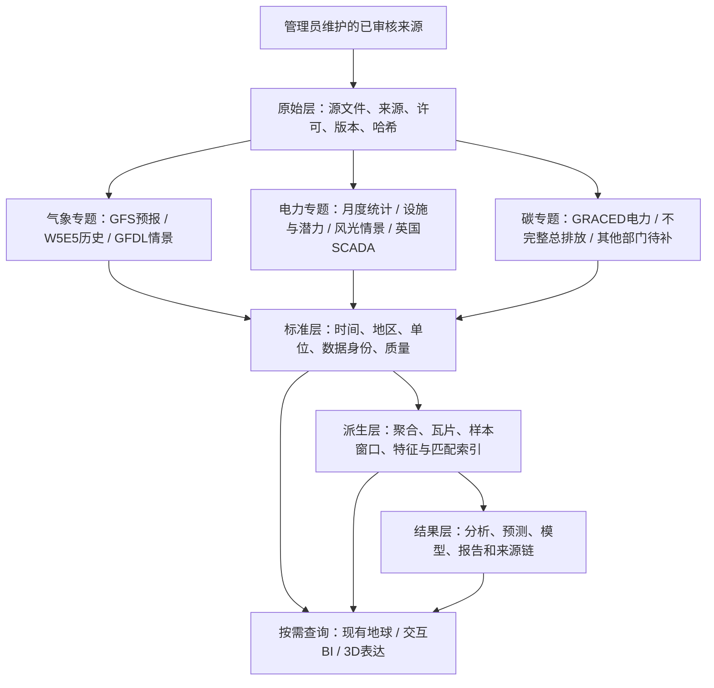

# 重构数据盘点与分配建议

> 核查时间：2026-09-26，北京时间约 22:12—22:16。
> 状态：只读实库盘点和方案建议；未导入、修改、删除数据库数据，未训练模型或改造网站。
> 新架构以现有气象、电力、碳三个地球为入口。旧跨区调度、储能优化等缺口不再自动列为第一阶段阻塞。
> 本轮后续调整：经济专题拟采用哈佛Atlas官方来源；中国风场超短期预测因缺配对数据暂缓。第一阶段核心改为MCP通用分析调用，论文专用预测保留后续研究，以下数据事实不变。

## 证据与核查范围

- 连接网站现有 PostgreSQL，数据库 `zyz` 当前约 93 GB，连接强制 `default_transaction_read_only=on`，每条查询设置超时。
- 检查表结构、实际分组行数、时间覆盖、单位、来源登记、部分质量字段和数据粒度；未解压遍历所有二进制气象帧、重新计算全部原文件哈希或验证所有物理归档文件存在性。
- 本地证据位于工作区 `../outputs/20260926-data-audit/`：`schema.json`、`inventory.json`、`details.json`、`supplement.json`，均相对仓库根目录。前两次分年/月统计出现语法错误，随后补充查询成功；对应结论使用 `supplement.json`，不使用失败条目。
- 下文“已入库”表示实际表中查到数据；源表的 verified/imported 为既有流程登记，本轮没有重新执行源文件完整性验证。
- 旧数据字典中的“只有 SSP126”“没有 W5E5”“只有全国统计”等表述已不能代表现状。保留旧文档作为历史快照，本文件和本轮讨论记录提供更新证据。

## 当前实际数据与推荐用途

| 数据 | 实库核查 | 数据身份及可用方式 | 第一阶段安排 |
|---|---|---|---|
| 全球 GFS 天气场 | 13 指标、22 次起报、286 个字段记录，0.5°；最新起报 2026-09-26 14:00，北京时间有效时刻 17:00，预报时效 +3h | 业务预报，不是气象站实测；零散22批不是连续完整历史档案 | 气象地球风粒子、温度等标量图层；地区摘要和按已有时次绘图，标明起报/有效时刻与更新时间 |
| W5E5 v3.0 中国裁剪 | 2019—2024，6变量，3848点；每变量2192日，共13152帧；432源文件登记 | 日尺度偏差校正再分析；`hours=1` 是每日一个数值时间片，不表示小时气象；温度单位 K | 历史天气日/月趋势、季节性、区域对比和聚类；不作为场站配对预测NWP |
| GFDL-ESM4 四情景气象 | SSP126/245/370/585；2021—2060；5变量×4情景共292200日块；3848点，全部 `hours=24`；80源文件登记 | 长期模型情景；每块保留逐小时值，温度已登记为°C；聚合质量字段中缺失计数为0，但未重算全部载荷 | 气象地球小时/日/月表达、情景BI、粒子/曲面模板；情景对比不等于真实未来预测 |
| GFDL 风光序列 | 四情景×32区域×40年×2技术=10240条年度序列；每条8760/8784小时 | 核心量为容量因子，`scale=10000`；已有功率/电量统计按当前地图已投运资产装机换算，属于派生情景 | 电力地球风光资源展示、日内/季节变化、情景比较；原始CF和装机换算结果分开标识 |
| 国家统计局月度能源统计 | 2015—2025，全国+31省；54912行，10产品、13种产品指标组合；全国1716、省级53196行 | 官方发布统计；包括发电量、分电源发电量、煤油气产量等；不是小时负荷/场站功率 | 电力BI首选真实统计数据：月度趋势、分地区排名、能源结构；能源经济作为专题标签，不必新增第四个地球 |
| 能源设施、OSM、GISPO | 9143条设施；1004381条OSM几何；222943条资源潜力；1507条Natural Earth几何；24条数据中心位置 | 分别是公开项目名录、众包地理、研究潜力和基础边界；不是同一口径的政府全量统计 | 现有地球点线面及资源分布；只能按各自身份和覆盖范围统计 |
| 光伏足迹 | 数据库有汇总JSON，原始归档登记为2个verified文件 | 已有来源及汇总，不等于完整可查询多边形已入空间表 | 先用已有汇总；精细足迹交互列为已有源待处理项，不能说必须重新找数据 |
| GRACED Power | 2019-01-01—2026-05-31，2708日、89月；0.1°，单位kgC/h | 研究估算；该区间日期记录连续，非逐小时观测 | 碳地球首个完整专题：排放空间分布、日/月/年趋势及地区汇总 |
| GRACED total | 851日、28月，散布2019—2022；各年分别242/275/273/61日 | 不连续的总排放研究估算；其他部门未在帧表查到记录 | 暂列部分可用；仅在确有数据的日期展示，不能画成2019—2022完整趋势 |
| Hill of Towie 风场 | 英国2025；21机组、48.3MW；52561条场站10分钟记录含次年边界点，1059488条机组信号 | 历史实测SCADA；场站无NULL但有10302条负功率；机组功率72条NULL；无权威限电标签 | 独立英国风场分析和研究回测专题，不能归为中国省级实测 |
| Hill of Towie 配对NWP | 2921条，1461次起报，预报时效仅+3/+6小时；100m U/V和风速；已有6605条60分钟配对 | 历史发布的GFS预报；现成配对为research-only；`curtailment_known`全部false | 小时基线回测可复用；论文超短期工作流需要另建10/15分钟窗口和充分的未来NWP输入 |

补充：省级能源统计有9442条NULL，全国267条NULL，合计9709。1月份所有4576条记录均为NULL，2月份3641条NULL。此处可能涉及源方合并发布、不适用或缺报，必须按指标核对，不能统一补零或插值；同比、本期、累计也不能互相替代。

W5E5日尺度和WFDE5小时尺度在 [CDS官方说明](https://cds.climate.copernicus.eu/datasets/derived-near-surface-meteorological-variables?tab=overview) 中明确区分。现有W5E5源属性还沿用ISIMIP DOI，而下载入口与文件标注v3.0，来源版本与引用映射应后续对齐核验；本轮未凭旧DOI推翻实库中的v3.0文件登记。

## 如何组织：专题分类与数据处理阶段是两个维度

- 初期可以在一个PG实例内逻辑分区，不要求一个专题一套物理数据库。原始NC/GRIB/MAT留文件存储，PG保存目录、结构化观测和查询所需数据。
- 同一数据源通过专题标签和引用被多个页面使用，不为三个地球重复存三份。用户私有的是项目筛选、分析任务和结果；管理员发布的官方/研究来源是平台共用资产。
- 新增原始文件按文件接口管理；现有PG二进制帧先保留兼容，不因重构方案立即搬走93GB数据库或重导全量数据。
- 统一元数据至少包含：来源机构/产品及版本、数据身份、覆盖范围、空间分辨率、时间间隔和聚合方式、单位、许可、质量、处理配方、可支持的模板/算法。
- 预报单独保存起报时刻、有效时刻和当时可获得的时间；气候情景单独保存GCM/SSP；实测保存实体、采样时间和质量状态，避免全部塞入意义不明的“时间”字段。
- 不跨口径强制拼接：GFS预报、W5E5再分析、GFDL情景分组展示；月度电量不能伪装小时功率；容量因子和装机估算不能当实测发电；kgC与kgCO2、K与°C要经明确规则转换。

## 第一阶段缺口及优先级

### P0：已有数据先整理，不需要先扩大采购或下载

1. **权威数据目录同步。** `dataset_catalog`共54项，仍有SSP245/370/585气象pending、20个NC缺失等过时记录，与实表冲突；已有NBS月度数据也使笼统“省级发电量未导入”失真。Agent能力判断必须来自经过核对的发布目录。`climate_vre_sources`只登记3个新增情景，SSP126数据已存在但该登记表缺行；`source_files`和JSON清单仍带单情景旧条目。需按数据类型明确权威目录与更新责任，非简单把所有状态全部改成ready。
2. **时间和单位契约。** W5E5日、GFDL小时、GFS起报/有效时间、NBS月度、SCADA十分钟各自保留；W5E5 K与GFDL°C不可直接相减；识别VRE容量因子编码和装机假设。
3. **质量与可用范围。** NBS空值原因、GRACED total缺月、GFS留存批次不连续、SCADA负值和限电未知都需要随数据返回。SCADA负值不能未经源解释直接当错误删除，可能反映净功率/自耗等口径；这只是待核对的解释方向，不是已确定原因。
4. **版本和血缘。** 保存数据版本清单、原始源与处理配方、聚合方法及模型版本，支持用户下次打开仍看到原版本。已有时间戳或文件哈希不自动等于完整项目版本恢复能力。

### P1：做论文预测前必须补齐的样本准备与语义

- 以英国风场为首个回测对象，从十分钟SCADA重建连续输入/输出窗口、缺测掩码、可用容量与运行状态规则，不能将105.9万机组记录当作同等数量独立可训练窗口。
- 现有NWP仅+3/+6时效且每个有效时刻只保留一个记录（实际唯一索引为source/entity/valid_time）。论文每个预测起点需要当时可获得的未来4小时天气轨迹：应审计是否足够，并补充必要时效和同有效时刻的不同起报版本；不能先用后发预报再回填历史输入。
- 同一数值天气时效的插值可以作为声明的方法，但不能把3小时源数据宣传为新增的10/15分钟真实信息。
- 增量特征库、相似样本索引、完整输出已知的500窗口候选池、训练/验证/测试时间切分属于待加工的数据产品，不是采购一个新外部数据源。标准化与相似度参数只用当时可见训练数据。
- 明确预测目标是并网净功率还是扣除停机/限电后的潜在出力，核对负值与运行标签。权威限电标签当前缺少，会限制结论和可用功率预测；不能把研究回测一概禁止，也不能当作已具备正式生产预测条件。
- 当前十分钟实测与论文十五分钟设置不同，首版登记为适配实验。未来有真实十五分钟配对数据时，再研究严格复现实验。

### P2：按专题目标补充的外部数据

| 需求 | 真正缺的数据 | 是否阻塞当前框架验证 |
|---|---|---|
| 中国真实风场超短期预测 | 风场/机组实测功率＋对应历史发布NWP＋位置/容量/时区/运行状态及数据许可 | 不阻塞英国研究闭环；阻塞中国实测预测结论 |
| 碳多部门完整专题 | total缺失月份，工业/居民/交通等源数据及后续时期；最新可得批次需另行核实 | 不阻塞Power现有区间专题 |
| 官方省级装机历史 | 分省、分技术、分年份装机统计 | 不阻塞已有月度发电量BI；阻塞官方装机趋势和样本覆盖校准 |
| 月度统计近期扩展 | 当前入库止于2025，2026已发布月份和各指标空值解释待核对 | 不阻塞2015—2025可用时段分析 |
| 经济独立专题 | 拟从哈佛Atlas官方下载/API取得国家、产品、贸易与复杂度数据，核验覆盖、分类和币值 | 已明确拟用哈佛来源，尚未采集；不能写成平台已有贸易数据 |
| 历史小时气象专题 | WFDE5/ERA5所需地区变量；只有需要小时分析时再补 | 不阻塞W5E5日分析与已有GFDL小时情景 |
| 知识库问答 | 经审核、带版本和出处的领域文献/指标定义库 | 现有参考论文可作为候选，尚未在本轮审计中证明有完整审核入库链 |

省间调度参数、储能SOC、全套线路电气参数和设备3D模型不列第一阶段必补，符合当前已收敛的范围。

## 建议首批验证专题

1. 气象：GFS地球图层与W5E5日趋势，明确二者来源身份；再验证GFDL四情景切换。
2. 电力：NBS月度发电量BI配合现有设施地图，官方统计与地图资产各自说明；风光CF情景另设模板。
3. 碳：GRACED Power的空间图与时间趋势；不完整total默认只开放有数据范围。
4. 分析：先通过MCP完成一条现有真实数据的统计/聚类或通用时序回测链，保存输入版本、算法、参数、指标和结果。可选NBS月度序列、W5E5日序列或GRACED Power连续区间；各算法须满足数据要求。英国风场论文流程保留研究，中国风场流程暂缓，不作为首批通用MCP验收必需条件。

## 哈佛经济专题接入建议

- 优先使用[Atlas官方下载文件](https://atlas.hks.harvard.edu/data-downloads/)，按来源快照导入本地经济专题；[GraphQL API](https://github.com/harvard-growth-lab/api-docs/blob/main/atlas.md)可用于小范围补充，不把公共接口作为本站在线查询的稳定后端依赖。官方文档建议批量走下载并提醒接口变化风险。
- 首批建议国家年度概况、国家产品年度贸易、双边贸易、ECI/PCI等研究指标；先统一一种商品分类，保留国家/产品内部ID与正式代码映射，以及美元现价/不变价、基年、数据版本和引用信息。实际下载表和字段覆盖待验证。
- 管理员手动触发获取和审核发布，用户与Agent再从本地查询。哈佛处理后的贸易估算、经济复杂度与原始统计分别保留身份，不能将页面数值和不同下载批次混为同一版本。
- 本阶段仍讨论方案，未启动爬虫、下载或入库。原始和专题数据的组织模式沿用前文，不额外复制整套哈佛网站。

本建议先复用已存在且可解释的数据。精细3D和更多MCP能力通过这些真实专题验证数据接口后接入，无需为了展示效果先下载全部可想象的数据。
