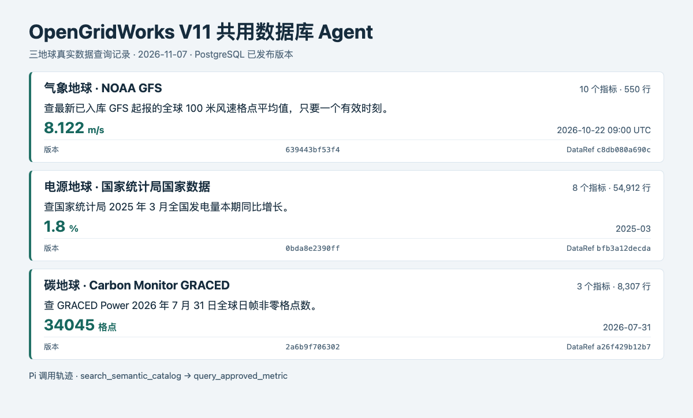

# V11 共用数据库 Agent

V11 第 1.5 节规定模块通过 `DataRef` 交接。第 2.4–2.7 节规定数据 Agent 读取已审核的语义目录，优先使用固定查询，再进入受控 Text-to-SQL。电源、气象和碳地球通过同一服务按专题取数。小云持有查询结果引用，并将其用于可视化、分析预测与来源回看。详见 [小云业务说明](./v11-visualization-analysis-agents.md)。

## 复用与改进

- 复用 Greensystem 数据 Agent 的 Pi 工具循环、目录优先、每轮调用上限和 PostgreSQL 只读事务。自然语言入口按专题限定工具，模型只提供经 JSON Schema 检查的筛选条件。
- 发布脚本把数据写入按专题分区的标准事实表。每个发布版本保存全部审核指标的口径、单位、可用序列及来源指纹。切换当前版本时保留历史版本。查询回传的 `query` 可以按原版本复现。
- 查询区分空结果、来源缺测和真实零值。空结果或全缺测时，在同一只读事务内核查同版本、同指标、同地区和产品的有效观测日期。响应的 `diagnosis` 只提供覆盖边界与一个备选时段，原筛选、结果和查询哈希保持原样。小云保存待确认时段，用户明确接受后才按原版本重查，并续办原来要求的图表或分析。
- 项目 Agent 采用 Pi 运行时。问数每轮从 PostgreSQL 加载最近四条问题和最后一份已确认的查询条件。批次清洗、发布和审核由程序及独立数据库角色负责。
- 地图的统一入口是右下角的小云。把鼠标移到角色上即可打开文字输入，或开启麦克风。语音使用浏览器转写和播报，文字与语音共用 `/api/xiaoyun`。明确的地图指令直接走页面操作，小云的 Pi 循环调用数据库 Agent 查数，再按结果引用调用图表或分析工具。各地球有独立的问数会话，追问按被引用的结果继承条件和版本。
- 小云通用问答复用最近四轮对话上下文，可查看本站已发布指标的口径。既有的 `/api/deepagent` 兼容入口仍可供调用方使用，早期实现保存在 `deepagent/`。

| 专题 | 查询范围 | 口径 |
| --- | --- | --- |
| 气象 | NOAA GFS 全球气温、10 米和 100 米风速、地面阵风、相对湿度、比湿、海平面气压、地面气压、可降水量、对流有效位能 | 返回每个预报帧的格点算术均值，保留起报和有效时刻。默认选择查询范围内最新已入库起报。 |
| 电力 | 国家统计局总发电量本期、累计、本期同比和累计同比，五类分电源本期值，原煤、原油、原油加工量和天然气本期值 | 覆盖全国和 31 个省级地区。指标各自限定产品和单位，来源空值保持 `null`。 |
| 碳 | GRACED Power 全球日帧格点排放速率合计、非零格点数、总格点数 | 速率使用 `kgC/h`。每日帧均保留原帧与档案哈希。 |

目录中的 `metric` 是该版本默认指标，`metrics` 列出该版本当前获准查询的全部指标。查询用 `metric_code` 选择指标，电力查询可在该指标的 `series_codes` 中用 `product` 选择产品。省略 `metric_code` 时沿用原默认指标。旧版引用可继续使用，旧版只提供当时发布的指标。

GRACED 速率和统计局发电量的指标规则与查询数据版本一起返回并随结果保存。规则有独立的版本标识，应用按已发布快照的指标、单位、时间粒度和来源类型匹配，历史查询的版本及哈希无需改写。GRACED 按日保留 `kgC/h`，月度发电量保留发布原值及缺测。年初至本月累计与累计同比跨年重置，当前只开放查数、出图和统计，本期发电量及本期同比可按实际连续观测预检预测。

截至本次发布，气象仅有 2026-10-22 的一批 GFS 起报。降水和辐射的累计时段待核实，雪深源数据出现 `9999` 异常值，暂未纳入目录。

## 复现

1. 在完成 `scripts/v11-schema-baseline.sql` 的 `zyz` 库中，以管理员执行 `scripts/v11-data-agent-extensions.sql`。宿主先安装与 PostgreSQL 主版本匹配的扩展文件，并为 TimescaleDB 配置 `shared_preload_libraries`。再以 `zyz` 依次执行 `v11-data-agent-schema.sql`、`v11-data-agent-nbs.sql`、`v11-data-agent-refresh-log.sql`、`v11-data-agent-context.sql` 和 `v11-data-agent-tiles.sql`，文件都在 `scripts/` 下。升级 API 服务后执行 `v11-data-agent-publish.sql` 发布已有源表。
2. 在服务端配置 `DATA_AGENT_DATABASE_URL`。生产环境给 JSON 和 MCP 客户端配置同一个服务端 Bearer token。自然语言入口另需配置 `DATA_AGENT_PI_ENABLED=true` 与 `DEEPSEEK_API_KEY`。
3. `GET /api/data-agent` 读取当前目录。`POST /api/data-agent` 接受 `catalog`、`query`、`ask` 和会话操作。Streamable HTTP MCP 路径为 `/api/mcp/data-agent`，提供 `list_published_catalog`、`query_published_data` 和 `resolve_project_result`。
4. 运行 `node scripts/verify-v11-data-agent.mjs` 验证三个专题。加 `--pi` 验证自然语言工具调用，加 `--sessions` 验证追问、会话恢复和业务取数。
5. 配置 `DATA_AGENT_DATABASE_URL`、`DATA_AGENT_VERIFY_URL` 和现有业务令牌 `DATA_AGENT_TOKEN`，运行 `node scripts/verify-v11-data-agent-benchmarks.mjs`，用独立只读 SQL 对照三个专题的已发布数值、单位、缺测与版本。加 `--live` 验证真实 Pi 会话的诊断确认、图表与 StatsForecast 回测复用同一结果，以及跨项目访问隔离。

## 国家统计局更新和审核

服务器上的 WSL cron 每两小时扫描一次国家统计局发布索引。脚本提取全国月报 13 项观测并保存原文哈希、原文、结构化值和校验结果。现有国家数据月表继续提供历史和省级序列。新闻发布表只补充实际发布的全国报告期，1–2 月合报需要单独处理。

新增报告期通过校验后自动发布。已有报告期修订或与上年同月相比出现大幅波动的批次进入复核。`/data-review` 显示来源、现值、新值和审核状态。解析失败或越界数据留在待审列表，可驳回并等待合格批次。发布在同一事务内更新事实、当前版本和批次状态。重复内容复用原批次，历史版本保持可读。调度检查记录写入 TimescaleDB 超表。

部署 worker 时用仅具备 `green_agent_ingest` 成员权限的独立登录，在受限的 `worker.env` 配置连接。把 `refresh-v11-nbs.mjs` 和 `run-v11-nbs-scheduled.sh` 放在同一服务目录，安装锁定的 `pg` 依赖并配置 `runtime/bin/node`。WSL 运行期间由 cron 执行。审核 API 另用 `green_agent_review` 连接和独立的 `DATA_AGENT_REVIEW_TOKEN`。DataGrip 可用于查看原表和进一步核验。

## 项目、结果和瓦片

- `create_project` 返回项目编号与访问密钥。后续 `create_session`、`get_session`、`resolve_result` 和带 `session` 的 `ask` 用 `X-Data-Project-Key` 提供该密钥。状态连接使用 `green_agent_context`。会话按修订号写入，复用上次查询条件的追问默认固定到上次版本。保存结果可由 HTTP 或 MCP 读取，项目密钥由调用方保管。
- `/api/data/vector-tiles/postgis/{z}/{x}/{y}.pbf` 读取 PostGIS 动态瓦片。当前图层 `osm_power_points` 使用现有 OpenStreetMap 电力点，范围为 7 至 15 级，每瓦片最多 5,000 个点。更新源表后执行 `REFRESH MATERIALIZED VIEW CONCURRENTLY derived.osm_power_point`。调用地图时显示 OpenStreetMap 署名。
- SSH 预览的碳帧、电力资产和旧版地图图层通过服务端 `DATABASE_URL` 读取。管理员在 `zyz` 执行 [预览地图只读授权](../scripts/v11-map-preview.sql) 后，预览启动器可以用现有 `green_v11_web_query` 登录建立地图连接，并在该连接的 URL `options` 参数中设置 `-c role=green_v11_web_map -c default_transaction_read_only=on -c statement_timeout=20000`。地图角色只读现有地图 API 使用的表，数据 Agent 查询仍以 `green_agent_ro` 执行。重启预览后用 `/api/database/health`、`/api/data/map-assets` 和 `/api/carbon-earth?request=manifest` 检查。
- 查询结果保留 V11 的 `dataset_id`、`version`、`query_hash`、字段、单位、时间范围与质量信息。本期项目结果为限行内联数据，`artifact_uri` 为 `null`。语义 embedding 索引、Wren MDL、SQLGlot、SeaweedFS Parquet 与其他专题的定时源更新属于后续接入。

## 可视化交接

`GET /api/visualization` 返回当前可用图表。对已有的项目查询结果，调用 `POST /api/visualization`，沿用数据服务的 Bearer 授权与 `X-Data-Project-Key`。

- 固定模板用 `{"action":"render","project_id":"<项目 UUID>","result_id":"<结果 UUID>","chart":"line"}`，也支持 `bar`，无需模型。
- 自然语言用 `{"action":"ask","project_id":"<项目 UUID>","result_id":"<结果 UUID>","instruction":"请用柱状图比较各月"}`。Pi 只选择图表模板，由同一个服务从授权项目读取结果并调用本机 `mcp-echarts`。

响应按 V11 的 `VisualizationSpec` 提供模板版本、原始 `DataRef`、字段映射、图表配置和预留的事件列表。ECharts MCP 接收时间标签和有效观测值。服务核对 MCP 的图表类型和点位数据，再恢复原查询中的缺测位置。小云的 `render_chart` 复用同一个图表服务，并在项目会话中保存图表及其输入引用。

