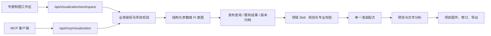

# 科研制图工作区

从任一专题页面进入「自定义制图」。研究工作区使用已发布数据、已授权问数结果、已完成预测任务和配置的只读归档。已有的小云快速制图和浏览器内 CSV 制图也在同一页。

## 使用工作区

1. 在「数据与图型」里选领域示例，再调整指标、时段、年份或地区。也可以在右侧输入自然语言，例如「画中国 2015 至 2025 年实际 GDP 增速和 2026 至 2028 年世界银行展望」。
2. 输入「换成学术黑白」或直接修改主题、图例、字体与布局，再应用到当前图件。「使用小云已有问数项目」可读取浏览器内已授权项目及最近结果。预测或回测任务需属于当前项目。
3. 点击「保存图件」。从图件库重新打开后，通过画布下方的修订选择读取历史版本。「另存为新图件」建立独立版本线。保存校验预期修订号，并发更新时可重开最新修订或另存。
4. 网页图可下载 SVG、JSON 与浏览器画布 PNG。论文模式额外提供矢量 PDF、300 DPI PNG、可编辑 SVG 和可独立运行的 Python 文件。JSON 带有图件配置、统计、来源版本、输入摘要及实际引擎版本。

右栏「文字分析」使用已经校验的数据。同期变化只比较相邻有效发布期。异常筛查用连续历史样本的四分位距。预测说明引用原始有效时段和已提供区间；相关图基于匹配样本。每条说明可跳到对应来源条目。 [Tableau Pulse 指标洞察类型](https://help.tableau.com/current/online/en-us/pulse_insights_platform_insight_types.htm)

## 运行链路



- Pi 的单轮工具 `select_chart` 接收登记的指标与当前图件配置，输出筛选条件或增量配置。数据解析、配对、统计和出图由程序完成。完整行数据留在服务端，发布记录不进入模型上下文。
- [Skill Registry](../src/lib/visualization-agent/research/registry.ts) 包含领域、触发条件、优先级、工具、约束、版本、输入输出模式和失败处理。总管负责意图，真实数据决定领域 Skill，渲染与主题使用单独配方，审图规则负责阻断。规则优先级为项目授权、真实数据和物理口径，其次为可执行的用户选择、领域推荐与表现配置。
- [公共协议](../src/lib/visualization-agent/research/contracts.ts) 定义 `VisualizationJob` 与 `VisualizationResult`。每个输入记录发布版本、数据标识、量纲、地区、粒度、时间语义、转换、缺测和质量标记。空间数据附坐标。预测附起报或发布版次、有效时段、模型及现有区间。
- `projects.agent_session` 复用当前项目权限和事务。工作预览每项目最多六件，跨 Node 进程可读，工作引用有效期二十分钟。正式图件保存独立修订和原始证据快照，样式编辑复用原数据摘要。默认图件库显示最近四十件，每件最多三十个修订。

| 领域 | 数据入口 | 工具后缀 |
| --- | --- | --- |
| `electricity` | 国家统计局发布指标、同项目预测及获批电力资料 | `prepare_timeseries`、`compare_forecasts`、`analyze_market_prices`、`analyze_generation_mix`、`visualize_market_results` |
| `meteorology` | 已发布 GFS 均值、真实全球网格缓存和区域卫星回放 | `prepare_timeseries`、`prepare_spatial_field`、`analyze_precipitation`、`analyze_wind_field`、`compare_forecasts` |
| `carbon` | GRACED 电力部门日帧、已授权结果和获批档案 | `prepare_emission_series`、`harmonize_emission_units`、`analyze_sector_structure`、`compare_scenarios`、`visualize_emission_flow` |
| `economy` | World Bank 历史 WDI、GEP 展望及获批经济资料 | `prepare_macro_series`、`harmonize_frequency`、`compare_forecasts`、`analyze_growth_contribution`、`visualize_macro_scenarios` |

领域工具接收 `project_id` 和 `datasets`，返回样本统计、来源校验、图型建议和转换说明。排放单位校验可接收 `target_unit`；允许同时间分母的质量单位换算。经济频率检查可接收 `target_frequency`，需要相同频率的发布输入。

## MCP 与运行配置

MCP 使用 Streamable HTTP 的 `POST /api/mcp/visualization`。使用现有业务令牌，并在项目工具请求头提供 `X-Data-Project-Key`。HTTP 工作区还使用 `X-Data-Project-Id`。例如 `economy.compare_forecasts` 的参数如下。

```json
{
  "project_id": "<项目 UUID>",
  "datasets": [
    { "kind": "economy", "metric": "real-growth", "country": "CHN", "start_year": 2015, "end_year": 2025 },
    { "kind": "economy", "metric": "growth-outlook", "country": "CHN", "start_year": 2026, "end_year": 2028 }
  ]
}
```

| MCP 工具 | 请求参数与接收内容 |
| --- | --- |
| `viz.list_capabilities` | 空参数，返回已配置引擎、发布目录和 Skill 契约 |
| `viz.profile_dataset` | `project_id, datasets`，返回单位、时段、版本与样本信息 |
| `viz.create_plan`、`viz.validate_chart` | `project_id, job`，计划或包含实际渲染验证的回执 |
| `viz.render_interactive`、`viz.render_scientific` | `project_id, job`，交互配置或论文 SVG |
| `viz.edit_chart` | `project_id, artifact_id, task_id, patch`，只应用修改字段 |
| `viz.export_chart` | `project_id, artifact_id, format`，返回文件名、MIME 和 Base64 |
| `viz.save_project`、`viz.open_figure` | 保存使用 `artifact_id` 和可选 `figure_id, expected_revision`；读取使用 `figure_id` 和可选 `revision`。都要提供 `project_id` |

- ECharts 6.1.0 是站内交互运行时，论文白底、学术灰度、浅色青蓝、科研连续色、灰蓝与深色六个主题通过图件级令牌配置。 [ECharts 发布记录](https://github.com/apache/echarts/releases/tag/6.1.0)
- Flint 选择绝对路径 `OGW_VIZ_FLINT_ENTRY`，指向本地安装的 `flint-chart-mcp@1.0.1/dist/cli.js`。进程关闭文件引用，运行实际的 `validate_chart` 和 `compile_chart`。按类别键逐点对账后，把单系列折线或柱图交给 ECharts。 [Flint MCP 官方接口](https://github.com/microsoft/flint-chart/blob/main/packages/flint-mcp/README.md)
- 论文模式设置 `OGW_VIZ_PYTHON` 为 Python 的绝对路径，并在该环境安装 `scripts/visualization/requirements.txt`。安装含中文形状的系统字体或通过 `OGW_VIZ_FONT_FILE` 提供文件。进程在临时目录内运行固定绘图模板，带输入预算、超时和文件校验。可在相同 Python 与字体环境运行下载的 `python figure.py figure.svg`。 [Academic Figure 上游](https://github.com/TingxiYu/academic-figure-skill/tree/1df9940dd01ac939f072b12fe28d6353b79b90f9)
- 实际 GDP 增速取 WDI 的 `NY.GDP.MKTP.KD.ZG`，增长展望取公开 GEP 版次。2026 年 6 月版只用发布点值。 [WDI 实际 GDP 增速](https://data.worldbank.org/indicator/NY.GDP.MKTP.KD.ZG) · [Global Economic Prospects](https://www.worldbank.org/en/publication/global-economic-prospects)
- 原始网格通过 `.weather-cache/` 的真实 NOAA GFS 清单核验。旧版可通过 `OGW_VIS_GRID_ARCHIVE` 配置以 SHA-256 命名的只读归档。卫星回放使用已发布记录或明确选择的内置档案。其他数据归档由服务端管理员登记绝对路径 `OGW_VIS_DATA_CATALOG`，目录中的 `releases.json` 将数据集 ID 映射到 64 位 SHA-256 字符串，`<id>/<sha256>.json` 保存数据。服务校验摘要与 [归档字段](../src/lib/visualization-agent/research/datasets.server.ts)。
- Plotly 路由保留为待评估的三维网格能力。当前生产配置可使用空间热图及已有地球渲染。主题和图型配方使用项目自有配置。 [方案审计](./visualization-audit.md)

## 验收记录

| 检查 | 环境和覆盖 |
| --- | --- |
| 项目门禁 | 干净工作树的 `npm run check`，含 ESLint、TypeScript 和 Next.js standalone 生产构建 |
| 规划固定用例 | 跨领域配对、缺测和零值、区间、误差统计、小提琴图、流量守恒、缺测网格、引擎和主题冲突 |
| 真实来源 HTTP 和 MCP | 独立 PostgreSQL 使用 NBS 2025 年 3 至 10 月风电与太阳能发布值、NOAA 全球温度与 10 米风速快照、GRACED 2025 年 8 月的 31 个日帧、WDI 2015 至 2025 年及 GEP 2026 至 2028 年。两个 Node 实例验证工作预览复用。覆盖并发修订检查、项目隔离、重复任务、实际 Pi 请求及原始摘要复现。[NBS 2025 年 3 月发布](https://www.stats.gov.cn/sj/zxfb/202504/t20250416_1959320.html) · [GRACED](https://carbonmonitor-graced.com/datasets.html) |
| 网格 | NOAA 全球缓存 5,490 个抽取格点与美国东南部卫星降水回放 4,941 个抽取格点。检查坐标、有效时间、网格分辨率与缺测遮罩 |
| 渲染和导出 | Flint 数据逐项对账。Matplotlib 两面板、中文、183 mm 栏宽与 SVG／PDF／PNG／Python 文件。从导出的 Python 重绘，SVG 的 SHA-256 与原件相同。Chrome 桌面及 390 像素手机尺寸验证生成、文字、修改、保存、重载、修订切换和 PNG／SVG 下载 |
| 尚待复验 | 远程开发库本轮 SSH 连接超时。后续在原发布环境验证最新目录、GFS 100 米指标及原部署链路。负荷、电价、区域行业碳排放、碳情景和经济历史修订需要相应来源。固定输入已验证可对齐的电力与气象匹配，真实匹配要等同地区、同时间粒度的发布序列 |

```bash
npm run check
node --test scripts/verify-v11-research-planner.mjs
DATA_AGENT_VERIFY_URL=http://127.0.0.1:3000 \
  OGW_VIZ_VERIFY_GRIDS=true OGW_VIZ_VERIFY_PI=true \
  node scripts/verify-v11-research-visualization.mjs
DATA_AGENT_VERIFY_URL=http://127.0.0.1:3000 \
  node scripts/verify-v11-research-browser.mjs
```

HTTP 与 MCP 验收脚本沿用 `DATA_AGENT_TOKEN`。设置 `OGW_VIZ_VERIFY_ARTIFACTS` 可保留样张，设置 `OGW_VIZ_VERIFY_SECOND_ORIGIN` 可验证共享 PostgreSQL 的第二个 Node 实例。GFS 风速快照采用其他已登记测高时，可通过 `OGW_VIZ_VERIFY_WIND_METRIC` 指定其指标编码。浏览器验收使用能从浏览器完成业务授权的本机预览；可通过 `CHROME_PATH` 指定 Chrome。
